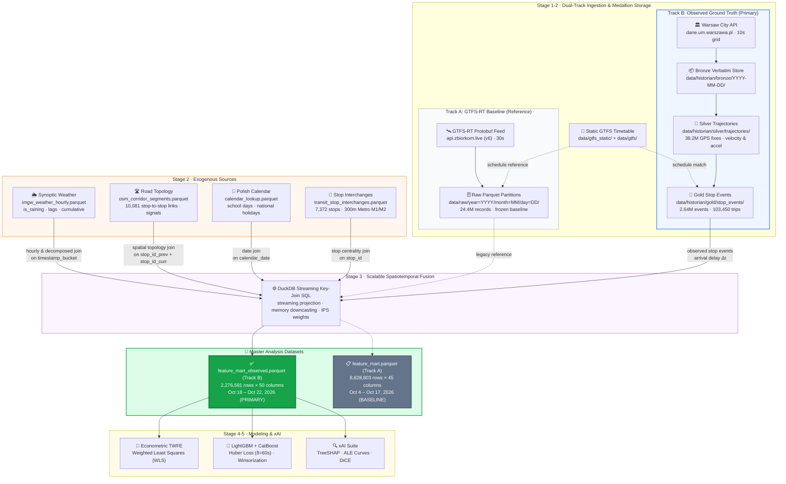
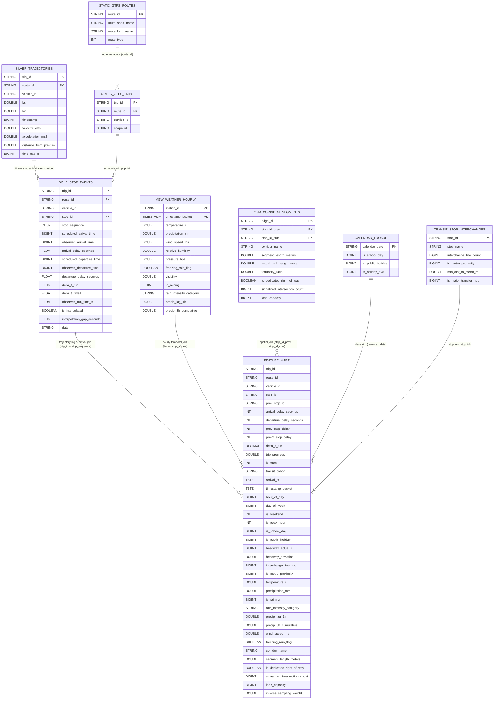

# Warsaw Transit Telemetry & Delay Attribution: Data Schema Reference

This document provides a comprehensive technical reference for all data schemas used across the Warsaw Transit Telemetry & Delay Attribution System, including Track B primary observed telemetry (Historian Medallion tiers), Track A baseline GTFS-RT feeds, exogenous auxiliary stores, and the unified modeling feature mart.

---

## 1. Data Flow & Master Analysis Table Overview

The telemetry pipeline processes transit observations through progressive refinement stages, culminating in the **Master Feature Mart**, which serves as the single source of truth for econometric regression, machine learning benchmarks, and xAI delay attribution.

### 1.1 Pipeline Data Flow



---

### 1.2 Table Relationships (Entity-Relationship Diagram)



---

### Table Usage at a Glance

| Dataset | File Path | Format / Size | Role in System | Analysis Status |
| :--- | :--- | :--- | :--- | :---: |
| **Observed Feature Mart (Track B)** | `data/processed/feature_mart_observed.parquet` | Parquet (~85 MB, 2.28M rows) | Master modeling matrix (Observed Ground Truth) | **PRIMARY ANALYSIS** 🎯 |
| **Gold Stop Events (Track B)** | `data/historian/gold/stop_events/date=*/stop_events.parquet` | Parquet (~68 MB, 2.64M rows) | Reconstructed stop arrivals and departures | Ground Truth Tier |
| **Silver Trajectories (Track B)**| `data/historian/silver/trajectories/date=*/trajectories.parquet` | Parquet (~450 MB, 38.2M rows) | Deduplicated GPS fixes with velocity/accel | Cleaned Silver Tier |
| **Legacy Feature Mart (Track A)** | `data/processed/feature_mart.parquet` | Parquet (~286 MB, 8.83M rows) | Master modeling matrix (Frozen GTFS-RT Reference) | Baseline Benchmark |
| **Raw Telemetry Partitions** | `data/raw/year=*/month=*/day=*/*.parquet` | Parquet (~225 MB, 24.4M rows) | Track A GTFS-RT historical archive | Ingestion / Baseline |
| **Static GTFS Schedules** | `data/gtfs_static/` & `data/gtfs/` | Text CSV / DuckDB (~163 MB) | Scheduled timetable reference | Reference Lookup |
| **Hourly Weather Telemetry** | `data/processed/imgw_weather_hourly.parquet` | Parquet (~35 KB, 1,057 hours) | IMGW synoptic weather + decomposed rain features | Joined into Mart |
| **Corridor Road Topology** | `data/processed/osm_corridor_segments.parquet` | Parquet (~438 KB, 10,081 links) | Road & signal infrastructure | Joined into Mart |
| **Polish Calendar Lookup** | `data/processed/calendar_lookup.parquet` | Parquet (~11 KB, 3,652 days) | School days & national holidays | Joined into Mart |
| **Stop Interchanges & Metro** | `data/processed/transit_stop_interchanges.parquet` | Parquet (~150 KB, 7,372 stops) | Hub connectivity & transfer load | Joined into Mart |

---

## 2. Primary Analysis Dataset: Unified Feature Mart

* **Primary File Path**: [`data/processed/feature_mart_observed.parquet`](data/processed/feature_mart_observed.parquet) (Track B Observed Telemetry)
* **Comparative Reference**: [`data/processed/feature_mart.parquet`](data/processed/feature_mart.parquet) (Track A GTFS-RT Baseline)
* **Status**: **ACTIVE TARGET FOR ALL EMPIRICAL ANALYSIS, BENCHMARKS & xAI**
* **Dimensions**: **2,276,591 rows × 50 columns** (compressed Apache Parquet with Snappy)
* **Observation Unit**: Single stop-to-stop transit vehicle arrival transition $(i, s, t)$

### Schema & Data Dictionary

| Column Name | Data Type | Nullable | Domain Taxonomy | Description & Example |
| :--- | :--- | :---: | :--- | :--- |
| `trip_id` | `VARCHAR` | No | Identifier | Unique GTFS trip identifier (e.g., `'100/1/TP-SZO'`) |
| `route_id` | `VARCHAR` | No | Identifier | Transit line number (e.g., `'17'`, `'503'`, `'709'`) |
| `vehicle_id` | `VARCHAR` | No | Identifier | Physical vehicle tracking code (e.g., `'1001'`, `'5402'`) |
| `stop_sequence` | `INTEGER` | No | Operational | Sequential stop index along the trip (1, 2, 3...) |
| `stop_id` | `VARCHAR` | No | Spatial Key | Current GTFS stop ID (e.g., `'700201'`) |
| `prev_stop_id` | `VARCHAR` | Yes | Spatial Key | Upstream stop ID traversed immediately prior |
| **`arrival_delay_seconds`** | `FLOAT` | No | **Target Variable** | **Primary regression target**: Observed minus scheduled arrival time ($\Delta t$, in seconds) |
| `departure_delay_seconds` | `FLOAT` | Yes | Target / Auxiliary | Observed minus scheduled departure time ($\Delta t_{dep}$, in seconds) |
| `prev_stop_delay` | `FLOAT` | Yes | Operational | Lag-1 delay at preceding stop ($\Delta t_{s-1}$, in seconds) |
| `prev2_stop_delay` | `FLOAT` | Yes | Operational | Lag-2 delay two stops prior ($\Delta t_{s-2}$, in seconds) |
| `delta_t_run` | `FLOAT` | Yes | Operational | Running delay component: $\Delta t_{arr, s} - \Delta t_{dep, s-1}$ (seconds) |
| `delta_t_dwell` | `FLOAT` | Yes | Operational | Dwell delay component: $\Delta t_{dep, s} - \Delta t_{arr, s}$ (seconds) |
| `observed_run_time_s` | `FLOAT` | Yes | Operational | Actual elapsed transit time between stops (seconds) |
| `trip_progress` | `DOUBLE` | No | Operational | Normalized route completion ratio $\in [0.0, 1.0]$ |
| `is_origin_stop` | `BOOLEAN` | No | Operational | Flag indicating trip terminal departure (`true` if first stop) |
| `is_terminal_stop` | `BOOLEAN` | No | Operational | Flag indicating route terminus (`true` if final stop) |
| `is_tram` | `INTEGER` | No | Fleet / Mode | Modal indicator: `1` for electric tram, `0` for bus |
| `transit_cohort` | `VARCHAR` | No | Operational | Classification: `'urban_tram'`, `'urban_bus'`, `'suburban_bus'`, `'other'` |
| `arrival_ts` | `TIMESTAMPTZ` | No | Temporal Key | Microsecond-precision timestamp of vehicle arrival |
| `timestamp_bucket` | `TIMESTAMPTZ` | No | Temporal Key | Hourly-truncated timestamp for weather joining (e.g., `2026-10-18 08:00:00+00`) |
| `hour_of_day` | `BIGINT` | No | Temporal | Local hour $\in [0, 23]$ |
| `day_of_week` | `BIGINT` | No | Temporal | Day index: $0 = \text{Monday}, \dots, 6 = \text{Sunday}$ |
| `is_weekend` | `INTEGER` | No | Temporal | Binary flag: `1` on Saturday/Sunday, `0` on weekdays |
| `is_peak_hour` | `INTEGER` | No | Temporal | Binary flag: `1` during rush hours (07:00–09:00, 16:00–18:00) |
| `is_morning_peak` | `INTEGER` | No | Temporal | Binary flag: `1` during morning rush hour (07:00–09:00) |
| `is_evening_peak` | `INTEGER` | No | Temporal | Binary flag: `1` during evening rush hour (16:00–18:00) |
| `is_school_day` | `BIGINT` | No | Calendar | Binary flag: `1` if Polish public schools are in session |
| `is_public_holiday` | `BIGINT` | No | Calendar | Binary flag: `1` on official Polish national holidays |
| `headway_actual_s` | `BIGINT` | Yes | Operational | Observed vehicle time interval following prior bus on same route (seconds) |
| `headway_deviation` | `DOUBLE` | Yes | Operational | Normalized headway deviation: $(h_{actual} - h_{sched}) / h_{sched}$ |
| `interchange_line_count` | `BIGINT` | No | Infrastructure | Number of distinct transit routes serving the stop (network centrality) |
| `is_metro_proximity` | `BIGINT` | No | Infrastructure | Binary flag: `1` if stop is within 300m walking radius of Metro M1/M2 |
| `temperature_c` | `DOUBLE` | No | Meteorological | Synoptic 2m ambient air temperature in Celsius |
| `precipitation_mm` | `DOUBLE` | No | Meteorological | Cumulative hourly liquid rainfall / liquid equivalent (mm) |
| `is_raining` | `BIGINT` | No | Meteorological | Binary rain indicator: `1` if `precipitation_mm > 0`, else `0` |
| `rain_intensity_category` | `VARCHAR` | No | Meteorological | Rain classification: `'none'`, `'light'`, `'moderate'`, `'heavy'` |
| `precip_lag_1h` | `DOUBLE` | No | Meteorological | Preceding 1-hour precipitation depth ($t-1$, mm) |
| `precip_3h_cumulative` | `DOUBLE` | No | Meteorological | Moving 3-hour cumulative rainfall ($t-3 \to t$, mm) |
| `wind_speed_ms` | `DOUBLE` | No | Meteorological | 10m sustained horizontal wind speed (m/s) |
| `relative_humidity` | `DOUBLE` | No | Meteorological | Relative atmospheric humidity percentage $\in [0, 100]$ |
| `freezing_rain_flag` | `BOOLEAN` | No | Meteorological | Binary indicator for road icing / freezing drizzle |
| `corridor_name` | `VARCHAR` | Yes | Topology | Name of primary arterial corridor (e.g., `'Puławska'`, `'Trasa W-Z'`) |
| `segment_length_meters` | `DOUBLE` | No | Topology | Stop-to-stop road segment traversal length (meters) |
| `actual_path_length_meters`| `DOUBLE` | No | Topology | True roadway centerline path distance (meters) |
| `tortuosity_ratio` | `DOUBLE` | No | Topology | Route curve ratio: $\text{actual\_path\_length} / \text{euclidean\_distance}$ |
| `signalized_intersection_count` | `BIGINT` | No | Topology | Number of traffic signals along the road segment |
| `is_dedicated_right_of_way` | `BOOLEAN` | No | Topology | Physical right-of-way segregation: `true` for tram tracks / bus lanes |
| `lane_capacity` | `BIGINT` | No | Topology | Total mixed-traffic vehicular travel lanes on the corridor |
| `is_study_corridor` | `INTEGER` | No | Topology | Binary flag: `1` if segment lies on one of Warsaw's 4 focal study corridors |
| `inverse_sampling_weight` | `DOUBLE` | Yes | Sampling | Normalized Inverse Probability of Sampling (IPS) weight $w_i$ |

---

## 3. Which Features Are Used in Specific Analyses?

The columns of the feature mart are organized into distinct modeling subsets depending on the econometric or machine learning methodology applied:

### A. Econometric Baseline: Two-Way Fixed Effects (TWFE) Panel Regression
* **Objective**: Measure causal, ceteris paribus marginal effects of exogenous infrastructure and weather shocks.
* **Equation**:
  $$\text{arrival\_delay}_{i,s,t} = \alpha_i + \gamma_t + \beta_1 \text{precip}_t + \beta_2 \text{temp}_t + \beta_3 \text{signals}_s + \beta_4 \text{dedicated\_row}_s + \rho \text{prev\_delay}_{i,s-1,t} + \varepsilon_{i,s,t}$$
* **Dependent Variable ($Y$)**: `arrival_delay_seconds`
* **Entity Fixed Effects ($\alpha_i$)**: `route_id` (absorbing route-level unobserved heterogeneity)
* **Time Fixed Effects ($\gamma_t$)**: `hour_of_day` (absorbing citywide diurnal traffic demand)
* **Estimation Method**: Weighted Least Squares (WLS) using normalized Inverse Probability of Sampling (IPS) weights ($w_i$) to debias stratified sampling back to population proportions.
* **Standard Error Clustering**: Clustered at `route_id` level using Huber-White HC1 covariance.
* **Standardized Coefficients ($\beta^*_k$)**: Computed as $\beta^*_k = \beta_k \cdot (\sigma_{X_k} / \sigma_Y)$ to enable scale-free comparison across continuous and discrete regressors.
* **Regressors ($X$)**:
  - `precipitation_mm` (Rainfall elasticity)
  - `temperature_c` (Thermal shock)
  - `signalized_intersection_count` (Traffic signal friction)
  - `segment_length_meters` (Distance exposure)
  - `prev_stop_delay` (Autoregressive persistence)
  - *Note: Invariant spatial features like `is_dedicated_right_of_way` and `lane_capacity` are absorbed by entity fixed effects in pure within-route estimators and evaluated via between-cohort pooled regressions.*

### B. Machine Learning Benchmark: Non-Linear Gradient Boosting (LightGBM & CatBoost)
* **Objective**: Maximize out-of-sample predictive accuracy, capture non-linear thresholds, and detect multi-way feature interactions.
* **Sample Weighting**: Ingests `inverse_sampling_weight` during training to ensure loss gradients reflect true network operating proportions.
* **Robust Loss Objective**: Huber loss ($\delta=60.0\text{s}$) to prevent quadratic error inflation from extreme delay outliers.
* **Feature Vector ($X$, 24 Active Features)**:
  1. `prev_stop_delay` (Operational: Lag-1 delay persistence, winsorized $[p_{01}, p_{99}]$)
  2. `signalized_intersection_count` (Infrastructure: Traffic lights)
  3. `segment_length_meters` (Infrastructure: Inter-stop distance)
  4. `actual_path_length_meters` (Infrastructure: Roadway travel distance)
  5. `tortuosity_ratio` (Infrastructure: Road winding / curve index)
  6. `interchange_line_count` (Infrastructure: Transfer hub connectivity)
  7. `is_metro_proximity` (Infrastructure: Proximity to Metro M1/M2)
  8. `is_dedicated_right_of_way` (Infrastructure: Physical right-of-way isolation)
  9. `trip_progress` (Operational: Schedule progress along trip route)
  10. `headway_deviation` (Operational: Dispatch bunching / gap irregularity, winsorized $[p_{01}, p_{99}]$)
  11. `hour_of_day` (Temporal: Hour of day, 0–23)
  12. `day_of_week` (Temporal: Day of week, 0–6)
  13. `is_peak_hour` (Temporal: Peak period indicator)
  14. `is_school_day` (Calendar: School operational day)
  15. `is_public_holiday` (Calendar: Statutory holiday)
  16. `is_tram` (Fleet: Rail vs. Rubber-tire vehicle mode)
  17. `lane_capacity` (Infrastructure: Corridor mixed-traffic lanes)
  18. `precipitation_mm` (Weather: Continuous rainfall depth)
  19. `is_raining` (Weather: Binary rain state indicator)
  20. `precip_lag_1h` (Weather: Preceding hour precipitation depth)
  21. `precip_3h_cumulative` (Weather: 3-hour moving rainfall sum)
  22. `temperature_c` (Weather: Ambient 2m temperature)
  23. `wind_speed_ms` (Weather: Horizontal wind speed)
  24. `relative_humidity` (Weather: Atmospheric humidity percentage)

### C. Explainable AI (xAI) Delay Attribution & Counterfactuals
* **TreeSHAP Attributions**: Computed across all benchmark features to calculate global beeswarm importance and local waterfall decompositions.
* **Accumulated Local Effects (ALE)**: Continuous and discrete variables analyzed for non-linear tipping points:
  - `prev_stop_delay`, `trip_progress`, `is_dedicated_right_of_way`, `signalized_intersection_count`, `segment_length_meters`, `precipitation_mm`, `temperature_c`, `headway_deviation`, `precip_lag_1h`, `precip_3h_cumulative`.
* **DiCE Counterfactual Interventions**:
  - **Actionable (Controllable by Transit Agency)**:
    - `prev_stop_delay` (Upstream schedule recovery holding)
    - `headway_deviation` (Dispatch interval regularization)
    - `is_dedicated_right_of_way` (Bus lane allocation / dedicated track conversion)
    - `signalized_intersection_count` (Transit Signal Priority green wave)
  - **Immutable (Fixed Environmental & Physical Constraints)**:
    - `hour_of_day`, `day_of_week`, `is_peak_hour`, `is_school_day`, `is_public_holiday`
    - `temperature_c`, `precipitation_mm`, `is_raining`, `precip_lag_1h`, `precip_3h_cumulative`, `wind_speed_ms`, `relative_humidity`
    - `segment_length_meters`, `actual_path_length_meters`, `tortuosity_ratio`, `is_tram`

---

## 4. Ingestion & Auxiliary Source Schemas

### A. Track B Primary: Gold Stop Events
* **Directory**: [`data/historian/gold/stop_events/date=YYYY-MM-DD/stop_events.parquet`](data/historian/gold/stop_events/)
* **Format**: Date-partitioned Apache Parquet (Snappy compression)
* **Scale**: **2,639,240 stop events** across **103,450 complete trips** (5 days, Oct 18–22, 2026).
* **Generation**: Linearly interpolated from Silver kinematic trajectories matched against active scheduled GTFS trips.

| Field Name | PyArrow Type | Description |
| :--- | :--- | :--- |
| `trip_id` | `STRING` | Unique scheduled GTFS trip identifier |
| `route_id` | `STRING` | Transit line number (e.g., `'1'`, `'175'`) |
| `vehicle_id` | `STRING` | Physical vehicle identifier |
| `stop_id` | `STRING` | Stop post identifier |
| `stop_sequence` | `INT32` | Stop sequence integer |
| `scheduled_arrival_time` | `INT64` | Scheduled arrival epoch seconds |
| `observed_arrival_time` | `INT64` | Reconstructed observed arrival epoch seconds |
| `arrival_delay_seconds` | `FLOAT` | Arrival delay delta in seconds ($>0$ late, $<0$ early) |
| `scheduled_departure_time` | `INT64` | Scheduled departure epoch seconds |
| `observed_departure_time` | `INT64` | Reconstructed observed departure epoch seconds |
| `departure_delay_seconds` | `FLOAT` | Departure delay delta in seconds |
| `delta_t_run` | `FLOAT` | Link traversal running delay: $\Delta t_{arr, s} - \Delta t_{dep, s-1}$ |
| `delta_t_dwell` | `FLOAT` | Stop dwell delay: $\Delta t_{dep, s} - \Delta t_{arr, s}$ |
| `observed_run_time_s` | `FLOAT` | Elapsed travel time between consecutive stops |
| `is_interpolated` | `BOOLEAN` | `true` if arrival was linearly interpolated between fixes |
| `interpolation_gap_seconds`| `FLOAT` | Temporal gap between trajectory fixes surrounding the stop |
| `date` | `STRING` | Service date string (`'YYYY-MM-DD'`) |

---

### B. Track B Primary: Silver Kinematic Trajectories
* **Directory**: [`data/historian/silver/trajectories/date=YYYY-MM-DD/trajectories.parquet`](data/historian/silver/trajectories/)
* **Format**: Date-partitioned Apache Parquet
* **Scale**: **38,214,890 GPS fixes** (5 days, Oct 18–22, 2026).
* **Processing**: Deduplicated, Europe/Warsaw localized, with kinematic velocity ($v = \Delta d / \Delta t$) and acceleration ($a = \Delta v / \Delta t$) computation.

| Field Name | PyArrow Type | Description |
| :--- | :--- | :--- |
| `trip_id` | `STRING` | Scheduled trip identifier |
| `route_id` | `STRING` | Transit line identifier |
| `vehicle_id` | `STRING` | Unique physical vehicle tracking code |
| `lat` | `DOUBLE` | WGS84 latitude |
| `lon` | `DOUBLE` | WGS84 longitude |
| `timestamp` | `INT64` | Observation epoch seconds |
| `velocity_kmh` | `DOUBLE` | Trajectory velocity in km/h |
| `acceleration_ms2` | `DOUBLE` | Longitudinal acceleration in $\text{m/s}^2$ |
| `distance_from_prev_m` | `DOUBLE` | Euclidean distance from previous fix (meters) |
| `time_gap_s` | `INT64` | Time delta between fixes (seconds) |

---

### C. Track A Baseline: Raw Partitioned Transit Telemetry
* **Directory**: [`data/raw/year=YYYY/month=MM/day=DD/*.parquet`](data/raw/)
* **Format**: Hive-partitioned Apache Parquet (Snappy compression, strict PyArrow schema)
* **Scale**: **24,395,598 raw GTFS-RT records** (14 days, Oct 4–17, 2026).

| Field Name | PyArrow Type | Description |
| :--- | :--- | :--- |
| `feed_timestamp` | `INT64` | Unix epoch seconds when the GTFS-RT feed was produced |
| `trip_id` | `STRING` | Trip identifier corresponding to static timetable |
| `route_id` | `STRING` | Public line identifier (e.g., `'17'`, `'190'`) |
| `start_date` | `STRING` | Scheduled trip start date (`'YYYYMMDD'`) |
| `start_time` | `STRING` | Scheduled trip start time (`'HH:MM:SS'`) |
| `vehicle_id` | `STRING` | Unique physical vehicle tracker code |
| `stop_sequence` | `INT32` | Stop sequence integer |
| `stop_id` | `STRING` | Identifier of current stop |
| `arrival_delay_seconds` | `INT32` | Delay in seconds at arrival (negative = early, positive = late) |
| `departure_delay_seconds`| `INT32` | Delay in seconds at departure |
| `rt_arrival_time` | `INT64` | Real-time estimated arrival Unix timestamp |
| `rt_departure_time` | `INT64` | Real-time estimated departure Unix timestamp |
| `record_ingested_at` | `STRING` | UTC ISO-8601 ingestion audit timestamp |
| *Partition: `year`* | `INT64` | Hive partition year (e.g., `2026`) |
| *Partition: `month`* | `INT64` | Hive partition month (e.g., `10`) |
| *Partition: `day`* | `STRING` | Hive partition day (e.g., `'04'`) |

---

### D. Synoptic Weather Telemetry (IMGW-PIB)
* **File Path**: [`data/processed/imgw_weather_hourly.parquet`](data/processed/imgw_weather_hourly.parquet)
* **Source**: Official IMGW-PIB Synoptic Weather Stations (*Warszawa-Okęcie* WMO `12375` & *Warszawa-Bielany* `352200380`).

| Column Name | Type | Description |
| :--- | :--- | :--- |
| `station_id` | `VARCHAR` | Official station identifier |
| `station_name` | `VARCHAR` | Weather station name (e.g., `'WARSZAWA-OKECIE'`) |
| `timestamp` | `TIMESTAMP` | Exact observation timestamp |
| `timestamp_bucket` | `TIMESTAMP` | Hourly-truncated timestamp for join linkage |
| `temperature_c` | `DOUBLE` | Air temperature at 2 meters altitude (°C) |
| `relative_humidity` | `DOUBLE` | Relative air humidity percentage (%) |
| `precipitation_mm` | `DOUBLE` | Total precipitation depth past hour (mm) |
| `is_raining` | `BIGINT` | Binary rain indicator: `1` if `precipitation_mm > 0`, else `0` |
| `rain_intensity_category` | `VARCHAR` | Rain classification: `'none'`, `'light'`, `'moderate'`, `'heavy'` |
| `precip_lag_1h` | `DOUBLE` | Preceding 1-hour precipitation depth ($t-1$, mm) |
| `precip_3h_cumulative` | `DOUBLE` | Moving 3-hour cumulative rainfall ($t-3 \to t$, mm) |
| `wind_speed_ms` | `DOUBLE` | Mean horizontal wind speed (m/s) |
| `pressure_hpa` | `DOUBLE` | Atmospheric pressure reduced to sea level (hPa) |
| `freezing_rain_flag` | `BOOLEAN` | Indicator for freezing precipitation / icy road risk |
| `visibility_m` | `DOUBLE` | Horizontal atmospheric visibility (meters) |

---

### E. Corridor Road Topology & Infrastructure (OSMnx)
* **File Path**: [`data/processed/osm_corridor_segments.parquet`](data/processed/osm_corridor_segments.parquet)
* **Source**: OpenStreetMap road network extracted via OSMnx, covering 10,081 stop-to-stop links and 4,179 traffic signals across Warsaw.

| Column Name | Type | Description |
| :--- | :--- | :--- |
| `edge_id` | `VARCHAR` | Unique corridor edge identifier (e.g., `'pulawska_edge_001'`) |
| `corridor_name` | `VARCHAR` | Radial corridor name (`'Puławska'`, `'Aleje Jerozolimskie'`, `'Trasa W-Z'`, `'Towarowa / Okopowa'`) |
| `stop_id_prev` | `VARCHAR` | Upstream transit stop ID |
| `stop_id_curr` | `VARCHAR` | Downstream transit stop ID |
| `stop_name_prev` | `VARCHAR` | Upstream stop official name |
| `stop_name_curr` | `VARCHAR` | Downstream stop official name |
| `segment_length_meters` | `DOUBLE` | Straight-line distance between stops (m) |
| `actual_path_length_meters`| `DOUBLE` | Actual road centerline traversal distance (m) |
| `tortuosity_ratio` | `DOUBLE` | Sinuosity / tortuosity ratio ($\ge 1.0$) |
| `is_dedicated_right_of_way`| `BOOLEAN`| Physical lane isolation (tram reservation or bus lane) |
| `signalized_intersection_count` | `BIGINT` | Number of traffic signal heads along the segment |
| `lane_capacity` | `BIGINT` | Number of general traffic travel lanes |

---

### F. Polish Calendar & Statutory Holidays
* **File Path**: [`data/processed/calendar_lookup.parquet`](data/processed/calendar_lookup.parquet)
* **Source**: Programmatically generated according to Polish statutory law (*Ustawa o dniach wolnych od pracy*) and the Ministry of National Education (*MEN*) school calendars.

| Column Name | Type | Description |
| :--- | :--- | :--- |
| `calendar_date` | `VARCHAR` | Date string in ISO format (`'YYYY-MM-DD'`) |
| `is_school_day` | `BIGINT` | `1` if schools are in session; `0` during summer/winter breaks |
| `is_public_holiday` | `BIGINT` | `1` on statutory public holidays |
| `is_holiday_eve` | `BIGINT` | `1` on days preceding a statutory holiday |

---

### G. Transit Stop Interchanges & Metro Proximity
* **File Path**: [`data/processed/transit_stop_interchanges.parquet`](data/processed/transit_stop_interchanges.parquet)
* **Source**: Graph topology derived from Static GTFS stop coordinate registry and Warsaw Metro station portals (M1 / M2).

| Column Name | Type | Description |
| :--- | :--- | :--- |
| `stop_id` | `VARCHAR` | GTFS stop identifier |
| `stop_name` | `VARCHAR` | Official stop name (e.g., `'Centrum 01'`, `'Metro Politechnika 03'`) |
| `interchange_line_count` | `BIGINT` | Total count of distinct bus and tram lines stopping at this platform |
| `is_metro_proximity` | `BIGINT` | `1` if Euclidean distance to nearest Metro entrance $\le 300\text{m}$ |
| `min_dist_to_metro_m` | `DOUBLE` | Exact walking/Euclidean distance to nearest Metro station portal (meters) |
| `is_major_transfer_hub` | `BIGINT` | `1` if stop serves $\ge 5$ distinct transit routes |

---

## 5. SQL Reference: Querying the Datasets with DuckDB

You can query all schemas directly without loading them into memory using [DuckDB](https://duckdb.org):

### Querying the Observed Master Analysis Table
```sql
-- Query Track B master analysis table for rain vs dry delay disparity across cohorts
SELECT
    transit_cohort,
    is_raining,
    COUNT(*) AS total_observations,
    ROUND(AVG(arrival_delay_seconds), 1) AS mean_delay_seconds,
    ROUND(MEDIAN(arrival_delay_seconds), 1) AS median_delay_seconds,
    ROUND(AVG(CASE WHEN is_dedicated_right_of_way THEN 1.0 ELSE 0.0 END) * 100, 1) AS pct_dedicated_row
FROM read_parquet('data/processed/feature_mart_observed.parquet')
GROUP BY transit_cohort, is_raining
ORDER BY transit_cohort, is_raining;
```

### Querying the Gold Reconstructed Stop Events
```sql
-- Inspect daily stop event volume and mean delay in the Gold tier
SELECT
    date,
    COUNT(*) AS stop_events,
    COUNT(DISTINCT trip_id) AS complete_trips,
    COUNT(DISTINCT route_id) AS routes_served,
    ROUND(AVG(arrival_delay_seconds), 1) AS mean_delay_seconds,
    ROUND(AVG(CASE WHEN is_interpolated THEN 1.0 ELSE 0.0 END) * 100, 2) AS pct_interpolated
FROM read_parquet('data/historian/gold/stop_events/*/*.parquet')
GROUP BY date
ORDER BY date;
```
