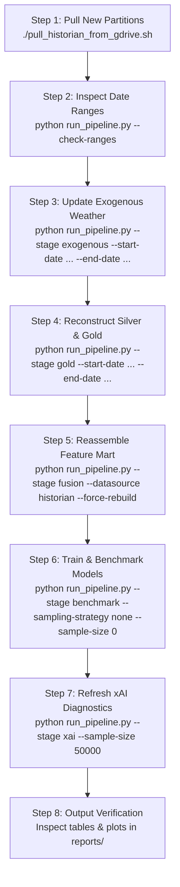

# Warsaw Transit Telemetry & Delay Attribution System

## Operational Infrastructure & Deployment Context

> **IMPORTANT**: The live transit delay telemetry ingestion pipeline is **actively running in production on a remote self-hosted server** and backed up daily to Google Drive.
> For private, host-specific paths and remote credentials on this workstation, refer to `LOCAL_DEPLOYMENT.md` and `.env` (both git-ignored).

### 1. Remote Self-Host Server
- **Host Environment**: Remote Linux server running Docker Compose or native Python daemon. (Specific server paths and credentials are documented in git-ignored `LOCAL_DEPLOYMENT.md`).
- **Primary Daemon Process**: Continuous high-frequency ingestion daemon running via Docker Compose (`container_name: warsaw_historian_daemon` using `docker-compose.historian.yml`) or `python3 historian_daemon.py`.
- **Primary Ingestion Targets**:
  - `dane.um.warszawa.pl`: Warsaw City API GPS feeds for buses (`um_bus`) and trams (`um_tram`) polled on a strict 10-second wall-clock grid.
  - `api.zbiorkom.live`: GTFS-RT Warsaw endpoint (`zbk_rt`) polled every 30 seconds for TripUpdates and Service Alerts.
- **Dead Man's Switch**: Sends periodic heartbeats and failure alerts to [Healthchecks.io](https://healthchecks.io) (`HISTORIAN_HEARTBEAT_URL` every 5 min).
- **Code Stability Constraint**: Any refactoring or code pushed to `main` must maintain 100% backward compatibility with `historian_daemon.py`, `run_preflight.py`, `Dockerfile`, `docker-compose.historian.yml`, and `src/` root module proxies so remote `git pull` operations never disrupt running daemons.

### 2. Automated Google Drive Backup
- **Tool**: `rclone`
- **Configured Remote**: `${RCLONE_REMOTE:-gdrive}` (configured in `.env` or `LOCAL_DEPLOYMENT.md`)
- **Automated Schedule**:
  - **Historian Telemetry (`data/historian/`)**: Cron job every 6 hours at minute 30 (`30 */6 * * *`) via [`backup_historian_to_gdrive.sh`](backup_historian_to_gdrive.sh) -> `${RCLONE_REMOTE}:${HISTORIAN_DEST_FOLDER}` (default `gdrive:WarsawDelayTelemetry/data/historian`).
- **Audit Logs**: `logs/backup_historian.log`

---

## Standard Operating Procedure: Pulling Latest Data & Running Pipeline

When pulling newer telemetry down from Google Drive and retraining downstream models on this workstation, follow this exact step-by-step protocol. Future agents and researchers do not need to inspect code details—execute these commands in order:



### Step 1: Pull Latest Telemetry Partitions from Google Drive
- **Good Case (Standard Fast Daily Parquet Sync — Default)**:
  Runs `rclone copy` with `--update`, skipping cold raw `bronze/source=*/**` (`.tar.zst`) archives and downloading only the pre-unpacked daily Parquet partitions (`bronze_parquet/date=YYYY-MM-DD/{vehicle_fixes.parquet, zbk_forecasts.parquet}`), `bronze/_ticks/`, `silver/`, `gold/`, and `gtfs/*.zip`:
  ```bash
  ./pull_historian_from_gdrive.sh
  ```
- **Not-So-Good Case (Cold Backup Recovery — Pulling Raw `.tar.zst` Archives)**:
  If you ever need to re-parse raw Warsaw City API JSONs or Zbiorkom GTFS-RT Protobufs from the cold backup vault on Google Drive, pass `--with-raw-bronze` (optionally scoped to a single `--date YYYY-MM-DD`):
  ```bash
  # Pull cold .tar.zst archives for a specific date:
  ./pull_historian_from_gdrive.sh --with-raw-bronze --date 2026-11-02

  # Or pull all cold .tar.zst archives across all dates:
  ./pull_historian_from_gdrive.sh --with-raw-bronze
  ```
*Audit log: `logs/pull_historian_gdrive.log`.*

### Step 2: Audit Temporal Bounds
Check the date boundaries across Bronze Parquet, Gold, Weather, GTFS, and OSM sources:
```bash
.venv/bin/python run_pipeline.py --check-ranges
```
Take note of the newly added dates (e.g., from `2026-10-28` to `2026-10-30`).

### Step 3: Update Exogenous Weather Telemetry
Harvest IMGW-PIB hourly synoptic observations covering the expanded calendar window:
```bash
.venv/bin/python run_pipeline.py --stage exogenous --start-date <START_DATE> --end-date <END_DATE>
```
*Example: `.venv/bin/python run_pipeline.py --stage exogenous --start-date 2026-10-18 --end-date 2026-10-30`.*

### Step 4: Reconstruct Silver Trajectories & Gold Stop Events for New Dates
> **CRITICAL**: The Silver/Gold reconstructor automatically uses the fast daily Parquet partitions (`data/historian/bronze_parquet/date=YYYY-MM-DD/`) without unzipping raw archives, and caches/reuses existing Gold dates instantaneously:
```bash
# Good Case (Fast Path — reads daily bronze_parquet directly):
.venv/bin/python run_pipeline.py --stage gold --start-date <NEW_START_DATE> --end-date <NEW_END_DATE>

# Not-So-Good Case (Fallback Path — forces reading cold raw .tar.zst archives or rebuilding bronze_parquet):
.venv/bin/python -m src.historian.compact --date <DATE> --backfill-parquet --force
.venv/bin/python run_pipeline.py --stage gold --start-date <DATE> --end-date <DATE> --force-rebuild --use-raw-bronze
```
*Example: `.venv/bin/python run_pipeline.py --stage gold --start-date 2026-10-28 --end-date 2026-10-30`.*
*(Note: `--stage all` does not re-run `--stage gold` by default; always run `--stage gold` when new partitions are synced).*

### Step 5: Rebuild the Unified Fused Feature Mart
Fuse all Gold stop events across all available dates with hourly weather, OSMnx corridor topology, school/holiday calendars, and Metro transfer hubs into `data/historian/processed/feature_mart_observed.parquet`:
```bash
.venv/bin/python run_pipeline.py --stage fusion --datasource historian --force-rebuild
```
*Execution takes ~30 seconds for 7+ million rows using DuckDB priority deduplication views.*

### Step 6: Train & Benchmark Econometric Baseline and Gradient Boosters
Train the TWFE panel regression baseline, LightGBM, and CatBoost models across Pooled, Urban Tram, Urban Bus, and Suburban Bus cohorts using zero-leakage purged temporal block cross-validation:

- **Full-Population Benchmark (All Records, Exact Thesis Evaluation)**:
  ```bash
  .venv/bin/python run_pipeline.py --stage benchmark --datasource historian --sampling-strategy none --sample-size 0 --objective huber
  ```
- **Fast Stratified Subsample Benchmark (~50,000 observations with normalized IPS weights)**:
  ```bash
  .venv/bin/python run_pipeline.py --stage benchmark --datasource historian --sampling-strategy stratified --sample-size 50000 --objective huber
  ```

### Step 7: Refresh Explainable AI (xAI) Suite
Generate TreeSHAP beeswarm distributions, local waterfall plots, ALE response curves, 2D Dedicated ROW shock buffering interactions, and DiCE counterfactuals:
```bash
.venv/bin/python run_pipeline.py --stage xai --datasource historian --sampling-strategy stratified --sample-size 50000 --objective huber
```

### Step 8: Verify Output Deliverables in `reports/`
All outputs are centralized in `reports/`:
- **Benchmark Tables**:
  - `reports/tables/benchmark_comparison.csv` (Primary pooled model comparison)
  - `reports/tables/benchmark_by_cohort.csv` (Stratified cohort breakdown)
- **xAI Diagnostics & Counterfactuals**:
  - `reports/tables/xai/shap_interaction_matrix.csv`
  - `reports/tables/xai/counterfactual_summary.csv`
  - `reports/tables/xai/counterfactual_policy_metrics.json`
  - `reports/figures/xai/` (17 publication-quality visual exhibits: beeswarm, waterfall, ALE, 2D interactions, policy impacts)
- **Executive Deliverables**:
  - `reports/EXECUTIVE_REPORT.md` (Comprehensive thesis findings & policy guidance)
  - `reports/PRESENTATION_SLIDES.md` (12 Marp defense presentation slides)

---

## Architecture & Codebase Map

0. **Core (`src/core/`)**: Centralized paths (`DataPaths`), configuration (`IngestionConfig`), feature schemas (`FeatureRegistry`), and Polish academic/holiday calendar utilities.
1. **Historian Telemetry (`src/historian/`)**: 10s wall-clock aligned poller of `dane.um.warszawa.pl` (`poller.py`), bronze raw storage (`bronze.py`), silver trajectory kinematics (`silver.py`), weekly content-addressed static GTFS versioner (`static_gtfs.py`), and gold stop-event reconstructor (`gold.py`).
2. **Exogenous Enrichment (`src/exogenous/`)**: IMGW-PIB hourly synoptic weather telemetry harvester (`imgw.py`), OpenStreetMap corridor road network topology (`osm.py`), and transfer hub centrality (`interchange.py`).
3. **Spatiotemporal Fusion (`src/fusion/`)**: Multi-source DuckDB feature mart assembler (`feature_mart.py`), trajectory autoregressive lags (`trajectory.py`), and 12-cell stratified sampling engine with IPS weighting (`sampling.py`).
4. **Econometric & ML Modeling (`src/models/`)**: Purged temporal block splitter with 30-min blackout embargo and boundary trajectory purging (`validation.py`), TWFE panel regression baseline (`twfe.py`), LightGBM & CatBoost gradient boosters with Huber loss (`gbm.py`), and comparative benchmark runner (`benchmark.py`).
5. **Explainable AI (`src/xai/`)**: Global and local TreeSHAP attribution (`shap_explainer.py`), Accumulated Local Effects curves (`ale_curves.py`), 2D Dedicated ROW shock buffering interactions (`interactions.py`), and Diverse Counterfactual Explanations (`counterfactuals.py`).
6. **Publication Visualizations (`src/visualization/`)**: Reusable publication styling and standalone figure generators (`plots.py`).
7. **Pipeline Orchestrator (`src/pipeline/`)**: Modular stage runners (`stages.py`), temporal bounds checker (`ranges.py`), and CLI dispatcher (`run_pipeline.py`).


