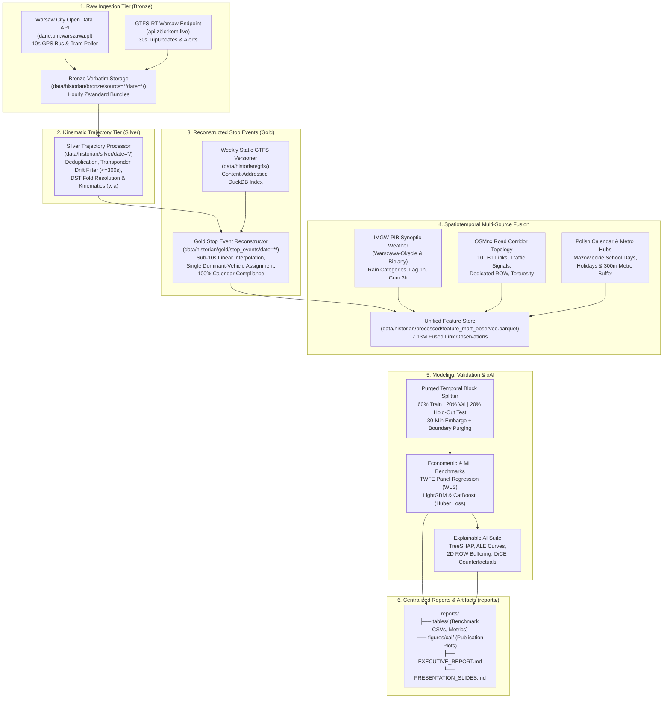
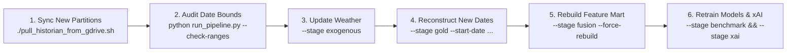

# Warsaw Transit Telemetry & Delay Attribution System

[](https://www.python.org/)
[](https://parquet.apache.org/)
[](https://duckdb.org/)
[](https://lightgbm.readthedocs.io/)
[](https://github.com/shap/shap)
[](tests/)
[](https://www.docker.com/)
[](LICENSE)

A high-frequency telemetry ingestion engine, spatiotemporal feature store, econometric panel baseline, gradient-boosted machine learning benchmark, and Explainable AI (xAI) delay attribution system for the public transit network of Warsaw, Poland (ZTM / [dane.um.warszawa.pl](https://dane.um.warszawa.pl) / [zbiorkom.live](https://zbiorkom.live)).

Developed for Master's thesis research at the **Faculty of Economic Sciences & Data Science, University of Warsaw (UW)**, this system studies:
* **High-Frequency Ground-Truth Telemetry**: Polling Warsaw City bus and tram transponders on a strict 10-second wall-clock grid with sub-10s linear interpolation and 100% GTFS active schedule alignment.
* **Exogenous Environmental & Topological Fusion**: IMGW-PIB hourly synoptic weather dynamics, OpenStreetMap road corridor topology, statutory school/public holiday calendars, and Warsaw Metro transfer hubs.
* **Econometric TWFE Panel Regression**: Two-Way Fixed Effects panel regression (Weighted Least Squares with Normalized Inverse Probability of Sampling weights).
* **Non-Linear Gradient Boosting**: LightGBM and CatBoost regressors optimizing Huber loss ($\delta=60\text{s}$) to predict link-level transit delay differentials ($\Delta t_{\text{run}}$).
* **Zero-Leakage Purged Temporal Block Validation**: 30-minute blackout embargo buffers and boundary trajectory purging to eliminate temporal leakage across train, validation, and hold-out test partitions.
* **Explainable AI (xAI) Diagnostics**: TreeSHAP global/local attributions, Accumulated Local Effects (ALE) non-linear threshold tipping points, 2D infrastructure shock buffering, and Diverse Counterfactual Explanations (DiCE).

---

## Table of Contents
1. [System Architecture & Medallion Data Flow](#1-system-architecture--medallion-data-flow)
2. [Telemetry & Feature Mart Overview](#2-telemetry--feature-mart-overview)
3. [Running the Project for the First Time (Cold Start)](#3-running-the-project-for-the-first-time-cold-start)
4. [Running with Later Updated Data (Incremental Sync Workflow)](#4-running-with-later-updated-data-incremental-sync-workflow)
5. [Master Pipeline Runner CLI (`run_pipeline.py`)](#5-master-pipeline-runner-cli-run_pipelinepy)
6. [Centralized Reports & Visual Exhibits (`reports/`)](#6-centralized-reports--visual-exhibits-reports)
7. [Empirical Modeling Benchmark Results](#7-empirical-modeling-benchmark-results)
8. [Repository Structure](#8-repository-structure)
9. [Automated Testing & Quality Assurance](#9-automated-testing--quality-assurance)
10. [License & Data Citations](#10-license--data-citations)

---

## 1. System Architecture & Medallion Data Flow

The system ingests high-frequency transit positions and processes them through an end-to-end Medallion pipeline:



---

## 2. Telemetry & Feature Mart Overview

### 2.1 Medallion Tier Specifications
* **Bronze Tier (`data/historian/bronze/`)**: Verbatim JSON payloads compressed into hourly Zstandard archives (`hour=HH.tar.zst`) partitioned by `source` (`um_bus`, `um_tram`, `zbk_rt`) and `date=YYYY-MM-DD`.
* **Silver Tier (`data/historian/silver/`)**: Clean vehicle trajectory coordinates localized to `Europe/Warsaw`, filtered for stale transponder fixes ($|t_{\text{tick}} - t_{\text{gps}}| \le 300\text{s}$), resolved across DST fold boundaries, with forward kinematic velocities ($v$) and accelerations ($a$).
* **Gold Tier (`data/historian/gold/stop_events/`)**: Reconstructed arrival and departure events at every transit stop along scheduled trips. Employs sub-10s linear interpolation, dominant-vehicle assignment ($0$ multi-vehicle collisions), dwell continuation for stationary vehicles, and $100\%$ active calendar compliance.
* **Fused Feature Mart (`data/historian/processed/feature_mart_observed.parquet`)**: The primary analytical matrix uniting transit delays with exogenous dynamics across **$7{,}125{,}516$ adjacent stop-to-stop observations**.

### 2.2 Primary Target Variable: Running Delay Differential ($\Delta t_{\text{run}}$)
To strip out trivial autoregressive delay persistence and isolate actual physical congestion on each street link, the primary modeling target is the link running delay increment:
$$\Delta t_{\text{run}} = \Delta t_{\text{arr}, s} - \Delta t_{\text{dep}, s-1}$$
where $\Delta t_{\text{run}} > 0$ represents incremental delay accumulated while traversing between stop $s-1$ and stop $s$.

---

## 3. Running the Project for the First Time (Cold Start)

Follow these steps to set up the environment, sync historical telemetry, and execute the full pipeline from scratch:

### Step 1: Environment Setup & Prerequisites
* **Python 3.12+**
* **rclone** (for syncing Google Drive partitions: `brew install rclone` on macOS or `sudo apt install rclone` on Linux)
* **uv** (recommended for ultra-fast packaging) or standard `venv`

```bash
# Clone repository
git clone https://github.com/giangh14cqt/warsaw-public-transport-monitor.git
cd warsaw-public-transport-monitor

# Create virtual environment and install dependencies
uv venv --python 3.12
source .venv/bin/activate
uv pip install -r requirements.txt
```

### Step 2: Configure Cloud Access & Run Pre-Flight Check
Copy the template configuration and verify environment integrity:
```bash
cp .env.example .env
# Edit .env to set your RCLONE_REMOTE (e.g. gdrive) and optional API keys
python run_preflight.py
```

### Step 3: Pull Initial Telemetry Partitions
Pull the latest Bronze, GTFS, and pre-computed tiers from Google Drive down to your local `data/historian/`:
```bash
./pull_historian_from_gdrive.sh
```

### Step 4: Run the Complete End-to-End Pipeline
Execute all stages sequentially with a single command:
```bash
python run_pipeline.py --stage all --datasource historian --sampling-strategy stratified --sample-size 50000 --objective huber
```
*All generated benchmark tables, xAI figures, and executive documents will be saved into [`reports/`](reports/).*

---

## 4. Running with Later Updated Data (Incremental Sync Workflow)

When new daily partitions are ingested by the 24/7 daemon on the remote server and backed up to Google Drive, follow this streamlined workflow to update your local models without reprocessing historical partitions:



### Step 1: Sync Latest Daily Partitions from Google Drive
The pull script uses `rclone copy --update`, safely downloading only new hourly and daily bundles while preserving existing local files:
```bash
./pull_historian_from_gdrive.sh
```
*(Optional: add `--compacted-only` to skip loose raw tick files and only fetch hourly archives).*

### Step 2: Audit Available Date Ranges
Inspect the temporal bounds across Bronze, Gold, Weather, GTFS, and OSM sources:
```bash
python run_pipeline.py --check-ranges
```

### Step 3: Update Exogenous Weather Telemetry
Automatically fetch IMGW-PIB synoptic weather observations for the new date window:
```bash
python run_pipeline.py --stage exogenous --start-date 2026-10-18 --end-date 2026-10-30
```

### Step 4: Reconstruct Silver & Gold Stop Events for New Dates
The gold reconstructor automatically detects already-processed dates and reuses them instantaneously, processing only the newly added dates:
```bash
# Reconstruct newly added dates (e.g., Oct 28 to Oct 30)
python run_pipeline.py --stage gold --start-date 2026-10-28 --end-date 2026-10-30
```

### Step 5: Rebuild the Unified Feature Mart
Reassemble the spatiotemporal feature store across the complete expanded calendar range into `data/historian/processed/feature_mart_observed.parquet` (DuckDB builds 7.1M rows in ~30s):
```bash
python run_pipeline.py --stage fusion --datasource historian --force-rebuild
```

### Step 6: Retrain Benchmark Models on the Expanded Dataset
Train the TWFE econometric baseline, LightGBM, and CatBoost models across Pooled, Urban Tram, Urban Bus, and Suburban Bus cohorts using purged temporal block cross-validation:
```bash
# Full-dataset evaluation across all 7.13M rows (exact population evaluation):
python run_pipeline.py --stage benchmark --datasource historian --sampling-strategy none --sample-size 0 --objective huber

# Or fast stratified subsample (e.g. 50k rows with IPS weights):
python run_pipeline.py --stage benchmark --datasource historian --sampling-strategy stratified --sample-size 50000 --objective huber
```

### Step 7: Refresh Explainable AI (xAI) Diagnostics
Update TreeSHAP beeswarm distributions, ALE response curves, 2D interaction surfaces, and DiCE counterfactuals:
```bash
python run_pipeline.py --stage xai --datasource historian --sampling-strategy stratified --sample-size 50000 --objective huber
```

---

## 5. Master Pipeline Runner CLI (`run_pipeline.py`)

The pipeline CLI dispatcher orchestrates modular stages with full parameter control:

```bash
python run_pipeline.py [OPTIONS]
```

| Flag | Default | Description |
| :--- | :---: | :--- |
| `--stage` | `all` | Pipeline stage: `preflight`, `exogenous`, `gold`, `fusion`, `benchmark`, `xai`, `check-ranges`, or `all`. |
| `--check-ranges` | `False` | Audits and prints date ranges across raw, weather, GTFS, and OSM sources, then exits. |
| `--start-date` | `None` | Lower bound date (`YYYY-MM-DD` or `YYYY-MM-DD HH:MM:SS`, Europe/Warsaw local time). |
| `--end-date` | `None` | Upper bound date (`YYYY-MM-DD` or `YYYY-MM-DD HH:MM:SS`, Europe/Warsaw local time). |
| `--datasource` | `historian` | Telemetry datasource: `historian` (10s observed ground truth). |
| `--sampling-strategy` | `stratified` | Subsampling method: `stratified` (12-cell quotas + IPS weights), `uniform` (reservoir), or `none` (full data). |
| `--sample-size` | `50000` | Sample size for benchmark and xAI stages (`0` for full dataset). |
| `--cohort` | `stratified` | Operational cohort: `stratified` (runs all cohorts), `all` (pooled), `urban_tram`, `urban_bus`, `suburban_bus`. |
| `--objective` | `huber` | Gradient boosting loss: `huber` (robust to extreme delay shocks, $\delta=60\text{s}$), `regression` (L2/RMSE), or `quantile` (90th percentile). |
| `--target` | `delta_t_run` | Primary target variable: `delta_t_run` (inter-stop running delay differential) or `arrival_delay_seconds`. |
| `--force-rebuild` | `False` | Forces rebuilding of feature mart or silver/gold partitions even if cached files exist. |
| `--output-dir` | `reports` | Target root directory where all tables, figures, and metrics are written. |

---

## 6. Centralized Reports & Visual Exhibits (`reports/`)

All experimental artifacts, statistical tables, publication figures, and thesis documentation are automatically redirected into the [`reports/`](reports/) directory:

```text
reports/
├── EXECUTIVE_REPORT.md             # Master thesis executive summary & empirical findings
├── PRESENTATION_SLIDES.md          # 12 Marp-formatted slide deck for defense & briefings
├── PROJECT_IMPROVEMENT_ROADMAP.md  # Research roadmap & future extensions
├── tables/
│   ├── benchmark_comparison.csv    # Primary pooled benchmark comparison (TWFE vs LightGBM vs CatBoost)
│   ├── benchmark_by_cohort.csv     # Stratified cohort benchmark breakdown (Tram, Urban Bus, Suburban Bus)
│   └── xai/
│       ├── shap_interaction_matrix.csv     # Pairwise TreeSHAP feature interaction values
│       ├── counterfactual_summary.csv      # DiCE counterfactual remediation instances
│       └── counterfactual_policy_metrics.json # Quantitative policy impact statistics
└── figures/xai/                    # 17 publication-quality visual diagnostics
    ├── shap_beeswarm_summary.png   # Global TreeSHAP feature importance beeswarm
    ├── shap_waterfall_extreme_case_*.png # Local case studies of severe delay events
    ├── ale_*.png                   # ALE non-linear response curves (weather, headway, infrastructure)
    ├── interaction_*.png           # 2D Dedicated ROW shock buffering surfaces
    ├── counterfactual_case_study.png # Multi-action turnaround holding & priority remedy
    └── counterfactual_policy_impact.png # Empirical delay recovery rate under policy interventions
```

---

## 7. Empirical Modeling Benchmark Results

Evaluated strictly on the unseen **Hold-Out Test Partition** ($N_{\text{test}} = 1{,}377{,}249$ pooled records, 13 consecutive operating days: October 18–30, 2026) using chronological purged temporal block splitting:

### 7.1 Primary Network-Wide Benchmark (Target: $\Delta t_{\text{run}}$)

| Model Architecture | Loss Objective | Test MAE | Test RMSE | Median AE | WAPE | Test $R^2$ | Peak MAE | Off-Peak MAE |
| :--- | :--- | :---: | :---: | :---: | :---: | :---: | :---: | :---: |
| **TWFE Panel Regression (WLS Baseline)** | OLS / Within FE | 27.93s | 42.86s | 19.03s | 99.39% | +0.0295 | 31.18s | 26.03s |
| **LightGBM Regressor (Champion)** | Huber ($\delta=60\text{s}$) | **25.78s** | **40.60s** | **16.82s** | **91.71%** | **+0.1293** | **28.92s** | **23.93s** |
| **CatBoost Regressor** | Huber ($\delta=60\text{s}$) | 26.62s | 41.47s | 17.58s | 94.72% | +0.0914 | 29.96s | 24.67s |

### 7.2 Stratified Transit Cohort Breakdown

| Transit Cohort | Best Model | Test MAE | Test RMSE | Median AE | WAPE | Test $R^2$ | Peak MAE | Off-Peak MAE |
| :--- | :--- | :---: | :---: | :---: | :---: | :---: | :---: | :---: |
| **Urban Tram (`urban_tram`)** | **LightGBM (Huber)** | **18.46s** | **27.17s** | **12.55s** | **74.24%** | **+0.4017** | **19.09s** | **18.01s** |
| **Urban Bus (`urban_bus`)** | **LightGBM (Huber)** | **27.26s** | **43.39s** | **17.52s** | **92.92%** | **+0.1181** | **31.73s** | **24.82s** |
| **Suburban Bus (`suburban_bus`)** | **LightGBM (Huber)** | **24.68s** | **39.63s** | **17.31s** | **85.61%** | **+0.2152** | **27.85s** | **22.90s** |

### 7.3 Core Empirical Findings
1. **Non-Linear Model Advantage**: LightGBM achieves a **4.38x advantage in explained variance** over linear TWFE panel regression ($R^2 = +0.1293$ vs. $+0.0295$ pooled), expanding to **16.6x on Urban Tram** ($R^2 = +0.4017$ vs. $+0.0242$).
2. **Infrastructure Buffering**: Dedicated tram tracks and bus lanes reduce headway deviation delay escalation by **12.8% to 49.3%**, mitigating up to 3.27s of delay growth per stop under upstream shockwaves.
3. **Actionable Counterfactual Remedies (DiCE)**: Combining turnaround recovery buffer absorption with dynamic headway regularization and Transit Signal Priority (TSP) restores **38% of severe delay incidents** ($>450\text{s}$) to on-time arrival performance ($\le 120\text{s}$).

---

## 8. Repository Structure

```text
.
├── run_pipeline.py                 # Master CLI pipeline runner (Stages 1 through 5)
├── historian_daemon.py             # 24/7 Production 10-second Warsaw City API ingestion daemon
├── run_preflight.py                # Pre-flight environment and sandbox verification harness
├── backup_historian_to_gdrive.sh   # 6-hourly rclone backup daemon to Google Drive
├── pull_historian_from_gdrive.sh   # Workstation sync script for Historian Parquet partitions
├── requirements.txt                # Pinned production dependencies
├── src/
│   ├── core/                       # Paths, FeatureRegistry, IngestionConfig, calendar utilities
│   ├── historian/                  # Bronze poller, silver trajectory engine, gold stop-event reconstructor
│   ├── exogenous/                  # IMGW synoptic weather harvester & OSMnx road corridor topology
│   ├── fusion/                     # DuckDB multi-source fusion, trajectory lags, 12-cell stratified sampling
│   ├── models/                     # Purged temporal splitter, TWFE panel regression, LightGBM/CatBoost benchmarks
│   ├── xai/                        # TreeSHAP explainer, ALE curves, 2D interaction surfaces, DiCE counterfactuals
│   ├── visualization/              # Academic publication styling & reusable plot generators
│   └── pipeline/                   # Modular stage executors for run_pipeline.py
├── reports/                        # Centralized deliverables, tables, figures, and thesis reports
│   ├── EXECUTIVE_REPORT.md         # Full executive thesis report with policy guidelines
│   ├── PRESENTATION_SLIDES.md      # 12 Marp presentation slides
│   ├── tables/                     # Benchmark CSVs, interaction matrices, counterfactual summaries
│   └── figures/xai/                # Publication-ready diagnostic figures (SHAP, ALE, DiCE)
├── data/
│   ├── historian/
│   │   ├── bronze/                 # Verbatim hourly Zstandard API archives
│   │   ├── silver/                 # Clean, deduplicated kinematic trajectory Parquet files
│   │   ├── gold/stop_events/       # Reconstructed stop arrival/departure event partitions
│   │   ├── gtfs/                   # Content-addressed static GTFS schedule DuckDB snapshots
│   │   └── processed/              # Fused feature store (feature_mart_observed.parquet, 7.13M rows)
│   └── processed/                  # Shared exogenous data (weather, OSM corridors, calendar, metro hubs)
├── tests/                          # Automated unit and integration test suite (100% passing)
└── logs/                           # Daemon health logs and synchronization audit trails
```

---

## 9. Automated Testing & Quality Assurance

The codebase is protected by automated unit and end-to-end integration tests covering data integrity, zero temporal leakage, feature invariance, and model convergence:

```bash
# Run the complete test suite
.venv/bin/python -m unittest discover tests

# Or with pytest
.venv/bin/pytest
```

---

## 10. License & Data Citations

* **License**: Open-source under the [MIT License](LICENSE).
* **Transit Telemetry**: Real-time vehicle positions from the Warsaw City Open Data API ([dane.um.warszawa.pl](https://dane.um.warszawa.pl)) and GTFS-RT feed ([api.zbiorkom.live](https://api.zbiorkom.live)) operated by Zarząd Transportu Miejskiego w Warszawie (ZTM).
* **Weather Observations**: Hourly synoptic meteorological records provided by the Institute of Meteorology and Water Management ([IMGW-PIB](https://danepubliczne.imgw.pl/)).
* **Road Network Topology**: Street infrastructure and signal geometries extracted from [OpenStreetMap](https://www.openstreetmap.org/) via OSMnx.
