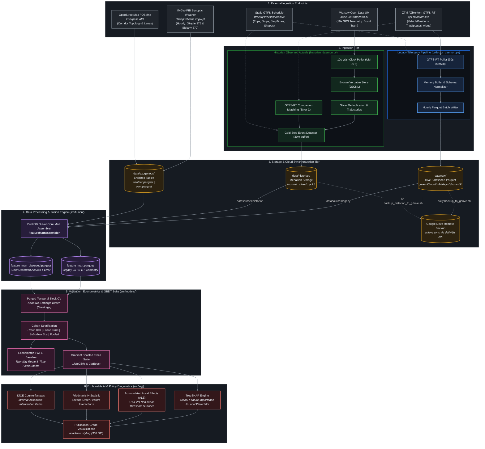
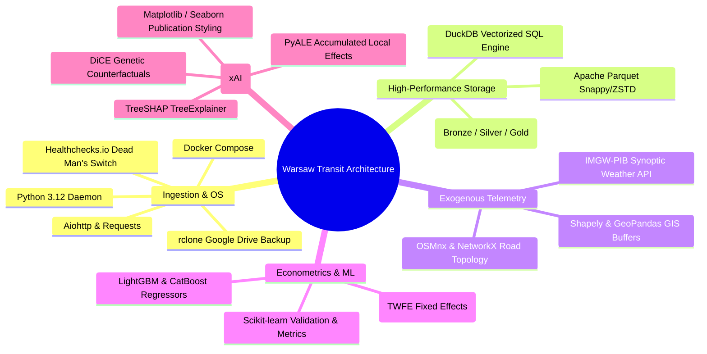

# Warsaw Transit Telemetry & Delay Attribution System
# System Architecture & Technical Blueprint

This directory contains comprehensive architectural diagrams and technical specifications for the entire **Warsaw Public Transport Telemetry, Historian & Delay Attribution System**. All diagrams are written in standard [Mermaid.js](https://mermaid.js.org/) syntax and natively render within GitHub and compatible Markdown viewers.

---

## 🗺️ Master System Architecture

The following diagram illustrates the complete end-to-end data lifecycle: from external municipal and meteorological data feeds, through dual ingestion pipelines, storage and cloud synchronization, DuckDB-powered feature mart fusion, econometric modeling, and explainable AI attribution.

---

## 📂 Architecture Directory Index

The architecture documentation is organized into three specialized segments:

| Segment | Path | Description |
| :--- | :--- | :--- |
| **1. Legacy Pipeline** | [`legacy_pipeline/`](file:///Users/truonggiangdo/Data/LearningMaterials/UW/Thesis/DelayTraffic/playground/architect/legacy_pipeline/) | GTFS-RT 30s protobuf ingestion, hourly partitioning, remote server daemon, and backup scripts. |
| **2. Historian Pipeline** | [`historian_pipeline/`](file:///Users/truonggiangdo/Data/LearningMaterials/UW/Thesis/DelayTraffic/playground/architect/historian_pipeline/) | 10s wall-clock aligned observed actuals, Medallion storage (Bronze/Silver/Gold), spatial buffer stop matching, and GTFS-RT forecast error calculation. |
| **3. Data Processing & Modeling** | [`data_processing/`](file:///Users/truonggiangdo/Data/LearningMaterials/UW/Thesis/DelayTraffic/playground/architect/data_processing/) | Exogenous feature engineering (weather, OSM, hubs), DuckDB dual-datasource fusion, purged temporal validation, econometric TWFE, GBDTs, and xAI attribution. |

---

## ⚖️ Architecture Comparison: Legacy vs. Historian

| Feature / Metric | Legacy Pipeline (`data/raw/`) | Historian Pipeline (`data/historian/`) |
| :--- | :--- | :--- |
| **Primary Data Source** | `api.zbiorkom.live` (GTFS-RT Protobuf) | `dane.um.warszawa.pl` (UM Warsaw API REST) |
| **Polling Cadence** | 30 seconds (best effort) | 10 seconds (strict wall-clock synchronized) |
| **Primary Target Metric** | Schedule Deviation (Predicted arrival delay) | **Observed Ground-Truth Arrival/Departure Delay** |
| **Dwell Time Resolution** | Imputed / missing | Measured physical vehicle standstill ($\ge 3\,\text{s}$) |
| **Forecast Error ($\Delta$)** | N/A (predicts against static timetable) | $|\text{Delay}_{\text{forecast}} - \text{Delay}_{\text{observed}}|$ (evaluated against real arrival) |
| **Storage Architecture** | Hive Partitioned Parquet (`year/month/day/hour`) | Medallion Architecture (`bronze/jsonl` $\to$ `silver/parquet` $\to$ `gold/parquet`) |
| **Storage Volume / Day** | $\approx 200 - 300\,\text{MB/day}$ | $\approx 85 - 110\,\text{MB/day}$ (compact compressed Parquet) |
| **Sync Cadence (Google Drive)** | Daily at 03:00 UTC via `backup_to_gdrive.sh` | Every 6 hours at :30 via `backup_historian_to_gdrive.sh` |
| **Operational Process** | `collector_daemon.py` (Docker or systemd) | `historian_daemon.py` (Docker Compose or systemd) |

---

## 🛠️ Technology Stack & Engine Registry

