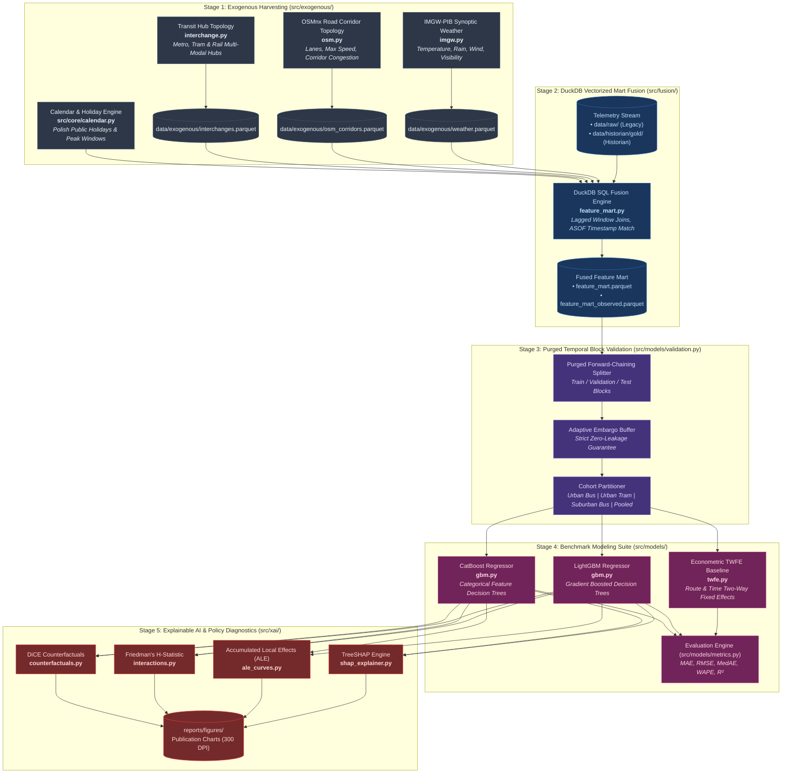
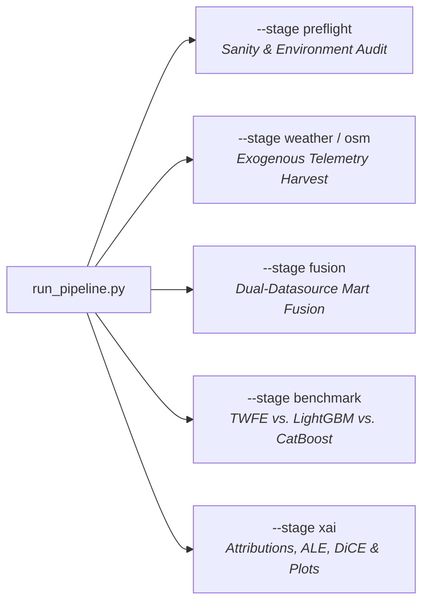

# Data Processing, Modeling & Delay Attribution Engine

This segment documents the downstream analytical, fusion, econometric, and machine learning components of the Warsaw Transit Telemetry System. Orchestrated via [`run_pipeline.py`](file:///Users/truonggiangdo/Data/LearningMaterials/UW/Thesis/DelayTraffic/playground/run_pipeline.py) and [`src/pipeline/stages.py`](file:///Users/truonggiangdo/Data/LearningMaterials/UW/Thesis/DelayTraffic/playground/src/pipeline/stages.py), the data processing pipeline bridges raw telemetry with academic-grade causal and predictive insights.

---

## 🏗️ End-to-End Processing Architecture



---

## 💻 CLI Orchestrator Dispatcher (`run_pipeline.py`)

All stages are executed synchronously or independently via a unified CLI dispatcher:



### CLI Command Reference
```bash
# 1. Harvest hourly meteorological telemetry from IMGW-PIB
python run_pipeline.py --stage weather --start-date 2026-10-01 --end-date 2026-10-18

# 2. Extract OSM road corridor topology
python run_pipeline.py --stage osm

# 3. Fuse feature mart (Legacy GTFS-RT Telemetry)
python run_pipeline.py --stage fusion --datasource legacy

# 4. Fuse feature mart (Historian Observed Actuals)
python run_pipeline.py --stage fusion --datasource historian

# 5. Train & evaluate benchmark models across all cohorts
python run_pipeline.py --stage benchmark --datasource historian --cohort all

# 6. Generate academic xAI figures & counterfactual recommendations
python run_pipeline.py --stage xai --datasource historian --model lgbm
```

---

## 📑 Detailed Architecture Documents in this Segment

1. [`exogenous_enrichment.md`](file:///Users/truonggiangdo/Data/LearningMaterials/UW/Thesis/DelayTraffic/playground/architect/data_processing/exogenous_enrichment.md) - Weather, road topology, and transit interchange extraction mechanics.
2. [`feature_mart_fusion.md`](file:///Users/truonggiangdo/Data/LearningMaterials/UW/Thesis/DelayTraffic/playground/architect/data_processing/feature_mart_fusion.md) - DuckDB vectorized dual-datasource fusion engine, lagged feature engineering, and schema dictionary.
3. [`modeling_and_xai.md`](file:///Users/truonggiangdo/Data/LearningMaterials/UW/Thesis/DelayTraffic/playground/architect/data_processing/modeling_and_xai.md) - Purged temporal block validation, econometric TWFE, GBDTs, and xAI diagnostic suite.
