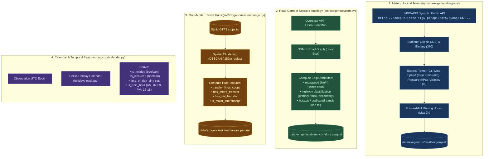
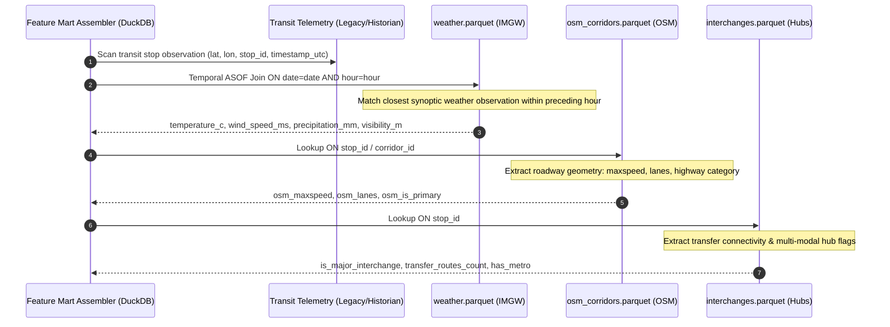

# Exogenous Telemetry Enrichment Architecture

This document details the ingestion, spatial aggregation, and temporal indexing of exogenous features—meteorological variables, road corridor network topology, and transit interchange proximity—that explain non-recurrent transit delays.

---

## 🌐 Multi-Source Exogenous Ingestion Architecture

---

## ⏱️ Spatial-Temporal Feature Join Topology

During feature mart assembly in DuckDB, each transit stop observation is joined against exogenous tables using a hybrid **ASOF temporal join** and **stop-post attribute lookup**:

---

## 📊 Exogenous Feature Definitions

| Feature Category | Column Name | Type | Unit / Range | Description |
| :--- | :--- | :--- | :--- | :--- |
| **Meteorology** | `temperature_c` | `FLOAT32` | $-25.0 \dots +40.0\,^\circ\text{C}$ | Ambient synoptic air temperature |
| | `wind_speed_ms` | `FLOAT32` | $0.0 \dots 35.0\,\text{m/s}$ | Sustained wind velocity |
| | `precipitation_mm` | `FLOAT32` | $0.0 \dots 100.0\,\text{mm/h}$ | Hourly accumulated rainfall / melted snowfall |
| | `visibility_m` | `FLOAT32` | $50 \dots 10000\,\text{m}$ | Atmospheric horizontal optical visibility |
| | `air_pressure_hpa` | `FLOAT32` | $950 \dots 1050\,\text{hPa}$ | Atmospheric barometric surface pressure |
| **Corridor Network**| `osm_maxspeed` | `INT32` | $30 \dots 80\,\text{km/h}$ | Legal vehicular speed limit of adjacent corridor |
| | `osm_lanes` | `INT32` | $1 \dots 5$ | Number of road lanes along corridor edge |
| | `osm_has_busway` | `INT32` | $0 \text{ or } 1$ | Dedicated transit / bus lane flag (`busway=yes`) |
| **Transit Hub** | `is_major_interchange`| `INT32` | $0 \text{ or } 1$ | Flag for major transit interchange hub |
| | `transfer_routes_count`| `INT32` | $1 \dots 25$ | Number of intersecting unique transit routes |
| | `has_metro_transfer` | `INT32` | $0 \text{ or } 1$ | Metro M1 / M2 transfer connection |
| **Calendar/Time** | `is_weekend` | `INT32` | $0 \text{ or } 1$ | Saturday or Sunday indicator |
| | `is_holiday` | `INT32` | $0 \text{ or } 1$ | Polish statutory public holiday indicator |
| | `is_rush_hour` | `INT32` | $0 \text{ or } 1$ | Morning (07-09) or afternoon (16-18) peak window |
| | `hour_sin`, `hour_cos` | `FLOAT32` | $[-1.0, 1.0]$ | Cyclical trigonometric time-of-day encoding |
