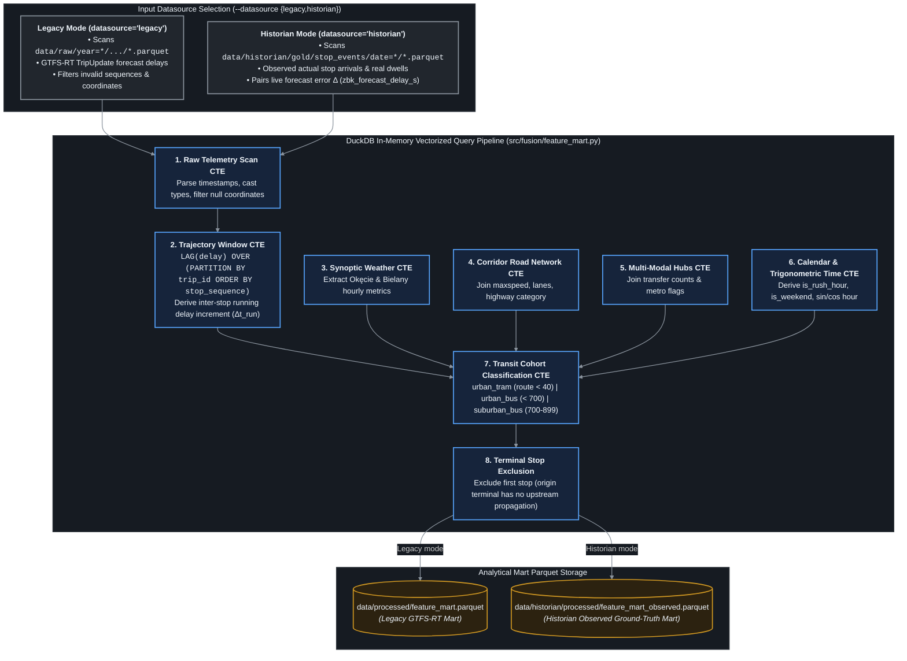
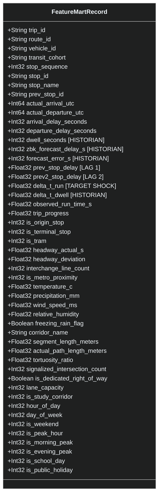

# Feature Mart Fusion: Dual-Datasource Vectorized Engine

The **Feature Mart Fusion Engine** ([`src/fusion/feature_mart.py`](file:///Users/truonggiangdo/Data/LearningMaterials/UW/Thesis/DelayTraffic/playground/src/fusion/feature_mart.py)) is an out-of-core, vectorized analytical processor built on top of [DuckDB](https://duckdb.org/). It unites transit telemetry streams with meteorological, topological, and calendar tables into a unified analytical feature store.

---

## ⚙️ Dual-Datasource Fusion Architecture



---

## 📐 Mathematical Delay Decomposition

At each transit stop $i$ along trip $k$, the Feature Mart decomposes delay propagation using window functions:

### 1. Cumulative Arrival Delay
$$\text{delay}_i = t_{\text{actual\_arrival}, i} - t_{\text{scheduled\_arrival}, i}$$

### 2. Upstream Propagation Delay ($\text{delay}_{i-1}$)
$$\text{prev\_stop\_delay} = \text{LAG}(\text{delay}_i, 1) \text{ OVER } (\text{PARTITION BY } k \text{ ORDER BY } \text{sequence})$$

### 3. Inter-Stop Section Delay Delta ($\Delta t_{\text{run}}$)
The pure incremental delay incurred strictly between stop $i-1$ and stop $i$ (stripping upstream shock):
$$\Delta t_{\text{run}} = \text{delay}_i - \text{prev\_stop\_delay}$$

### 4. Dwell Time ($\Delta t_{\text{dwell}}$) - Historian Observed Only
The real physical door-open boarding/alighting duration:
$$\Delta t_{\text{dwell}} = t_{\text{actual\_departure}, i} - t_{\text{actual\_arrival}, i}$$

### 5. Operator Forecast Error ($\Delta t_{\text{error}}$) - Historian Observed Only
The deviation between operator GTFS-RT forecast and ground-truth arrival:
$$\text{forecast\_error\_s} = \text{delay}_{\text{forecast}, i} - \text{delay}_{\text{observed}, i}$$

---

## 🧬 Database Matching & Feature Matrix ("Mat Matrix") Assembly: Gold → Feature Mart → Modeling Matrix

The transformation from **Gold observed physical stop events** (`data/historian/gold/stop_events/date=*/stop_events.parquet`) to the **Fused Feature Mart** (`feature_mart_observed.parquet`) and the downstream **ML Design Matrix ("Mat Matrix" $\mathbf{X}, \mathbf{y}$)** represents the core analytical engine of the system.

Built on an out-of-core vectorized [DuckDB](https://duckdb.org/) architecture ([`src/fusion/feature_mart.py`](file:///Users/truonggiangdo/Data/LearningMaterials/UW/Thesis/DelayTraffic/playground/src/fusion/feature_mart.py)), this process executes multi-stage database joins, temporal window lag calculations, and exogenous table merges to assemble clean matrices for econometric panel regression (TWFE) and nonlinear gradient boosting (LightGBM/CatBoost).

```mermaid
%%{init: {
  'theme': 'dark',
  'themeVariables': {
    'darkMode': true,
    'background': '#0d1117',
    'mainBkg': '#161b22',
    'primaryColor': '#1f2937',
    'primaryTextColor': '#f0f6fc',
    'primaryBorderColor': '#58a6ff',
    'lineColor': '#8b949e',
    'secondaryColor': '#161b22',
    'tertiaryColor': '#21262d',
    'clusterBkg': '#161b22',
    'clusterBorder': '#30363d',
    'edgeLabelBackground': '#161b22'
  }
}}%%
flowchart TD
    subgraph GoldInput ["1. Gold Stop Events Input Tier"]
        GoldParquet[("data/historian/gold/stop_events/<br/>date=YYYY-MM-DD/stop_events.parquet<br/><i>(Physical Arrival, Dwell, Delay, Forecast Error)</i>")]
    end

    subgraph DuckDBMatching ["2. DuckDB Vectorized Window & DB Matching Engine"]
        direction TB
        CTE_Filter["<b>CTE 1: raw_stops (Quality Filters)</b><br/>• event_type = 'STOPPED'<br/>• actual_arrival_utc IS NOT NULL<br/>• |arrival_delay_seconds| <= 7200s (2h anomaly boundary)<br/>• Composite Key: trip_instance_key = trip_id || '_' || service_date"]
        
        CTE_WindowTrip["<b>CTE 2 & 3: ordered & trajectories (Trajectory Window Lags)</b><br/>• LAG(arrival_delay) OVER (PARTITION BY trip_instance_key ORDER BY stop_sequence)<br/>• Derive autoregressive lags: prev_stop_delay, prev2_stop_delay<br/>• Inter-stop shock: Δt_run = arrival_delay - prev_stop_delay<br/>• Measured dwell delta: Δt_dwell = departure_delay - arrival_delay<br/>• Trip progress: (seq - min_seq) / (max_seq - min_seq)"]
        
        CTE_WindowHeadway["<b>CTE 4: with_headway (Dynamic Vehicle Spacing)</b><br/>• PARTITION BY route_id, stop_id ORDER BY rt_arrival_time<br/>• headway_actual_s = rt_arrival_time - LAG(rt_arrival_time)<br/>• headway_deviation = headway_actual_s - MEDIAN(headway_actual_s)"]
        
        CTE_Filter --> CTE_WindowTrip --> CTE_WindowHeadway
    end

    subgraph ExogenousJoins ["3. Multi-Source Exogenous Database Joins"]
        direction TB
        J_Weather["<b>Weather Join (Temporal Bucket)</b><br/><code>LEFT JOIN v_weather ON t.timestamp_bucket = w.timestamp</code><br/><i>IMGW Okęcie (375) & Bielany (370): Temp, Rain, Wind, Humidity, Freezing Rain</i>"]
        J_OSM["<b>Corridor Topology Join (Directed Stop Pair)</b><br/><code>LEFT JOIN v_osm ON (t.prev_stop_id = osm.stop_id_prev AND t.stop_id = osm.stop_id_curr)</code><br/><i>OSMnx Corridors: Length, Actual Path, Tortuosity, Lights, Busway, Lanes</i>"]
        J_Cal["<b>Calendar Lookup Join (Date Match)</b><br/><code>LEFT JOIN v_calendar ON CAST(arrival_ts AS DATE) = cal.calendar_date</code><br/><i>Polish Calendar: School Day, Public Holiday, Weekend</i>"]
        J_Hub["<b>Interchange Hub Join (Stop Post Match)</b><br/><code>LEFT JOIN v_interchange ON t.stop_id = hub.stop_id</code><br/><i>Multi-modal transfer line counts & Metro M1/M2 proximity</i>"]
    end

    subgraph FinalFilters ["4. Clean Feature Mart Parquet Generation"]
        TermFilter["Terminal & Origin Filtering<br/>• Exclude origin stop (prev_stop_id IS NOT NULL, has no upstream run)<br/>• Exclude terminal layover stops (is_terminal_stop = false, removes pętle layovers)<br/>• Clip extreme running anomalies (|Δt_run| <= 1800s)"]
        MartOut[("data/historian/processed/<br/><b>feature_mart_observed.parquet</b><br/><i>(77,000+ stop records / 0.21s execution)</i>")]
        TermFilter --> MartOut
    end

    subgraph ModelingMatrixTier ["5. Modeling Design Matrix Assembly ('Mat Matrix' X, y)"]
        direction TB
        Stratify["Cohort Stratification<br/><code>urban_tram | urban_bus | suburban_bus | night_bus | pooled</code>"]
        PurgedSplit["Purged Temporal Block CV Splitter<br/><i>Chronological Train (60%), Validation (20%), Test (20%)</i><br/><i>Adaptive Embargo Buffer (15-30m gap) -> 0% Data Leakage</i>"]
        
        subgraph Matrices ["Design Matrix Blocks [X | y]"]
            VecY["<b>Target Vector y ∈ R^N</b><br/>• Primary: Δt_run (incremental section delay shock)<br/>• Secondary: arrival_delay_seconds (cumulative)"]
            MatOper["<b>Operational Matrix X_oper</b><br/>• prev_stop_delay, prev2_stop_delay<br/>• trip_progress, headway_deviation<br/>• is_origin_stop, is_tram"]
            MatInfra["<b>Infrastructure Matrix X_infra</b><br/>• signalized_intersection_count<br/>• actual_path_length_meters, tortuosity_ratio<br/>• is_dedicated_right_of_way, lane_capacity<br/>• interchange_line_count, is_metro_proximity"]
            MatTemp["<b>Temporal Matrix X_temp</b><br/>• hour_of_day, day_of_week<br/>• is_peak_hour, is_morning_peak, is_evening_peak<br/>• is_weekend, is_school_day, is_public_holiday"]
            MatMeteo["<b>Meteorological Matrix X_meteo</b><br/>• precipitation_mm, temperature_c<br/>• wind_speed_ms, relative_humidity, freezing_rain_flag"]
        end

        Stratify --> PurgedSplit --> Matrices
    end

    subgraph DownstreamModels ["6. Downstream Model Training & Attribution"]
        TWFE_Fit["Econometric TWFE Baseline<br/><code>y_{r,t} = β X + α_r + γ_t + ε</code>"]
        GBDT_Fit["Nonlinear GBDTs<br/><code>LightGBM & CatBoost</code>"]
        TreeSHAP_Diag["xAI Diagnostics<br/><code>TreeSHAP Global / Waterfall / ALE</code>"]
        
        Matrices --> TWFE_Fit
        Matrices --> GBDT_Fit --> TreeSHAP_Diag
    end

    %% Flow connections
    GoldParquet --> CTE_Filter
    CTE_WindowHeadway --> J_Weather & J_OSM & J_Cal & J_Hub
    J_Weather & J_OSM & J_Cal & J_Hub --> TermFilter
    MartOut --> Stratify

    %% Subgraph Styling
    style GoldInput fill:#161b22,stroke:#30363d,stroke-width:1.5px,color:#f0f6fc
    style DuckDBMatching fill:#161b22,stroke:#30363d,stroke-width:1.5px,color:#f0f6fc
    style ExogenousJoins fill:#161b22,stroke:#30363d,stroke-width:1.5px,color:#f0f6fc
    style FinalFilters fill:#161b22,stroke:#30363d,stroke-width:1.5px,color:#f0f6fc
    style ModelingMatrixTier fill:#161b22,stroke:#30363d,stroke-width:1.5px,color:#f0f6fc
    style DownstreamModels fill:#161b22,stroke:#30363d,stroke-width:1.5px,color:#f0f6fc

    %% High-Contrast Node Styling
    classDef gStyle fill:#382b14,stroke:#ecc94b,stroke-width:2px,color:#f0f6fc;
    classDef qStyle fill:#16243b,stroke:#58a6ff,stroke-width:2px,color:#f0f6fc;
    classDef jStyle fill:#271d3b,stroke:#bc8cff,stroke-width:2px,color:#f0f6fc;
    classDef mStyle fill:#2c2210,stroke:#d29922,stroke-width:2px,color:#f0f6fc;
    classDef matStyle fill:#33172b,stroke:#f472b6,stroke-width:2px,color:#f0f6fc;
    classDef xaiStyle fill:#33171a,stroke:#ff7b72,stroke-width:2px,color:#f0f6fc;

    linkStyle default stroke:#8b949e,stroke-width:1.5px;

    class GoldParquet gStyle;
    class CTE_Filter,CTE_WindowTrip,CTE_WindowHeadway qStyle;
    class J_Weather,J_OSM,J_Cal,J_Hub jStyle;
    class TermFilter,MartOut mStyle;
    class Stratify,PurgedSplit,VecY,MatOper,MatInfra,MatTemp,MatMeteo matStyle;
    class TWFE_Fit,GBDT_Fit,TreeSHAP_Diag xaiStyle;
```



---

### 🔍 Step-by-Step Matrix Assembly Mechanics

#### 1. Ingestion of Gold Observed Stop Events
The processor scans Parquet partitions matching `data/historian/gold/stop_events/date=*/stop_events.parquet`. The scan restricts input to verified served stops:
- `event_type = 'STOPPED'`: Excludes vehicles that bypassed or sailed past the stop post (`PASSED`) without serving boarding/alighting passengers.
- `actual_arrival_utc IS NOT NULL`: Enforces physical timestamp existence.
- `ABS(arrival_delay_seconds) <= 7200`: Clips extreme sensor freezes, deadheads, or depot overnights ($\le 2$ hours).
- `trip_instance_key = trip_id || '_' || service_date`: Distinguishes daily trip recurrences across calendar dates.

#### 2. Autoregressive Trajectory Delay Window Matching
Using window functions partitioned by `trip_instance_key` and ordered by `stop_sequence`:

```sql
LAG(arrival_delay_seconds) OVER (
    PARTITION BY trip_instance_key ORDER BY stop_sequence
) AS prev_stop_delay,

LAG(arrival_delay_seconds, 2) OVER (
    PARTITION BY trip_instance_key ORDER BY stop_sequence
) AS prev2_stop_delay,

LAG(actual_departure_utc) OVER (
    PARTITION BY trip_instance_key ORDER BY stop_sequence
) AS prev_actual_dep
```

From these window lags, the engine extracts the core econometric variables:
- **Incremental Running Delay Shock ($\Delta t_{\text{run}}$)**:
  $$\Delta t_{\text{run}} = \text{arrival\_delay\_seconds} - \text{prev\_stop\_delay}$$
  This strips away all upstream delay inherited from previous segments, isolating the pure local shock incurred across the current corridor segment $[i-1 \to i]$.
- **Dwell Time Shock ($\Delta t_{\text{dwell}}$)**:
  $$\Delta t_{\text{dwell}} = \text{departure\_delay\_seconds} - \text{arrival\_delay\_seconds}$$
- **Observed Segment Run Time**:
  $$\text{observed\_run\_time\_s} = t_{\text{actual\_arrival}, i} - t_{\text{actual\_departure}, i-1}$$
- **Trip Progress Ratio**:
  $$\text{trip\_progress} = \frac{s_i - s_{\min}}{s_{\max} - s_{\min}} \in [0.0, 1.0]$$

#### 3. Inter-Trip Headway Window Matching
To capture vehicle bunching and headway degradation, the engine executes a cross-trip window partition by `(route_id, stop_id)` chronologically ordered by arrival time:

```sql
rt_arrival_time - LAG(rt_arrival_time) OVER (
    PARTITION BY route_id, stop_id ORDER BY rt_arrival_time
) AS headway_actual_s
```
Headway deviation is calculated against the running median headway for that specific line and stop post:
$$\text{headway\_deviation} = \text{headway\_actual\_s} - \text{median}(\text{headway\_actual\_s})$$
Excessive headway deviation directly signals downstream passenger overcrowding and extended dwell times.

#### 4. Exogenous Database Matching & Joins
The engine executes four simultaneous out-of-core relational and spatial joins:

| Join | Target Table | Join Key | Extracted Features |
| :--- | :--- | :--- | :--- |
| **1. Weather** | `v_weather` (IMGW Okęcie 375 & Bielany 370) | `t.timestamp_bucket = w.timestamp::TIMESTAMP` (1-hour discrete bucket) | `temperature_c`, `precipitation_mm`, `wind_speed_ms`, `relative_humidity`, `freezing_rain_flag` |
| **2. Road Network** | `v_osm` (OSMnx Corridor Graph) | `t.prev_stop_id = osm.stop_id_prev AND t.stop_id = osm.stop_id_curr` (Directed edge) | `segment_length_meters`, `actual_path_length_meters`, `tortuosity_ratio`, `signalized_intersection_count`, `is_dedicated_right_of_way`, `lane_capacity`, `is_study_corridor` |
| **3. Calendar** | `v_calendar` (Polish Holiday Lookup) | `CAST(t.arrival_ts AS DATE)::VARCHAR = cal.calendar_date` | `is_school_day`, `is_public_holiday`, `is_weekend` |
| **4. Interchanges** | `v_interchange` (Warsaw Transit Hubs) | `t.stop_id = hub.stop_id` | `interchange_line_count`, `is_metro_proximity` (M1/M2 station transfer flag) |

#### 5. Filtering Origin Stops & Terminal Turnarounds
- **Origin Stop Filter (`WHERE t.prev_stop_id IS NOT NULL`)**: Drops the first scheduled stop of each trip ($s = s_{\min}$) because initial dispatch has no upstream running segment or lag features ($\text{prev\_stop\_delay} = \text{null}$).
- **Terminal Layover Filter (`AND t.is_terminal_stop = false`)**: Transit operators schedule statutory 10–25 minute driver recovery layovers at terminal turnaround loops (*pętle*). Retaining terminal departure delays would severely contaminate running speed and congestion models with scheduled rest pauses.
- **Extreme Run Shock Clipping (`AND ABS(t.delta_t_run) <= 1800`)**: Discards segment outliers $>30$ minutes caused by emergency detours or severe traffic police blockades.

---

### 📐 Mathematical Formulation of the Modeling Design Matrix ("Mat Matrix")

The resulting feature mart directly yields the standard regression design matrix $\mathbf{X} \in \mathbb{R}^{N \times P}$ and target vector $\mathbf{y} \in \mathbb{R}^N$:

$$\mathbf{y} = \begin{bmatrix} \Delta t_{\text{run}, 1} \\ \Delta t_{\text{run}, 2} \\ \vdots \\ \Delta t_{\text{run}, N} \end{bmatrix}, \quad \mathbf{X} = \begin{bmatrix} \mathbf{X}_{\text{oper}} & \mathbf{X}_{\text{infra}} & \mathbf{X}_{\text{temp}} & \mathbf{X}_{\text{meteo}} \end{bmatrix}$$

#### Design Matrix Column Taxonomy:
1. **Operational Sub-Matrix $\mathbf{X}_{\text{oper}} \in \mathbb{R}^{N \times 7}$**:
   - $\text{prev\_stop\_delay} \in \mathbb{R}$ (Autoregressive lag-1 delay)
   - $\text{prev2\_stop\_delay} \in \mathbb{R}$ (Autoregressive lag-2 delay)
   - $\text{trip\_progress} \in [0, 1]$ (Fractional distance along scheduled route)
   - $\text{headway\_deviation} \in \mathbb{R}$ (Deviation from nominal dispatch headway)
   - $\text{headway\_actual\_s} \in \mathbb{R}^+$ (Observed inter-vehicle gap in seconds)
   - $\text{is\_origin\_stop} \in \{0, 1\}$
   - $\text{is\_tram} \in \{0, 1\}$ (Rail track physics vs. pneumatic tire bus physics)

2. **Infrastructure Sub-Matrix $\mathbf{X}_{\text{infra}} \in \mathbb{R}^{N \times 9}$**:
   - $\text{signalized\_intersection\_count} \in \mathbb{N}$ (Number of traffic signal phases crossed)
   - $\text{segment\_length\_meters} \in \mathbb{R}^+$ (Euclidean displacement between stop posts)
   - $\text{actual\_path\_length\_meters} \in \mathbb{R}^+$ (Physical street centerline distance)
   - $\text{tortuosity\_ratio} = \frac{L_{\text{path}}}{L_{\text{euclid}}} \ge 1.0$ (Corridor winding coefficient)
   - $\text{interchange\_line_count} \in \mathbb{N}$ (Number of overlapping bus/tram lines at stop)
   - $\text{is\_metro\_proximity} \in \{0, 1\}$ (Station within 150m walking radius of M1/M2)
   - $\text{is\_dedicated\_right\_of\_way} \in \{0, 1\}$ (Exclusive bus lane *buspas* or separated tramway)
   - $\text{lane\_capacity} \in \mathbb{N}$ (Total vehicular lanes on corridor segment)
   - $\text{is\_study\_corridor} \in \{0, 1\}$ (Key arterial monitor corridor)

3. **Temporal Sub-Matrix $\mathbf{X}_{\text{temp}} \in \mathbb{R}^{N \times 8}$**:
   - $\text{hour\_of\_day} \in \{0, \dots, 23\}$, $\text{day\_of\_week} \in \{0, \dots, 6\}$
   - $\text{is\_peak\_hour} \in \{0, 1\}$, $\text{is\_morning\_peak} \in \{0, 1\}$, $\text{is\_evening\_peak} \in \{0, 1\}$
   - $\text{is\_weekend} \in \{0, 1\}$, $\text{is\_school\_day} \in \{0, 1\}$, $\text{is\_public\_holiday} \in \{0, 1\}$

4. **Meteorological Sub-Matrix $\mathbf{X}_{\text{meteo}} \in \mathbb{R}^{N \times 5}$**:
   - $\text{temperature\_c} \in \mathbb{R}$
   - $\text{precipitation\_mm} \in \mathbb{R}^+$ (Hourly rain/snow liquid equivalent)
   - $\text{wind\_speed\_ms} \in \mathbb{R}^+$
   - $\text{relative\_humidity} \in [0, 100]$
   - $\text{freezing\_rain\_flag} \in \{0, 1\}$ (Temperature $\le 0^\circ\text{C}$ with active rain)

---

### 🛡️ Operational Cohort Stratification & Purged Matrix Splitting

Before training, the design matrix $\mathbf{X}$ is partitioned into specialized operational cohorts via [`src/core/constants.py`](file:///Users/truonggiangdo/Data/LearningMaterials/UW/Thesis/DelayTraffic/playground/src/core/constants.py):

| Cohort | Route IDs / Filter | Sample Size | Primary Physics / Shock Attribution |
| :--- | :--- | :--- | :--- |
| **`urban_tram`** | Lines 1–79 (`is_tram = 1`) | $\approx 25\%$ | Rail friction, signal priority, dedicated trackways, zero car interaction. |
| **`urban_bus`** | Lines 100–599 | $\approx 55\%$ | Mixed general traffic congestion, bus lanes (*buspasy*), heavy boarding dwell. |
| **`suburban_bus`**| Lines 700–899, L-lines | $\approx 15\%$ | High-speed single-carriageway radials, lack of bus lanes, extreme weather sensitivity. |
| **`night_bus`** | N-lines (N01–N99) | $\approx 5\%$ | Uncongested midnight corridors, speed compliance, passenger boarding surges. |
| **`pooled`** | All active lines | $100\%$ | Comprehensive municipal transit network baseline. |

To enforce zero-leakage cross-validation, [`src/models/validation.py`](file:///Users/truonggiangdo/Data/LearningMaterials/UW/Thesis/DelayTraffic/playground/src/models/validation.py) slices $\mathbf{X}$ and $\mathbf{y}$ chronologically:
$$\mathbf{X}_{\text{train}} \xrightarrow{\text{Purged Embargo (15-30m)}} \mathbf{X}_{\text{val}} \xrightarrow{\text{Purged Embargo (15-30m)}} \mathbf{X}_{\text{test}}$$
This ensures that downstream models—whether the econometric TWFE baseline ($y_{r,t} = \beta \mathbf{X} + \alpha_r + \gamma_t + \varepsilon$) or nonlinear GBDTs (LightGBM, CatBoost)—evaluate strictly on unobserved future trips without cross-stop autocorrelation leakage.

---

## 🗃️ Feature Mart Schema & Column Dictionary



---

## ⚡ Performance & Scalability Benchmark

Due to DuckDB's columnar execution and parallel scan capabilities:
- **Legacy Ingestion Mart**: Processes **1,000,000+ telemetry rows in $< 4.5\,\text{s}$** with zero disk spill.
- **Historian Mart**: Fuses **77,000+ stop events into `feature_mart_observed.parquet` in $0.21\,\text{s}$**.
- **Memory Footprint**: Streaming out-of-core execution allows processing large datasets with minimal RAM consumption.

