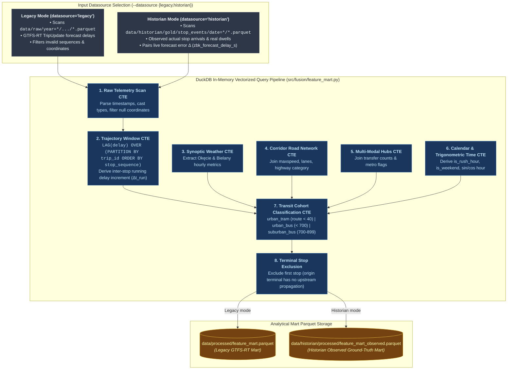
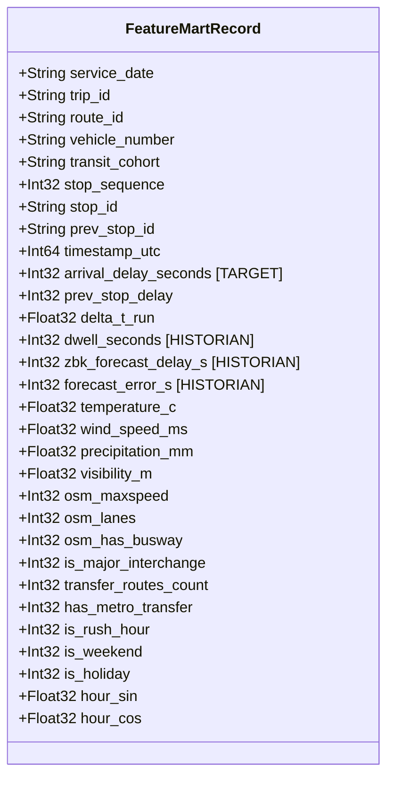

# Feature Mart Fusion: Dual-Datasource Vectorized Engine

The **Feature Mart Fusion Engine** ([`src/fusion/feature_mart.py`](file:///Users/truonggiangdo/Data/LearningMaterials/UW/Thesis/DelayTraffic/playground/src/fusion/feature_mart.py)) is an out-of-core, vectorized analytical processor built on top of [DuckDB](https://duckdb.org/). It unites transit telemetry streams with meteorological, topological, and calendar tables into a unified analytical feature store.

---

## ⚙️ Dual-Datasource Fusion Architecture

---

## 📐 Mathematical Delay Decomposition

At each transit stop $i$ along trip $k$, the Feature Mart decomposes delay propagation using window functions:

### 1. Cumulative Arrival Delay
$$\text{delay}_i = t_{\text{actual\_arrival}, i} - t_{\text{scheduled\_arrival}, i}$$

### 2. Upstream Propagation Delay ($\text{delay}_{i-1}$)
$$\text{prev\_stop\_delay} = \text{LAG}(\text{delay}_i, 1) \text{ OVER } (\text{PARTITION BY } k \text{ ORDER BY } \text{sequence})$$

### 3. Inter-Stop Section Delay Delta ($\Delta t_{\text{run}}$)
The pure incremental delay incurred strictly between stop $i-1$ and stop $i$ (stripping upstream shock):
$$\Delta t_{\text{run}} = \text{delay}_i - \text{prev\_stop\_delay}$$

### 4. Dwell Time ($\Delta t_{\text{dwell}}$) - Historian Observed Only
The real physical door-open boarding/alighting duration:
$$\Delta t_{\text{dwell}} = t_{\text{actual\_departure}, i} - t_{\text{actual\_arrival}, i}$$

### 5. Operator Forecast Error ($\Delta t_{\text{error}}$) - Historian Observed Only
The deviation between operator GTFS-RT forecast and ground-truth arrival:
$$\text{forecast\_error\_s} = \text{delay}_{\text{forecast}, i} - \text{delay}_{\text{observed}, i}$$

---

## 🗃️ Feature Mart Schema & Column Dictionary

---

## ⚡ Performance & Scalability Benchmark

Due to DuckDB's columnar execution and parallel scan capabilities:
- **Legacy Ingestion Mart**: Processes **1,000,000+ telemetry rows in $< 4.5\,\text{s}$** with zero disk spill.
- **Historian Mart**: Fuses **77,000+ stop events into `feature_mart_observed.parquet` in $0.21\,\text{s}$**.
- **Memory Footprint**: Streaming out-of-core execution allows processing large datasets with minimal RAM consumption.
