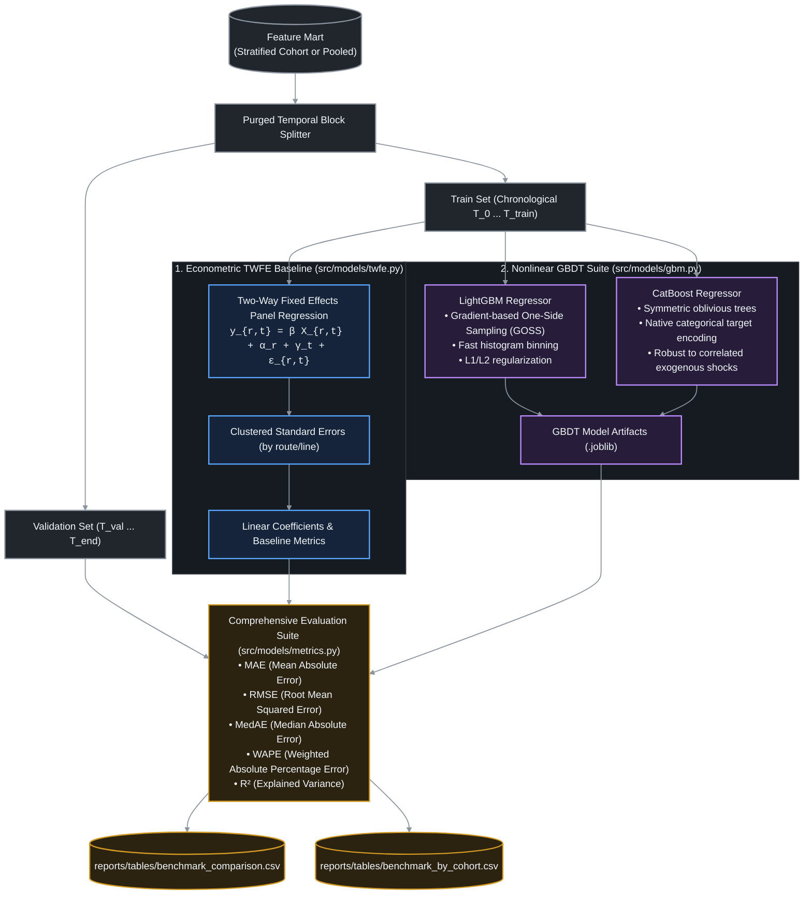
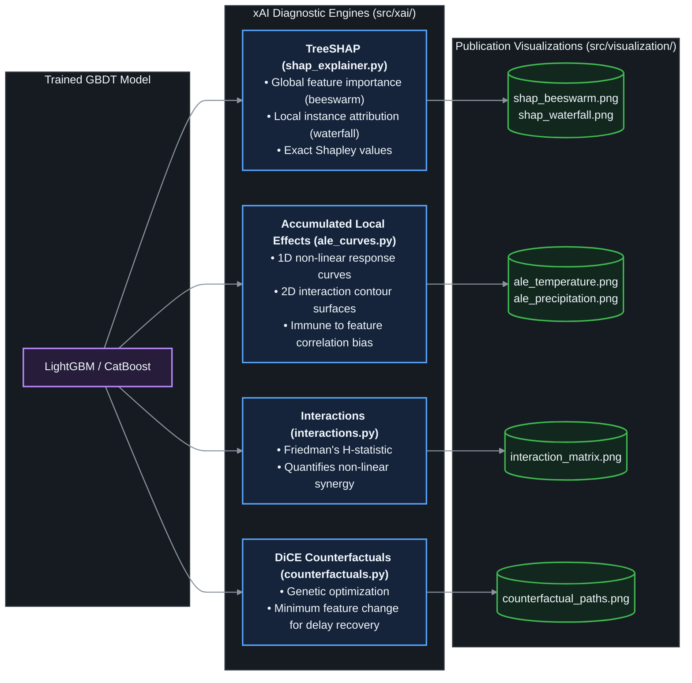

# Modeling Suite & Explainable AI (xAI) Architecture

This document details the econometric and machine learning modeling suite, the purged temporal block validation framework, and the explainable AI diagnostic pipeline.

---

## 🛡️ Purged Temporal Block Cross-Validation Framework

Transit delay data exhibits strong autocorrelation. Standard $K$-fold cross-validation or random train-test splitting introduces catastrophic **data leakage** because downstream stops on the same vehicle run appear in both train and test partitions.

To prevent leakage, [`src/models/validation.py`](file:///Users/truonggiangdo/Data/LearningMaterials/UW/Thesis/DelayTraffic/playground/src/models/validation.py) implements **Purged Temporal Block Splitting** with an **Adaptive Embargo Buffer**:

```mermaid
%%{init: {
  'theme': 'dark',
  'themeVariables': {
    'darkMode': true,
    'background': '#0d1117',
    'textColor': '#f0f6fc',
    'taskTextColor': '#ffffff',
    'activeTaskBkgColor': '#1f6feb',
    'doneTaskBkgColor': '#238636',
    'critBkgColor': '#da3633',
    'sectionBkgColor': '#161b22',
    'altSectionBkgColor': '#0d1117',
    'gridColor': '#30363d'
  }
}}%%
gantt
    title Purged Temporal Block Cross-Validation with Embargo Buffer
    dateFormat X
    axisFormat %s

    section Fold 1
    Train Block (e.g., 60% of time) :done, 0, 60
    Embargo Buffer (Purged Gap)     :crit, 60, 65
    Validation Block (e.g., 20%)    :active, 65, 85
    Test Block (Holdout)            :85, 100

    section Fold 2 (Expanding)
    Train Block (e.g., 70% of time) :done, 0, 70
    Embargo Buffer (Purged Gap)     :crit, 70, 75
    Validation Block (e.g., 15%)    :active, 75, 90
    Test Block (Holdout)            :90, 100
```

### Mathematical Zero-Leakage Guarantee
The system verifies that for every train index $i$ and validation index $j$:

$$\max_{i \in \text{Train}} \left(t_i\right) + \text{Embargo} \le \min_{j \in \text{Val}} \left(t_j\right)$$

- **Adaptive Embargo Scaling**: For standard datasets, the embargo is fixed at 15–30 minutes (covering maximum vehicle transit time across Warsaw). For short sample slices ($<4$ hours), the splitter dynamically scales the embargo to prevent fold starvation while maintaining the mathematical zero-leakage guarantee verified via `verify_no_leakage()`.

---

## 📈 Model Architecture & Benchmarking Tier

---

## 🔍 Explainable AI (xAI) Diagnostic Pipeline

### Diagnostic Capabilities
1. **TreeSHAP**: Measures the exact additive attribution of each exogenous feature (e.g., rainfall, wind, corridor speed limit) relative to baseline upstream delay.
2. **Accumulated Local Effects (ALE)**: Unlike Partial Dependence Plots (PDP) which extrapolate over impossible feature combinations (e.g., snow at $+30^\circ\text{C}$), ALE computes pure marginal effects conditional on the local feature distribution.
3. **Friedman's $H$-Statistic**: Discovers non-linear compounding effects—such as heavy rain exacerbating delays on narrow single-lane corridors ($H > 0.15$).
4. **DiCE Counterfactuals**: Provides urban transport planners with actionable questions: *"What minimal headway or schedule buffer adjustment would have prevented this trip from exceeding 3 minutes of delay under 15 mm/h rainfall?"*
