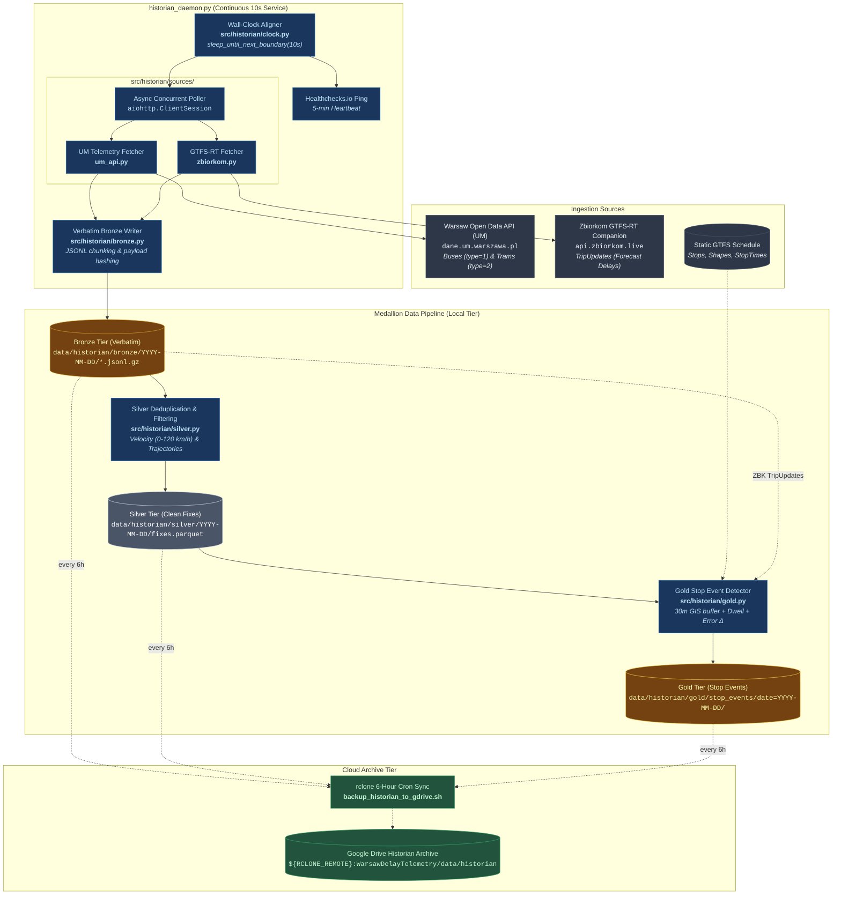
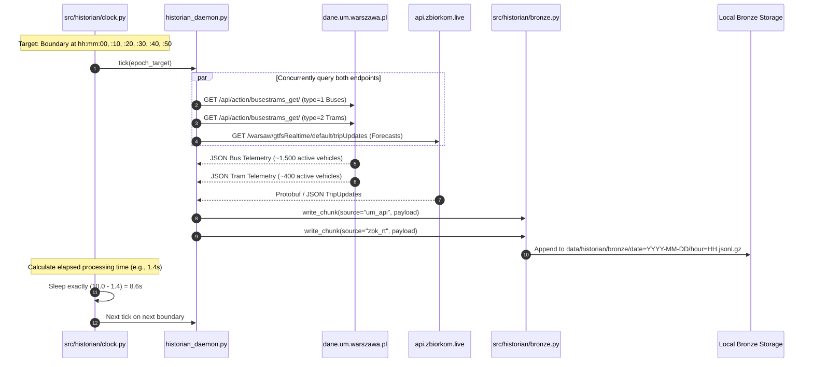
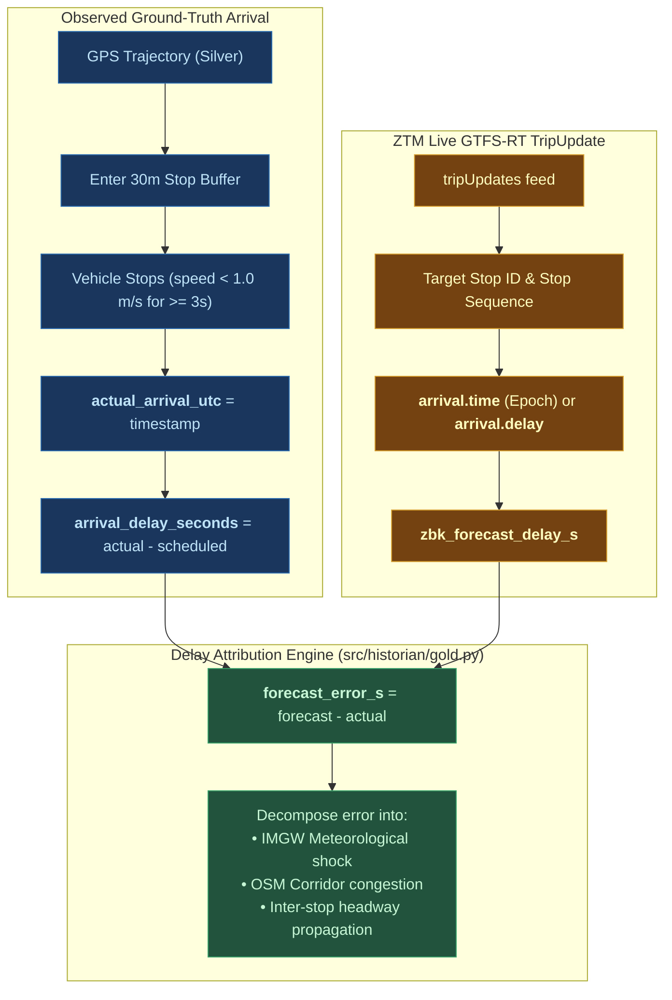

# Historian Observed Actuals Ingestion Pipeline

The **Historian Pipeline** is a next-generation, high-frequency public transit telemetry engine designed to solve the critical limitation of legacy GTFS-RT feeds: **the absence of ground-truth physical stop arrival, dwell time, and departure events**.

Operating on a strict **10-second wall-clock boundary**, the Historian captures raw vehicle positions directly from the Warsaw Municipal API (`dane.um.warszawa.pl`), pairs them with synchronized GTFS-RT dispatch forecasts, and processes them through an end-to-end **Medallion Data Architecture** (Bronze $\to$ Silver $\to$ Gold).

---

## 🏛️ Historian Architecture Overview

---

## ⏱️ Wall-Clock Synchronized Polling Cycle

Unlike standard background loops that use naive `time.sleep(10)`, the Historian uses precise **wall-clock interval synchronization** implemented in [`src/historian/clock.py`](file:///Users/truonggiangdo/Data/LearningMaterials/UW/Thesis/DelayTraffic/playground/src/historian/clock.py):

---

## 🎯 Ground-Truth Delay Attribution: Track B Forecast Error Matching

The Historian pipeline solves the delay attribution problem by explicitly pairing observed ground truth with live operator forecasts:

$$\text{Forecast Error} = \text{Delay}_{\text{forecast}} - \text{Delay}_{\text{observed}}$$

---

## 📁 Key Module Index
- [`historian_daemon.py`](file:///Users/truonggiangdo/Data/LearningMaterials/UW/Thesis/DelayTraffic/playground/historian_daemon.py) - Master 10s daemon loop and signal orchestrator.
- [`src/historian/clock.py`](file:///Users/truonggiangdo/Data/LearningMaterials/UW/Thesis/DelayTraffic/playground/src/historian/clock.py) - Sub-second precision wall-clock boundary scheduler.
- [`src/historian/sources/um_api.py`](file:///Users/truonggiangdo/Data/LearningMaterials/UW/Thesis/DelayTraffic/playground/src/historian/sources/um_api.py) - Warsaw Open Data API client with vehicle type normalization.
- [`src/historian/sources/zbiorkom.py`](file:///Users/truonggiangdo/Data/LearningMaterials/UW/Thesis/DelayTraffic/playground/src/historian/sources/zbiorkom.py) - Companion GTFS-RT TripUpdates poller.
- [`src/historian/bronze.py`](file:///Users/truonggiangdo/Data/LearningMaterials/UW/Thesis/DelayTraffic/playground/src/historian/bronze.py) - Verbatim JSONL storage writer with gzip compression and SHA256 integrity.
- [`src/historian/silver.py`](file:///Users/truonggiangdo/Data/LearningMaterials/UW/Thesis/DelayTraffic/playground/src/historian/silver.py) - Trajectory cleaning, speed thresholding, and Parquet conversion.
- [`src/historian/gold.py`](file:///Users/truonggiangdo/Data/LearningMaterials/UW/Thesis/DelayTraffic/playground/src/historian/gold.py) - Spatial GIS buffer stop event detection, dwell time calculation, and forecast error pairing.
