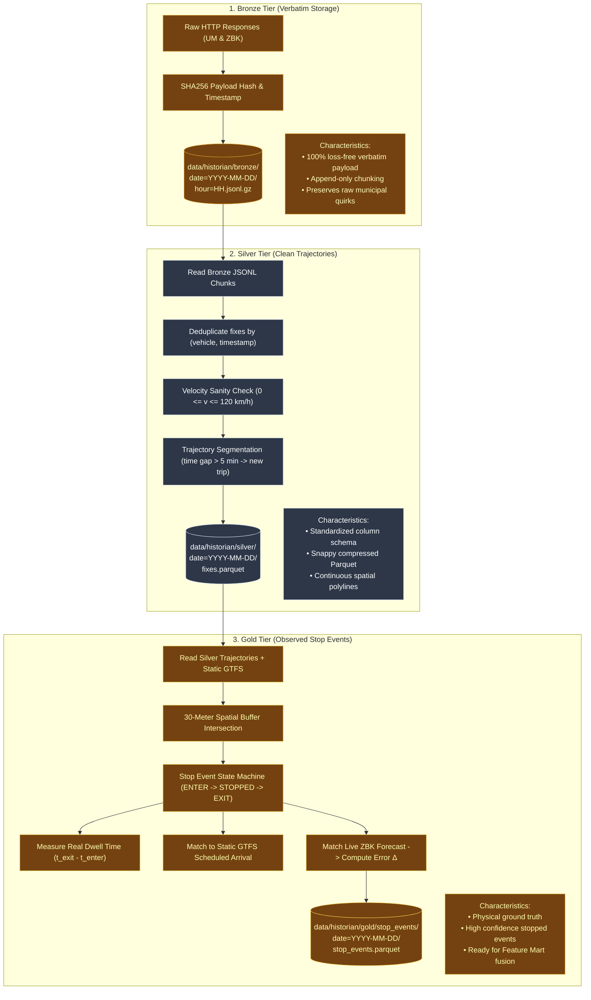
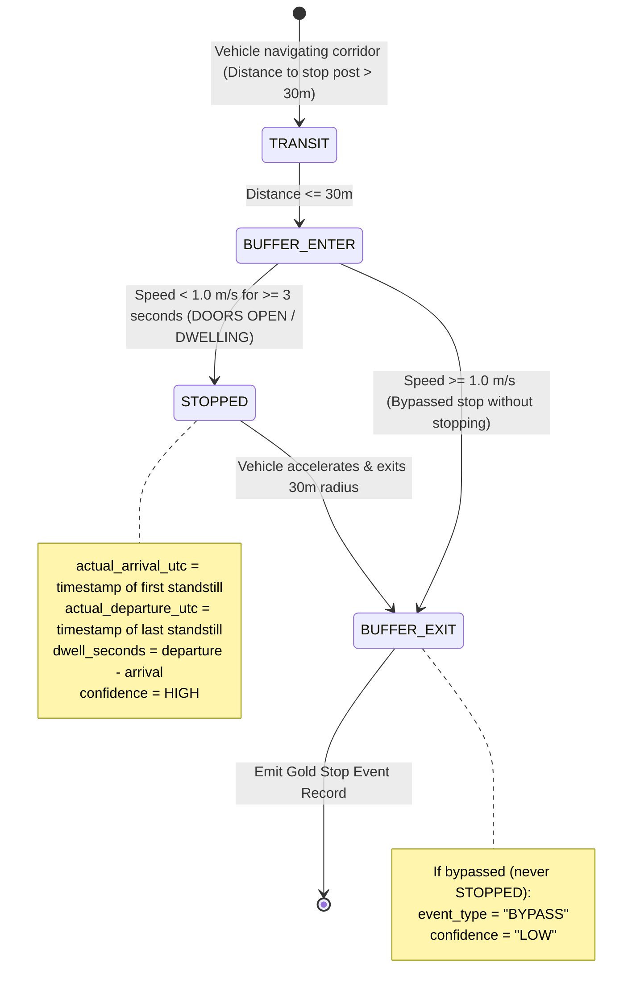

# Historian Pipeline: Medallion Architecture Deep Dive

The **Medallion Data Architecture** (Bronze $\to$ Silver $\to$ Gold) progressively cleans, deduplicates, and elevates raw transit GPS telemetry into high-value physical stop events ready for econometric analysis and ML attribution.

---

## 🥇 Medallion Architecture Overview

---

## 🚦 Stop Event Detection: Finite State Machine (FSM)

The Gold layer uses a spatial-temporal state machine to reliably detect vehicle stop events at designated transit posts:

---

## 📊 Medallion Tier Data Schemas

### Silver: `fixes.parquet`
| Column | Type | Description |
| :--- | :--- | :--- |
| `timestamp_utc` | `INT64` | Observation epoch timestamp |
| `vehicle_number` | `STRING` | Fleet vehicle ID (`"1001"`, `"3120"`) |
| `vehicle_type` | `STRING` | `"bus"` or `"tram"` |
| `line` | `STRING` | Route identifier (`"190"`, `"4"`, `"509"`) |
| `brigade` | `STRING` | Shift/brigade number |
| `lat` | `FLOAT64` | WGS84 Latitude |
| `lon` | `FLOAT64` | WGS84 Longitude |
| `speed_kmh` | `FLOAT32` | Calculated velocity between consecutive fixes |
| `distance_delta_m` | `FLOAT32` | Displacement from preceding fix |

---

### Gold: `stop_events.parquet`
| Column | Type | Description |
| :--- | :--- | :--- |
| `service_date` | `STRING` | Service date (`"YYYY-MM-DD"`) |
| `trip_id` | `STRING` | Matched GTFS trip identifier |
| `route_id` | `STRING` | Route number |
| `vehicle_number` | `STRING` | Fleet vehicle ID |
| `stop_sequence` | `INT32` | Stop position along the route |
| `stop_id` | `STRING` | ZTM stop post identifier (`"700201"`) |
| `stop_name` | `STRING` | Polish stop name (`"Dw. Centralny 01"`) |
| `scheduled_arrival_utc`| `INT64` | GTFS schedule timetable arrival epoch |
| `actual_arrival_utc` | `INT64` | **Observed physical arrival epoch** |
| `actual_departure_utc`| `INT64` | **Observed physical departure epoch** |
| `arrival_delay_seconds`| `INT32` | Ground truth arrival delay ($s$) |
| `dwell_seconds` | `INT32` | Measured dwell time at stop ($s$) |
| `zbk_forecast_delay_s`| `INT32` | Operator GTFS-RT forecast delay ($s$) |
| `forecast_error_s` | `INT32` | **Forecast Error: $\text{Delay}_{\text{forecast}} - \text{Delay}_{\text{observed}}$** |
| `event_type` | `STRING` | `"STOPPED"` vs `"BYPASS"` |
| `confidence` | `STRING` | `"HIGH"`, `"MEDIUM"`, `"LOW"` |
| `min_distance_to_stop_m`| `FLOAT32`| Distance of closest approach to stop pole ($m$) |
