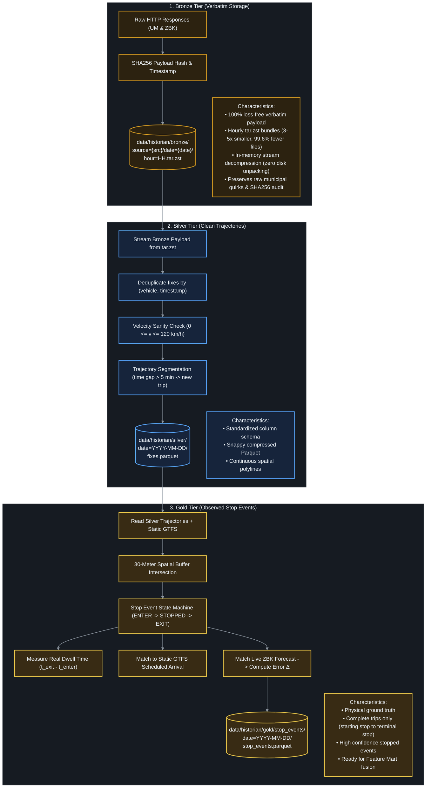
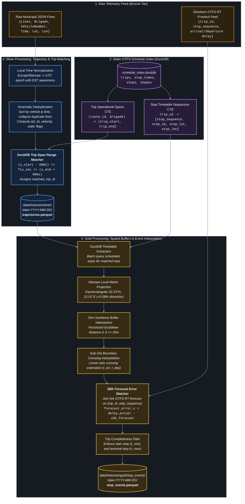
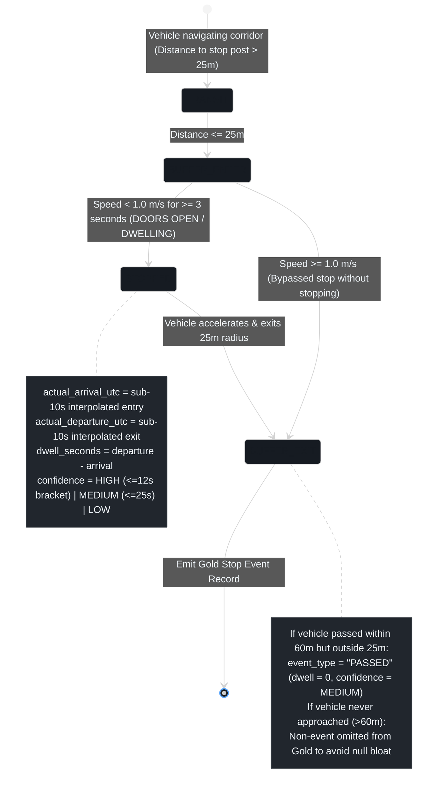

# Historian Pipeline: Medallion Architecture Deep Dive

The **Medallion Data Architecture** (Bronze $\to$ Silver $\to$ Gold) progressively cleans, deduplicates, and elevates raw transit GPS telemetry into high-value physical stop events ready for econometric analysis and ML attribution.

---

## 🥇 Medallion Architecture Overview



---

## 🔄 Database & Spatial Matching Engine: Raw Data (Bronze) → Silver → Gold

Raw municipal GPS telemetry polled from `dane.um.warszawa.pl` is purely observational: it contains vehicle IDs, route numbers, brigade codes, local timestamps, and raw coordinates, but **zero transit schedule context** (no `trip_id`, no `stop_id`, no scheduled timetable arrival targets).

To convert unindexed telemetry into high-value physical stop events, the Historian executes a multi-stage **database matching and geometric referencing pipeline** powered by an embedded [DuckDB](https://duckdb.org/) schedule index.



---

### 🔍 Step-by-Step Matching Mechanics

#### 1. Static Schedule DuckDB Indexing
During weekly GTFS synchronization, [`src/historian/static_gtfs.py`](file:///Users/truonggiangdo/Data/LearningMaterials/UW/Thesis/DelayTraffic/playground/src/historian/static_gtfs.py) builds `schedule_index.duckdb` directly from static GTFS text archives. Indexes are established on `trips(route_id, brigade, trip_id)` and `stop_times(trip_id, stop_sequence, stop_id)`.

#### 2. Raw to Silver: Brigade-to-Trip Database Matching
Raw fixes from `dane.um.warszawa.pl` supply the operational dispatch keys `(route_id, brigade)`. In [`src/historian/silver.py`](file:///Users/truonggiangdo/Data/LearningMaterials/UW/Thesis/DelayTraffic/playground/src/historian/silver.py), the processor executes an analytical group query against DuckDB:

```sql
SELECT
    t.trip_id,
    t.route_id,
    t.brigade,
    MIN(st.departure_time) AS trip_start,
    MAX(st.arrival_time) AS trip_end
FROM trips t
JOIN stop_times st ON t.trip_id = st.trip_id
WHERE t.brigade IS NOT NULL
GROUP BY t.trip_id, t.route_id, t.brigade;
```

Timetable strings are converted to seconds since midnight ($s_{\text{start}}, s_{\text{end}}$). Each raw GPS fix at timestamp $t_{\text{fix}}$ (in seconds of day) is matched to the active trip using an asymmetric operational time window:
$$(s_{\text{start}} - 600\,\text{s}) \le t_{\text{fix}} \le (s_{\text{end}} + 900\,\text{s})$$
- **$-600\,\text{s}$ (10 min pre-departure buffer)**: Captures early vehicle staging at origin stands.
- **$+900\,\text{s}$ (15 min post-arrival buffer)**: Accounts for cumulative congestion delays without misattributing pings to deadhead returns.
Fixes matching this criteria receive an authoritative `matched_trip_id`.

#### 3. Silver to Gold: Timetable Extraction & Local Metric Projection
In [`src/historian/gold.py`](file:///Users/truonggiangdo/Data/LearningMaterials/UW/Thesis/DelayTraffic/playground/src/historian/gold.py), all scheduled stops for matched trips are pulled via parameterized query:

```sql
SELECT
    st.trip_id,
    st.stop_sequence,
    st.stop_id,
    st.arrival_time,
    st.departure_time,
    s.stop_name,
    s.stop_lat,
    s.stop_lon
FROM stop_times st
JOIN stops s ON st.stop_id = s.stop_id
WHERE st.trip_id IN (?)
ORDER BY st.trip_id, st.stop_sequence;
```

To eliminate costly spherical trigonometry across millions of GPS fixes, coordinates are projected to a **local Euclidean metric plane** centered on the Warsaw centroid ($52.23^\circ\text{N}, 21.01^\circ\text{E}$) with $<0.08\%$ distortion:
$$x = (\lambda - 21.01^\circ) \times 68,325.49\,\text{m/deg}$$
$$y = (\phi - 52.23^\circ) \times 111,271.72\,\text{m/deg}$$

Vectorized Euclidean metric distance to stop post $(s_x, s_y)$:
$$d_k = \sqrt{(x_k - s_x)^2 + (y_k - s_y)^2}$$

#### 4. Sub-10s Stop Boundary Interpolation
Because the ingestion grid operates at 10-second intervals, vehicles often cross the stop geofence ($R = 25.0\,\text{m}$) between discrete GPS pings. Linear boundary interpolation calculates the exact continuous sub-10s crossing instant:

Given fix $(t_{\text{out}}, d_{\text{out}})$ outside the buffer and $(t_{\text{in}}, d_{\text{in}})$ inside:
$$\text{ratio} = \frac{d_{\text{out}} - R}{d_{\text{out}} - d_{\text{in}}}$$
$$t_{\text{boundary}} = t_{\text{out}} + \text{ratio} \cdot (t_{\text{in}} - t_{\text{out}})$$

- **Physical Arrival Epoch**: $t_{\text{actual\_arrival}} = \text{round}(t_{\text{boundary, entry}})$
- **Physical Departure Epoch**: $t_{\text{actual\_departure}} = \text{round}(t_{\text{boundary, exit}})$
- **Measured Dwell Duration**: $\Delta t_{\text{dwell}} = \max(0, t_{\text{actual\_departure}} - t_{\text{actual\_arrival}})$
- **Ground-Truth Delay**: $\text{arrival\_delay\_seconds} = t_{\text{actual\_arrival}} - t_{\text{scheduled\_arrival}}$

#### 5. Live GTFS-RT Companion Forecast Matching
The Historian concurrently ingests raw `zbk_rt` GTFS-RT Protobuf feeds from `api.zbiorkom.live`. Stop events are cross-referenced by composite key `(trip_id, stop_sequence)` to extract the operator's predicted delay at that exact moment:
$$\text{forecast\_error\_s} = \text{arrival\_delay\_seconds} - \text{zbk\_forecast\_delay\_s}$$
This isolates pure operator prediction error from underlying physical road congestion.

---

## 🚦 Stop Event Detection: Finite State Machine (FSM)

The Gold layer uses a spatial-temporal state machine to reliably detect vehicle stop events at designated transit posts:



### 🎯 Trip Completeness Invariant (Start-to-Terminal Filtering)

To guarantee statistically unbiased dwell times and valid autoregressive lag features for downstream modeling:
- **Starting Stop Requirement**: The trip's scheduled initial stop ($s_{\min} = \min(\text{stop\_sequence})$ in GTFS) must be observed (`STOPPED` or `PASSED`).
- **Terminal Stop Requirement**: The trip's scheduled final destination ($s_{\max} = \max(\text{stop\_sequence})$ in GTFS) must be observed (`STOPPED` or `PASSED`).
- **Incomplete Trip Exclusion**: Partial or truncated trips (e.g., trips clipped mid-route by ingestion startup or shutdown) are dropped from Gold storage. This guarantees downstream Feature Mart fusion operates exclusively on end-to-end trips with authentic origin-to-destination progression.

---

## 📊 Medallion Tier Data Schemas

### Silver: `trajectories.parquet`
Location: `data/historian/silver/date=YYYY-MM-DD/trajectories.parquet`

| Column | Type | Description |
| :--- | :--- | :--- |
| `service_date` | `STRING` | Operational service date (`"YYYY-MM-DD"`) |
| `vehicle_type` | `STRING` | Vehicle mode (`"bus"` or `"tram"`) |
| `vehicle_number` | `STRING` | Municipal fleet vehicle identifier (`"1001"`, `"3120"`) |
| `route_id` | `STRING` | Route identifier (`"190"`, `"4"`, `"509"`) |
| `brigade` | `STRING` | Operational shift/brigade number |
| `lat` | `FLOAT64` | WGS84 Latitude |
| `lon` | `FLOAT64` | WGS84 Longitude |
| `gps_timestamp_utc` | `INT64` | Normalized GPS fix epoch timestamp (UTC) |
| `gps_time_str` | `STRING` | Original municipal Warsaw local timestamp string |
| `tick_ts` | `INT64` | 10s wall-clock poller cycle epoch timestamp |
| `delta_t_s` | `FLOAT32` | Elapsed time from preceding vehicle fix ($s$) |
| `delta_d_m` | `FLOAT32` | Euclidean metric displacement from preceding fix ($m$) |
| `speed_mps` | `FLOAT32` | Computed kinematic velocity ($m/s$) |
| `is_static` | `BOOL` | True if vehicle is stationary ($v < 0.5\,\text{m/s}$ and $\Delta d < 5\,\text{m}$) |
| `n_ticks_seen` | `INT32` | Count of identical consecutive raw pings collapsed |
| `matched_trip_id` | `STRING` | Authoritative GTFS static trip identifier matched via DuckDB |

---

### Gold: `stop_events.parquet`
Location: `data/historian/gold/stop_events/date=YYYY-MM-DD/stop_events.parquet`

| Column | Type | Description |
| :--- | :--- | :--- |
| `service_date` | `STRING` | Service date (`"YYYY-MM-DD"`) |
| `trip_id` | `STRING` | Matched GTFS trip identifier |
| `route_id` | `STRING` | Route number |
| `brigade` | `STRING` | Shift/brigade number |
| `vehicle_number` | `STRING` | Fleet vehicle ID |
| `vehicle_type` | `STRING` | Vehicle mode (`"bus"` or `"tram"`) |
| `stop_sequence` | `INT32` | Ordered stop sequence along trip |
| `stop_id` | `STRING` | Warsaw ZTM stop post identifier (`"700201"`) |
| `stop_name` | `STRING` | Polish stop name (`"Dw. Centralny 01"`) |
| `scheduled_arrival_utc`| `INT64` | Timetable scheduled arrival epoch (UTC) |
| `scheduled_departure_utc`| `INT64` | Timetable scheduled departure epoch (UTC) |
| `actual_arrival_utc` | `INT64` | **Observed physical arrival epoch** via sub-10s interpolation |
| `actual_departure_utc`| `INT64` | **Observed physical departure epoch** via sub-10s interpolation |
| `arrival_delay_seconds`| `INT32` | Ground truth arrival delay ($s$) ($t_{\text{actual\_arr}} - t_{\text{sched\_arr}}$) |
| `departure_delay_seconds`| `INT32`| Ground truth departure delay ($s$) ($t_{\text{actual\_dep}} - t_{\text{sched\_dep}}$) |
| `dwell_seconds` | `INT32` | Measured dwell time at stop ($s$) ($\max(0, t_{\text{dep}} - t_{\text{arr}})$) |
| `zbk_forecast_delay_s`| `INT32` | Operator live GTFS-RT forecast delay ($s$) |
| `forecast_error_s` | `INT32` | **Forecast Error: $\text{Delay}_{\text{actual}} - \text{Delay}_{\text{forecast}}$** |
| `event_type` | `STRING` | `"STOPPED"` (served stop) vs `"PASSED"` (bypassed corridor) |
| `confidence` | `STRING` | `"HIGH"` ($\le 12\text{s}$ bracket), `"MEDIUM"` ($\le 25\text{s}$), `"LOW"` |
| `min_distance_to_stop_m`| `FLOAT32`| Distance of closest approach to stop pole ($m$) |

