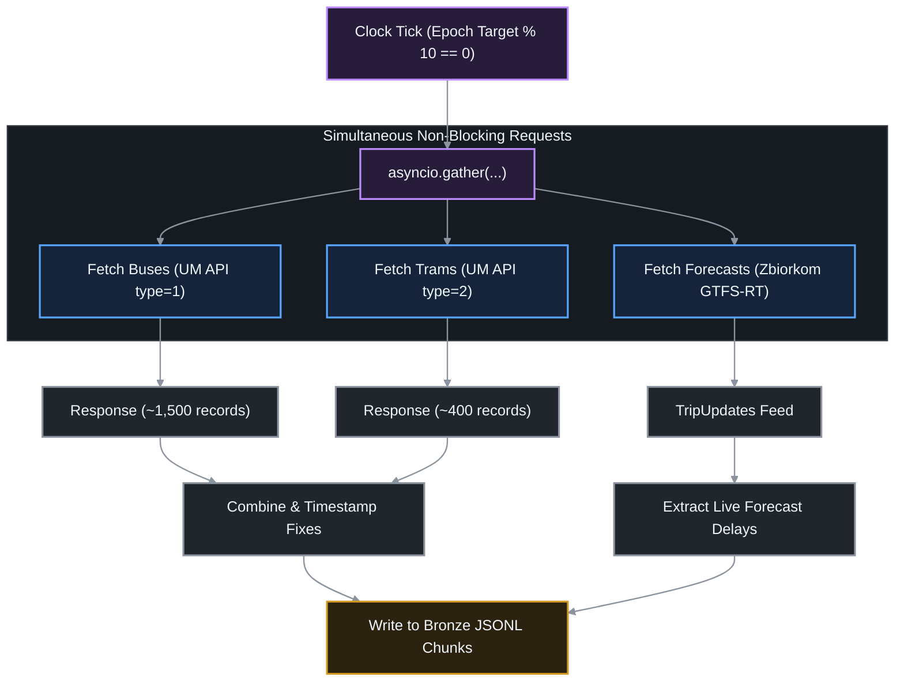
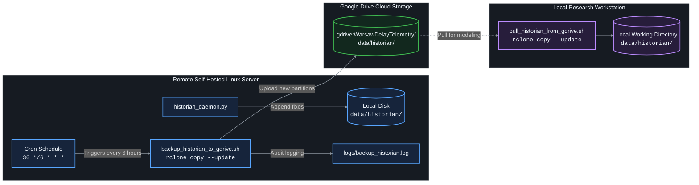

# Historian Pipeline: Synchronization & Operations Protocol

This document outlines the synchronization mechanics, concurrency model, and automated cloud backup lifecycle of the **Historian Telemetry Ingestion Pipeline**.

---

## ⏱️ Wall-Clock Boundary Alignment Engine

Standard polling loops suffer from **clock drift**: executing an HTTP fetch and data serialization consumes an unpredictable duration ($\delta t \approx 0.5 - 3.5\,\text{s}$). If a loop relies on static `sleep(10)`, the polling phase drifts continuously relative to the real world:

$$\text{Drift Accumulation: } t_{k} = t_0 + k \cdot 10 + \sum_{i=1}^k \delta t_i$$

To eliminate drift, [`src/historian/clock.py`](file:///Users/truonggiangdo/Data/LearningMaterials/UW/Thesis/DelayTraffic/playground/src/historian/clock.py) dynamically aligns every execution to absolute **POSIX wall-clock epochs**:

$$t_{\text{next\_target}} = \lceil t_{\text{current}} / 10 \rceil \times 10$$
$$\text{sleep\_duration} = \max\left(0.01, t_{\text{next\_target}} - t_{\text{current}}\right)$$

```mermaid
%%{init: {
  'theme': 'dark',
  'themeVariables': {
    'darkMode': true,
    'background': '#0d1117',
    'textColor': '#f0f6fc',
    'taskTextColor': '#ffffff',
    'activeTaskBkgColor': '#1f6feb',
    'doneTaskBkgColor': '#238636',
    'critBkgColor': '#da3633',
    'sectionBkgColor': '#161b22',
    'altSectionBkgColor': '#0d1117',
    'gridColor': '#30363d'
  }
}}%%
gantt
    title Strict 10-Second Wall Clock Alignment vs. Drifting Sleep
    dateFormat X
    axisFormat %s

    section Drifting (Naive sleep)
    Poll 1 (1.5s fetch)      :a1, 0, 1.5
    Sleep 10s                :a2, after a1, 10s
    Poll 2 (2.2s fetch)      :a3, after a2, 2.2s
    Sleep 10s                :a4, after a3, 10s

    section Aligned (Historian)
    Poll 1 (Target: 00s)     :b1, 0, 1.5
    Sleep (10 - 1.5 = 8.5s)  :b2, after b1, 8.5s
    Poll 2 (Target: 10s)     :b3, 10, 12.2
    Sleep (20 - 12.2 = 7.8s) :b4, after b3, 7.8s
    Poll 3 (Target: 20s)     :b5, 20, 21.2
```

---

## ⚡ Concurrency & Asynchronous I/O Model

The ingestion daemon leverages Python's `asyncio` and `aiohttp` to poll the Warsaw Open Data API (buses and trams) alongside the Zbiorkom GTFS-RT companion concurrently:

---

## ☁️ Cloud Synchronization & Backup Architecture

To ensure zero local disk saturation and complete disaster recovery, telemetry data is backed up to Google Drive every 6 hours using `rclone`:

### Backup Script Guarantees:
- **`--update`**: Only copies files where modification time is newer or file size differs, drastically reducing network bandwidth and avoiding redownloads.
- **Atomic Log Rotation**: All stdout and stderr output is piped to `logs/backup_historian.log` with timestamps for remote monitoring.
- **Zero Ingestion Interruption**: Ingestion daemon writes to disk independently of the backup process, preventing I/O lock contention.
