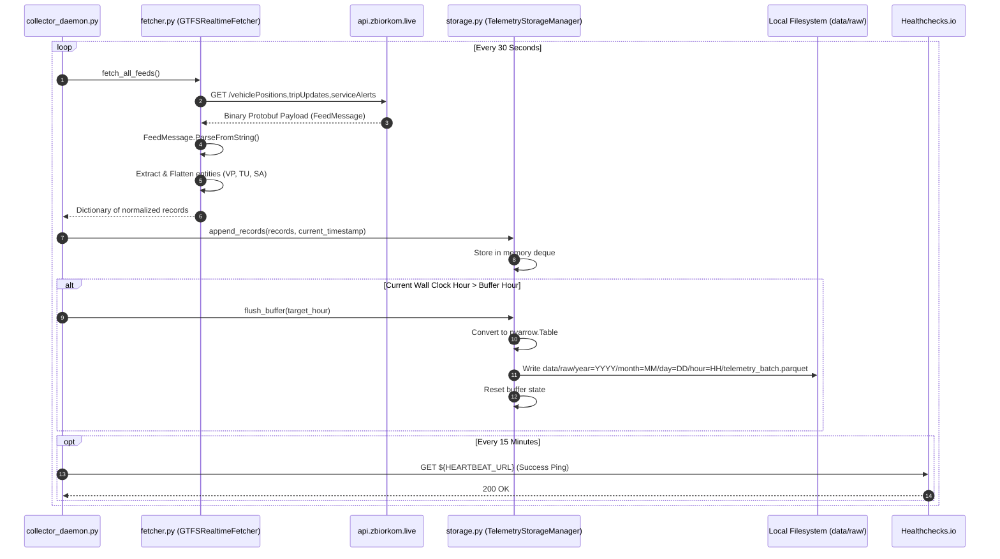
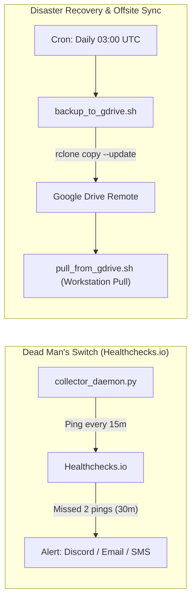

# Legacy GTFS-RT Telemetry Ingestion Pipeline

The **Legacy Ingestion Pipeline** is a continuous 24/7 telemetry ingestion engine running in production on a remote self-hosted Linux server. It polls GTFS-Realtime Protobuf feeds every 30 seconds from `api.zbiorkom.live`, normalizes vehicle positions and delay estimates, buffers records in memory, and writes partitioned Parquet files on an hourly boundary.

---

## 🏛️ Pipeline Overview & Architecture

```mermaid
flowchart TD
    subgraph External ["External Provider"]
        Endpoint["GTFS-RT Warsaw Endpoint<br/><code>https://api.zbiorkom.live/api6-open/warsaw/gtfsRealtime/default/...</code>"]
        StaticRepo["ZTM Static GTFS Repository<br/><code>https://mkuran.pl/gtfs/warsaw.zip</code>"]
    end

    subgraph DaemonProcess ["collector_daemon.py (Continuous Background Process)"]
        direction TB
        Timer["Loop Timer (30s Polling Cycle)"]
        
        subgraph FetcherSub ["src/ingestion/fetcher.py"]
            HTTPClient["Async/HTTP Request Client<br/><b>GTFSRealtimeFetcher</b>"]
            ProtoParser["Google Protobuf Parser<br/><code>FeedMessage.ParseFromString()</code>"]
            EntityFilter["Entity Classifier<br/><i>VehiclePositions | TripUpdates | Alerts</i>"]
        end

        subgraph StorageSub ["src/ingestion/storage.py"]
            MemBuffer["Thread-Safe In-Memory Buffer<br/><b>TelemetryStorageManager</b>"]
            HourDetector{"Hour Changed or<br/>Buffer Limit Reached?"}
            BatchWriter["PyArrow Parquet Batch Writer<br/><code>to_parquet(compression='snappy')</code>"]
        end

        subgraph StaticSub ["src/ingestion/gtfs_manager.py"]
            StaticArchiver["Weekly Static GTFS Archiver<br/><b>GTFSManager</b>"]
            HashCheck{"Archive Changed?"}
            ZipStore[("data/raw/static_gtfs/<br/>warsaw_YYYYWW.zip")]
        end

        Heartbeat["Healthchecks.io Ping<br/><i>15-min Dead Man's Switch</i>"]
    end

    subgraph LocalStorage ["Local File System Tier"]
        RawParquet[("data/raw/<br/>year=YYYY/<br/>month=MM/<br/>day=DD/<br/>hour=HH/*.parquet")]
    end

    subgraph CloudBackup ["Cloud Disaster Recovery"]
        Rclone["rclone Sync Job<br/><i>Daily 03:00 UTC via backup_to_gdrive.sh</i>"]
        GDrive[("Google Drive Backup<br/><code>${RCLONE_REMOTE}:WarsawDelayTelemetry/data/raw</code>")]
    end

    %% Wiring
    Endpoint -->|HTTP GET (30s)| HTTPClient
    StaticRepo -->|Weekly Poll| StaticArchiver
    StaticArchiver --> HashCheck
    HashCheck -->|New hash| ZipStore

    Timer --> HTTPClient
    HTTPClient --> ProtoParser
    ProtoParser --> EntityFilter
    EntityFilter -->|Normalized Dicts| MemBuffer
    
    MemBuffer --> HourDetector
    HourDetector -->|Yes| BatchWriter
    BatchWriter --> RawParquet
    
    Timer --> Heartbeat
    RawParquet -.->|Nightly Cron| Rclone
    Rclone -.-> GDrive

    %% Styles
    classDef extNode fill:#2d3748,stroke:#4a5568,color:#edf2f7;
    classDef daemonNode fill:#1a365d,stroke:#2b6cb0,color:#bee3f8;
    classDef storeNode fill:#744210,stroke:#d69e2e,color:#fefcbf;
    classDef cloudNode fill:#22543d,stroke:#38a169,color:#c6f6d5;

    class Endpoint,StaticRepo extNode;
    class Timer,HTTPClient,ProtoParser,EntityFilter,MemBuffer,HourDetector,BatchWriter,StaticArchiver,HashCheck,Heartbeat daemonNode;
    class RawParquet,ZipStore storeNode;
    class Rclone,GDrive cloudNode;
```

---

## 🔄 Sequence Diagram: 30-Second Ingestion Loop

The interaction between the ingestion daemon, protobuf fetcher, in-memory buffer, and local storage is shown below:



---

## 📁 Directory & Partition Layout

The storage engine writes partitioned Parquet files following the standard Apache Hive convention:

```text
data/raw/
├── static_gtfs/
│   ├── warsaw_202615.zip          <- Weekly static GTFS snapshots
│   └── warsaw_202616.zip
└── year=2026/
    └── month=10/
        ├── day=17/
        │   ├── hour=00/
        │   │   └── telemetry_20261017_000000.parquet
        │   ├── hour=01/
        │   └── ...
        └── day=18/
            ├── hour=14/
            │   └── telemetry_20261018_140000.parquet
            └── hour=15/
```

---

## 🛡️ Reliability & Operational Protocols



### Key Python Module References
- [`collector_daemon.py`](file:///Users/truonggiangdo/Data/LearningMaterials/UW/Thesis/DelayTraffic/playground/collector_daemon.py) - Master continuous loop and signal handlers (`SIGTERM`, `SIGINT`).
- [`src/ingestion/fetcher.py`](file:///Users/truonggiangdo/Data/LearningMaterials/UW/Thesis/DelayTraffic/playground/src/ingestion/fetcher.py) - HTTP request handling, retry exponential backoff, and GTFS-RT Protobuf parser.
- [`src/ingestion/storage.py`](file:///Users/truonggiangdo/Data/LearningMaterials/UW/Thesis/DelayTraffic/playground/src/ingestion/storage.py) - Deque buffer management and Parquet file serialization.
- [`src/ingestion/gtfs_manager.py`](file:///Users/truonggiangdo/Data/LearningMaterials/UW/Thesis/DelayTraffic/playground/src/ingestion/gtfs_manager.py) - Weekly MD5-verified static GTFS archiver.
