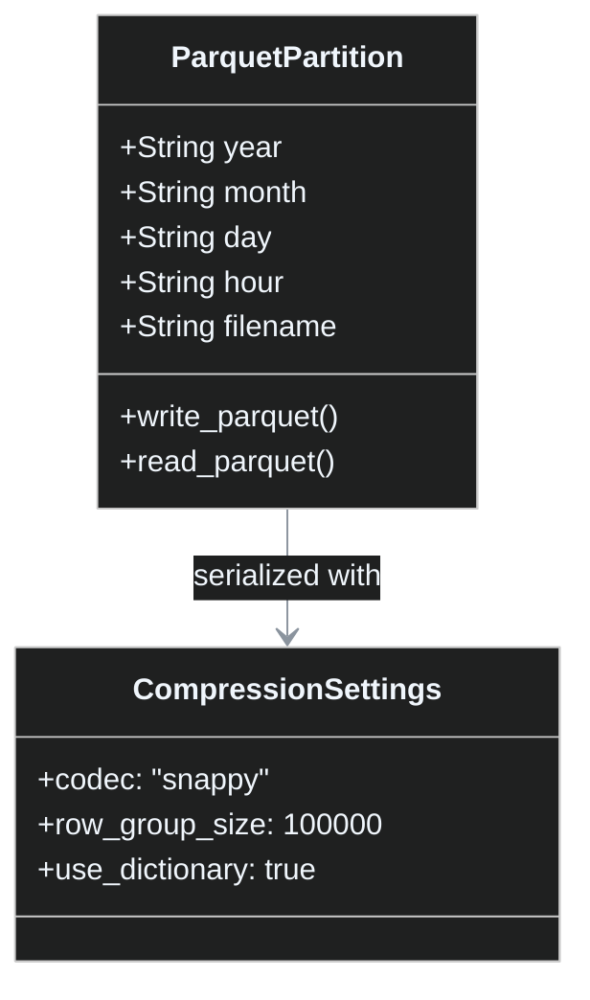

# Legacy Telemetry Ingestion: Data Flow & Entity Schemas

This document details the internal data flow, protobuf message transformation, entity schemas, and storage lifecycle of the **Legacy Telemetry Ingestion Pipeline**.

---

## 🔀 End-to-End Data Transformation Flow

```mermaid
%%{init: {
  'theme': 'dark',
  'themeVariables': {
    'darkMode': true,
    'background': '#0d1117',
    'mainBkg': '#161b22',
    'primaryColor': '#1f2937',
    'primaryTextColor': '#f0f6fc',
    'primaryBorderColor': '#58a6ff',
    'lineColor': '#8b949e',
    'secondaryColor': '#161b22',
    'tertiaryColor': '#21262d',
    'clusterBkg': '#161b22',
    'clusterBorder': '#30363d',
    'edgeLabelBackground': '#161b22'
  }
}}%%
flowchart LR
    subgraph RemoteEndpoints ["Remote GTFS-RT Protobuf Feeds"]
        VP_Feed["VehiclePositions Feed<br/><i>entity.vehicle</i>"]
        TU_Feed["TripUpdates Feed<br/><i>entity.trip_update</i>"]
        SA_Feed["ServiceAlerts Feed<br/><i>entity.alert</i>"]
    end

    subgraph Normalization ["In-Memory Parsing & Flattening (src/ingestion/fetcher.py)"]
        Parser["Google Protobuf Deserializer<br/><code>gtfs_realtime_pb2.FeedMessage</code>"]
        Flattener["Record Normalizer & Timestamp Aligner"]
    end

    subgraph EntityTables ["Intermediate In-Memory Tables"]
        VP_Rec["VehiclePosition Record<br/><i>trip_id, vehicle_id, lat, lon, speed, bearing</i>"]
        TU_Rec["TripUpdate Record<br/><i>trip_id, stop_sequence, arrival_delay, departure_delay</i>"]
        SA_Rec["ServiceAlert Record<br/><i>alert_id, cause, effect, header_text</i>"]
    end

    subgraph PartitionTier ["Parquet Storage Tier (src/ingestion/storage.py)"]
        ArrowTable["PyArrow Table Construction"]
        SnappyWriter["Snappy Parquet Serialization"]
        DiskFile[("data/raw/year=YYYY/month=MM/day=DD/hour=HH/<br/>telemetry_batch.parquet")]
    end

    VP_Feed --> Parser
    TU_Feed --> Parser
    SA_Feed --> Parser

    Parser --> Flattener
    Flattener --> VP_Rec
    Flattener --> TU_Rec
    Flattener --> SA_Rec

    VP_Rec --> ArrowTable
    TU_Rec --> ArrowTable
    SA_Rec --> ArrowTable

    ArrowTable --> SnappyWriter --> DiskFile

    %% Subgraph Styling
    style RemoteEndpoints fill:#161b22,stroke:#30363d,stroke-width:1.5px,color:#f0f6fc
    style Normalization fill:#161b22,stroke:#30363d,stroke-width:1.5px,color:#f0f6fc
    style EntityTables fill:#161b22,stroke:#30363d,stroke-width:1.5px,color:#f0f6fc
    style PartitionTier fill:#161b22,stroke:#30363d,stroke-width:1.5px,color:#f0f6fc

    %% Node Styling
    classDef remoteNode fill:#16243b,stroke:#58a6ff,stroke-width:2px,color:#f0f6fc;
    classDef parseNode fill:#271d3b,stroke:#bc8cff,stroke-width:2px,color:#f0f6fc;
    classDef tableNode fill:#21262d,stroke:#8b949e,stroke-width:2px,color:#f0f6fc;
    classDef storeNode fill:#2c2210,stroke:#d29922,stroke-width:2px,color:#f0f6fc;

    linkStyle default stroke:#8b949e,stroke-width:1.5px;

    class VP_Feed,TU_Feed,SA_Feed remoteNode;
    class Parser,Flattener parseNode;
    class VP_Rec,TU_Rec,SA_Rec,ArrowTable,SnappyWriter tableNode;
    class DiskFile storeNode;
```

---

## 📋 Entity Schemas

### 1. `VehiclePositions` (`entity.vehicle`)
Records instantaneous physical observations reported by ZTM dispatch telemetry:

| Column Name | Type | Description | Example |
| :--- | :--- | :--- | :--- |
| `timestamp` | `INT64` | POSIX timestamp of GPS observation | `1792330800` |
| `vehicle_id` | `STRING` | Fleet identifier (vehicle number) | `"1001"` |
| `trip_id` | `STRING` | Static GTFS trip reference | `"92/1001/2026-10-18"` |
| `route_id` | `STRING` | Line/route number | `"190"` |
| `latitude` | `FLOAT64` | WGS84 Latitude coordinate | `52.2297` |
| `longitude` | `FLOAT64` | WGS84 Longitude coordinate | `21.0122` |
| `bearing` | `FLOAT32` | Compass heading (0-360 degrees) | `184.5` |
| `speed` | `FLOAT32` | Instantaneous vehicle velocity ($m/s$) | `11.2` |
| `current_status` | `STRING` | GTFS-RT status (`IN_TRANSIT_TO`, `STOPPED_AT`) | `"STOPPED_AT"` |
| `current_stop_sequence` | `INT32` | 1-based stop sequence along scheduled pattern | `14` |

---

### 2. `TripUpdates` (`entity.trip_update`)
Contains real-time dispatch forecasts and schedule deviations computed by ZTM:

| Column Name | Type | Description | Example |
| :--- | :--- | :--- | :--- |
| `trip_id` | `STRING` | Scheduled trip identifier | `"92/1001/2026-10-18"` |
| `route_id` | `STRING` | Line/route number | `"190"` |
| `stop_sequence` | `INT32` | Stop sequence along trip pattern | `15` |
| `stop_id` | `STRING` | ZTM stop post identifier (`stop_id`) | `"700201"` |
| `arrival_delay` | `INT32` | Predicted arrival deviation in seconds | `180` |
| `departure_delay`| `INT32` | Predicted departure deviation in seconds | `195` |
| `schedule_relationship`| `STRING` | Status (`SCHEDULED`, `SKIPPED`, `CANCELED`) | `"SCHEDULED"` |

---

### 3. `ServiceAlerts` (`entity.alert`)
Service disruptions, accidents, detours, and track maintenance notices:

| Column Name | Type | Description | Example |
| :--- | :--- | :--- | :--- |
| `alert_id` | `STRING` | Unique alert GUID | `"alert_20261018_041"` |
| `cause` | `STRING` | Root cause (`ACCIDENT`, `WEATHER`, `CONSTRUCTION`) | `"ACCIDENT"` |
| `effect` | `STRING` | Impact on service (`SIGNIFICANT_DELAYS`, `DETOUR`) | `"SIGNIFICANT_DELAYS"` |
| `informed_route_id` | `STRING` | Affected route | `"190"` |
| `header_text` | `STRING` | Polish plain text description | `"Zderzenie pojazdów na ul. Radzymińskiej"` |

---

## 🗄️ Parquet Storage Partitioning & Compression

### Partitioning Rationale
- **Time Partitioning (`year=YYYY/month=MM/day=DD/hour=HH`)**: Enables predicate pushdown in DuckDB and Polars query planners so queries spanning specific date windows only read the required partition directories from disk, bypassing 95%+ of irrelevant telemetry chunks.
- **Snappy Compression**: Provides ultra-fast decompression throughput with low CPU overhead, ideal for real-time daemon writes on resource-constrained edge servers.
