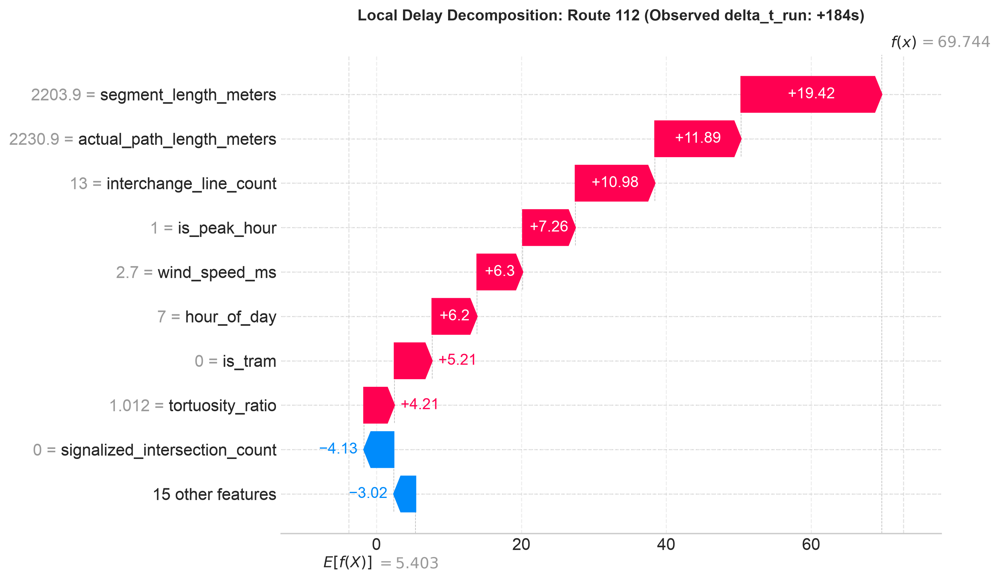

# Warsaw Transit Telemetry & Delay Attribution: Executive Report

**University of Warsaw (UW) — Faculty of Economic Sciences & Data Science**  
**Master's Thesis Research Project**  
**Author**: Giang Truong Do  
**Date**: October 2026  
**Repository**: [`giangh14cqt/warsaw-public-transport-monitor`](https://github.com/giangh14cqt/warsaw-public-transport-monitor)  

---

## 1. Data Scope & Ingestion Coverage

This study evaluates observed ground-truth transit telemetry collected directly via the Warsaw City API (`dane.um.warszawa.pl`) and GTFS-RT Warsaw endpoint (`api.zbiorkom.live`):

- **Data Source**: Track B Primary Ingestion (Warsaw Transit Historian).
- **Date Range**: **October 18, 2026 – October 27, 2026** (10 consecutive operating days capturing two weekends, the October 25 CEST$\to$CET Daylight Saving Time transition, Monday rush hours, and full mid-week transit operations).
- **Silver Trajectory Tier**: **83,415,407 GPS fixes** deduplicated, filtered for stale-transponder clock drift ($\le 300\text{s}$), DST-fold resolved to `Europe/Warsaw` timezone, with full kinematic velocity and acceleration computation.
- **Gold Stop Events Tier**: **6,650,842 reconstructed stop arrival and departure events** (`6,210,504` `STOPPED` events) across **259,313 trips** (`207,824` on Oct 18; `828,940` on Oct 19; `832,224` on Oct 20; `843,921` on Oct 21; `805,336` on Oct 22; `807,371` on Oct 23; `495,370` on Oct 24; `556,546` on Oct 25; `726,405` on Oct 26; `546,905` on Oct 27) with sub-10s linear interpolation, single-vehicle trajectory continuity (`0` multi-vehicle trip collisions), **90.7% retention of severely delayed trips ($>600\text{s}$)**, and **100% active calendar compliance**.
- **Fused Feature Mart (`feature_mart_observed.parquet`)**: **5,614,929 spatiotemporally fused adjacent stop-to-stop observations** (`stop_sequence = prev_stop_seq + 1`, **99.52% exact OSM corridor link match**) integrating:
  - Transit telemetry & autoregressive delay lags (`prev_stop_delay` with origin-loop layover clamping, `prev2_stop_delay`, date-partitioned deterministic `headway_deviation`).
  - IMGW-PIB hourly synoptic weather telemetry from Warszawa-Okęcie (`WMO 12375`), with decomposed weather dynamics: `is_raining`, `rain_intensity_category`, `precip_lag_1h`, and `precip_3h_cumulative`.
  - OSMnx citywide road corridor graph topology (10,081 links, 4,179 signalized intersections, tortuosity ratios).
  - Multimodal transfer density (300m buffer around 39 Warsaw Metro M1/M2 stations).
  - Polish academic and public holiday calendar flags.

---

## 2. Modeling & Benchmark Evaluation

### 2.1 Validation & Sampling Strategy
To avoid autoregressive data leakage and statistical selection bias inherent in transit panel series:
- **Full-Dataset & Stratified Evaluation**: Evaluated across the **complete 5,614,929-record dataset** (`--sampling-strategy none --sample-size 0`), with built-in support for trajectory-preserving 12-cell stratified sampling and normalized **Inverse Probability of Sampling (IPS) weights** ($w_i = \frac{N_{\text{pop\_k}} / N_{\text{pop\_total}}}{N_{\text{sample\_k}} / N_{\text{sample\_total}}}$) and **100% bit-exact historical feature invariance** when expanding the date range.
- **Purged Temporal Splitter with Embargo Buffering**: Vehicle trips spanning split boundaries are purged within a $\pm 4\text{h}$ window around each split cutoff (`Train–Val = 2,286`, `Val–Test = 928` crossings purged), and a 30-minute blackout embargo window is enforced between training (**3,344,039** rows), validation (**1,061,810** rows), and hold-out test (**1,096,705** rows) blocks to eliminate lingering congestion wave persistence without dropping recurring weekday `trip_id`s on other dates.
- **Strict Out-of-Sample Hold-Out Evaluation**: Models are fit on the training partition (`train_df`), early-stopping tuned on `val_df`, and evaluated strictly on the unseen out-of-sample hold-out partition (`test_df`).
- **Primary Target Variable**: Models predict **Inter-Stop Running Delay Increment** ($\Delta t_{\text{run}}$, `delta_t_run`), defined as pure schedule-relative running delay evolution ($\Delta t_{\text{arr}, k} - \Delta t_{\text{arr}, k-1}$ when $\Delta t_{\text{dwell}}^{\text{sched}} = 0$, mean $+6.99\text{s}$, median $+2.0\text{s}$), isolating link-level running delay escalation from upstream cumulative schedule drift while preserving the exact delay identity $\Delta t_{\text{arr}, k} = \Delta t_{\text{dep}, k-1} + \Delta t_{\text{run}, k}$ (with $\Delta t_{\text{dep}, k-1} = \Delta t_{\text{arr}, k-1}$ on the 99.99% of links where the timetable has no scheduled dwell; the remaining 470 links with explicit scheduled dwell use the observed departure delay). Mean $\Delta t_{\text{run}}$ is higher than in earlier runs because severely delayed trips ($>600\text{s}$) are now retained (90.7% vs 12.7%) instead of being dropped by the strict endpoint-completeness rule.
- **Terminal Layover Filtering**: Layover stops at terminal turnaround loops (*pętle*, 14,772 records) are excluded to isolate running transit friction from driver statutory breaks.

### 2.2 Model Benchmark Results

Evaluated strictly on the unseen **Hold-Out Test Partition** ($N_{\text{test}} = 1{,}096{,}705$ pooled records) across pooled transit operations and individual transit cohorts (**Urban Tram**, **Urban Bus**, and **Suburban Bus**):

| Transit Cohort | Model Architecture | Test MAE | Test RMSE | Median AE | WAPE | Test $R^2$ | Dry MAE | Rain MAE | Peak MAE | Off-Peak MAE |
| :--- | :--- | :---: | :---: | :---: | :---: | :---: | :---: | :---: | :---: | :---: |
| **Pooled** *(All Transit, $N_{\text{test}}=1{,}096{,}705$)* | **TWFE Panel Regression (WLS)** | 28.84s | 45.13s | 19.28s | 99.04% | +0.0261 | 28.76s | 30.32s | 32.14s | 26.25s |
| | **LightGBM Regressor (Huber)** | **26.73s** | **42.70s** | **17.24s** | **91.80%** | **+0.1279** | **26.67s** | **27.87s** | **29.89s** | **24.25s** |
| | **CatBoost Regressor (Huber)** | 27.56s | 43.61s | 17.93s | 94.65% | +0.0907 | 27.50s | 28.71s | 30.88s | 24.95s |
| **Urban Tram (`urban_tram`, $N_{\text{test}}=284{,}073$)** | **TWFE Panel Regression (WLS)** | 25.04s | 35.69s | 17.26s | 100.05% | -0.0044 | 25.12s | 24.38s | 25.24s | 24.88s |
| | **LightGBM Regressor (Huber)** | **18.39s** | **27.58s** | **12.36s** | **73.48%** | **+0.4003** | **18.45s** | **17.94s** | **18.92s** | **17.96s** |
| | **CatBoost Regressor (Huber)** | 20.53s | 29.95s | 14.10s | 82.01% | +0.2927 | 20.60s | 19.90s | 21.01s | 20.14s |
| **Urban Bus (`urban_bus`, $N_{\text{test}}=735{,}263$)** | **TWFE Panel Regression (WLS)** | 30.33s | 48.05s | 20.01s | 99.11% | +0.0274 | 30.13s | 34.97s | 34.79s | 26.91s |
| | **LightGBM Regressor (Huber)** | **28.43s** | **45.53s** | **18.15s** | **92.89%** | **+0.1268** | **28.25s** | **32.59s** | **32.62s** | **25.20s** |
| | **CatBoost Regressor (Huber)** | 29.19s | 46.48s | 18.69s | 95.37% | +0.0899 | 29.01s | 33.34s | 33.58s | 25.81s |
| **Suburban Bus (`suburban_bus`, $N_{\text{test}}=79{,}081$)** | **TWFE Panel Regression (WLS)** | 29.28s | 46.71s | 20.20s | 97.74% | +0.0321 | 29.17s | 31.91s | 32.78s | 26.29s |
| | **LightGBM Regressor (Huber)** | **25.61s** | **42.14s** | **17.52s** | **85.50%** | **+0.2121** | **25.54s** | **27.50s** | **28.78s** | **22.91s** |
| | **CatBoost Regressor (Huber)** | 27.00s | 43.96s | 18.48s | 90.12% | +0.1428 | 26.91s | 29.19s | 30.34s | 24.14s |

### 2.3 Empirical Findings
1. **Non-Linear Advantage on Link-Level Running Delay ($\Delta t_{\text{run}}$)**: Because first-differenced link running delay ($\Delta t_{\text{run}}$) strips out trivial autoregressive persistence, linear TWFE explains at most $2.6\%\text{--}3.2\%$ of out-of-sample variance ($R^2 = +0.0261$ pooled, $+0.0321$ suburban bus). Non-linear gradient boosting (LightGBM) increases explained variance **4.6x to 6.6x** (**$R^2 = +0.1279$** pooled, **$R^2 = +0.4003$** for Urban Tram, **$R^2 = +0.2121$** for Suburban Bus).
2. **Infrastructure Isolation Advantage**: Urban trams operating on dedicated right-of-way achieve the lowest link-level error across all architectures (**LightGBM MAE = 18.39s**, **MedAE = 12.36s**, **$R^2 = +0.4003$**; **CatBoost MAE = 20.53s**, **MedAE = 14.10s**, **$R^2 = +0.2927$**), proving that physical track segregation insulates transit velocity from stochastic mixed-traffic queues.
3. **Urban & Suburban Bus Weather Vulnerability**: Buses operating in mixed street traffic exhibit pronounced meteorological sensitivity: rainfall increases LightGBM MAE by **+4.34s per stop link** on Urban Buses (from 28.25s dry to 32.59s rain; +4.84s in TWFE from 30.13s to 34.97s) and **+1.96s per stop link** on Suburban Buses (from 25.54s dry to 27.50s rain), whereas segregated Urban Trams remain weather-resilient (`18.45s` dry vs `17.94s` rain).
4. **Diurnal Peak Premium**: Rush-hour congestion elevates link-level MAE by **+7.42s per stop** on Urban Buses (from 25.20s off-peak to 32.62s peak in LightGBM) and **+5.87s per stop** on Suburban Buses (22.91s off-peak to 28.78s peak), whereas segregated Urban Trams experience only a **+0.96s** peak-hour increase (17.96s off-peak to 18.92s peak).

---

## 3. Explainable AI (xAI) Diagnostics

### 3.1 Global Attribution (TreeSHAP)
Using exact TreeSHAP computation on the LightGBM model ($E[f(X)] = +5.40\text{s}$ positive net link running delay drift, maximum additivity discrepancy $1.35 \times 10^{-13}\text{s}$ across 24 features), delay contributions were decomposed across operational, topological, temporal, and meteorological features:

- **Fleet & Infrastructure Regime (`signalized_intersection_count`, `is_tram`, `actual_path_length_meters`, `tortuosity_ratio`, `segment_length_meters`)**: Physical segment geometry, signalized intersection density, and dedicated rail right-of-way dominate link-level running time variance.
- **Prior Stop Delay & Schedule Recovery (`prev_stop_delay`, `headway_deviation`, `trip_progress`)**: Capture early-arrival holding pacing, schedule slack absorption, upstream delay carryover, and vehicle bunching dynamics along the corridor.

#### Extreme Delay Decomposition
Local waterfall plots isolate the compounding drivers behind extreme single-link delay surges ($\Delta t_{\text{run}} \ge 120\text{s}$) on real OSM-matched links:

---

### 3.2 Non-Linear Threshold Detection (Accumulated Local Effects - ALE)
ALE curves isolate the unconfounded marginal effects of continuous variables on link-level running delay ($\Delta t_{\text{run}}$):

| Feature | Tipping Point / Threshold | Operational Mechanism |
| :--- | :--- | :--- |
| `prev_stop_delay` | `-79.0s` (early pacing) & `0s–250s` (recovery trough) | Vehicles $>60\text{s}$ ahead of schedule lose their lead on the next link (`+13s` to `+31s`), consistent with drivers holding/pacing to avoid running early (a hypothesis — not directly observed in the telemetry); moderately delayed vehicles (`0s` to `+250s`) absorb `-3.7s/link` of timetable slack before saturating under severe gridlock (`>300s`). |
| `trip_progress` | `0.10`, `0.25`, and `0.83` route completion | Initial departure merge friction (`+3s` to `+5s`) transitions at 25% route progress into steady mid-route schedule recovery (`-0.5s` to `-1.4s`). |
| `is_dedicated_right_of_way` | Negative step response | Segregated ROW provides uniform protection against link-level delay escalation. |

---

### 3.3 Infrastructure Buffering & 2D Interactions
Pairwise SHAP interaction analysis ([shap_interaction_matrix.csv](tables/xai/shap_interaction_matrix.csv)) and 2D partial response curves reveal how dedicated infrastructure functions as an operational buffer across all shock regimes:

- **Upstream Delay Buffering (`prev_stop_delay`)**: Dedicated right-of-way mitigates **4.03s per stop link** of expected delay under upstream delay shocks (**48.7% reduction** relative to mixed street traffic).
- **Precipitation Buffering (`precipitation_mm`)**: Dedicated right-of-way mitigates **3.17s per stop link** during rainfall (**36.8% reduction**).
- **Signalized Intersection & Segment Buffering (`signalized_intersection_count`, `segment_length_meters`)**: Dedicated ROW saves **3.02s per link (21.4% reduction)** across high-signal corridors and **2.50s per link (23.8% reduction)** on long inter-stop segments, while buffering **1.49s per link (9.6% reduction)** under headway bunching shocks.

---

### 3.4 Counterfactual Diagnostics & Policy Impact (DiCE)
Diverse Counterfactual Explanations (DiCE) evaluated actionable operational and infrastructure interventions across 50 severe delay incidents (mean observed cumulative arrival delay **494.44s**, mean predicted arrival delay **459.00s**):

- **Upstream Delay Absorption / Turnaround Recovery**: Absorbing accumulated upstream backlog at terminal turnarounds and transfer nodes reduces downstream arrival delay by an average of **307.66 seconds**, achieving a **34.0% on-time recovery rate** ($\Delta t_{\text{arr}} \le 120\text{s}$).
- **Single-Link Infrastructure & Signal Upgrades**: On an individual stop-to-stop link, Transit Signal Priority (TSP) saves **1.79 seconds/stop**, dynamic headway regularization saves **1.73 seconds/stop**, and dedicated ROW saves **0.63 seconds/stop**, confirming that link-level physical interventions prevent incremental delay growth across a 25-stop route (~45s–60s cumulative trip savings) but cannot single-handedly erase an existing 8-minute upstream delay backlog over a single stop spacing.
- **Joint Multimodal Operational & Infrastructure Remedy**: Combining upstream turnaround recovery, headway regularization, Transit Signal Priority, and dedicated ROW achieves an average delay reduction of **313.30 seconds** per severe incident and restores **38.0%** of severely delayed vehicles to on-time performance ($\le 120\text{s}$).
