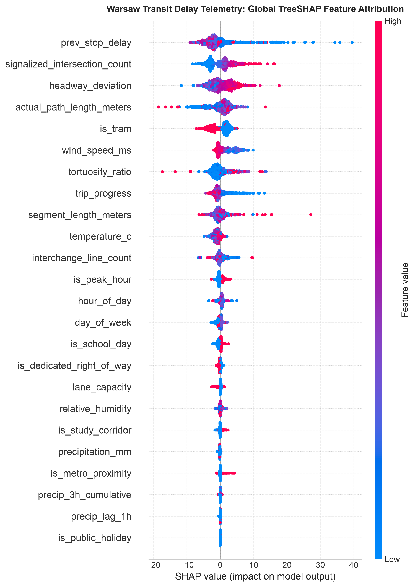
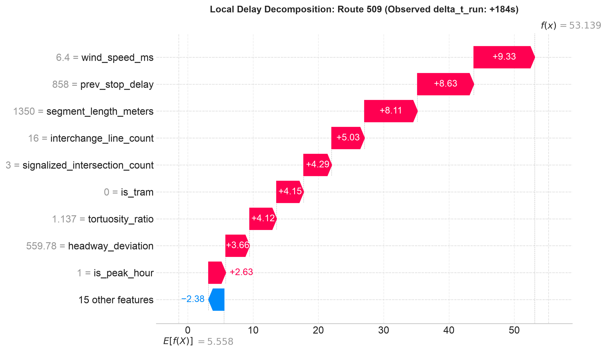
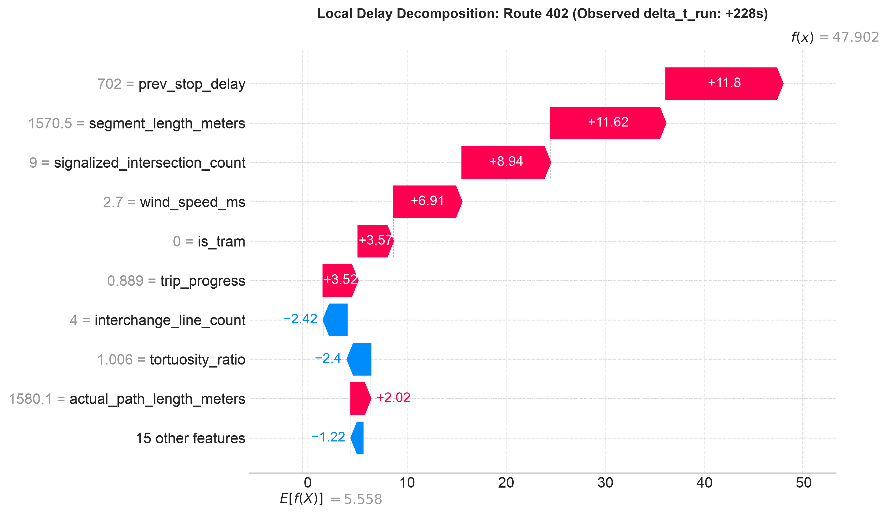
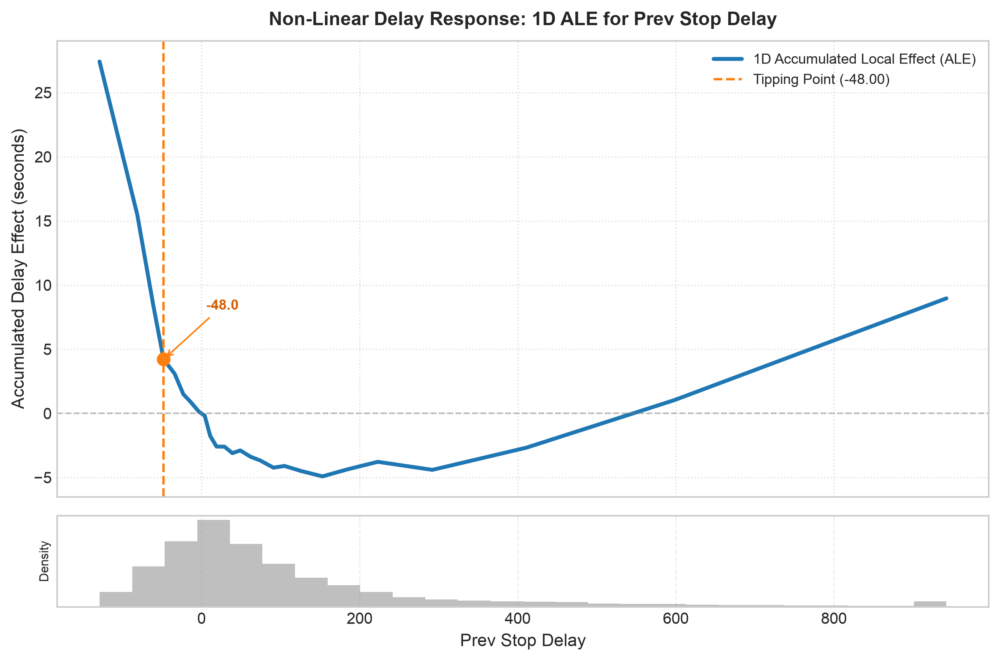
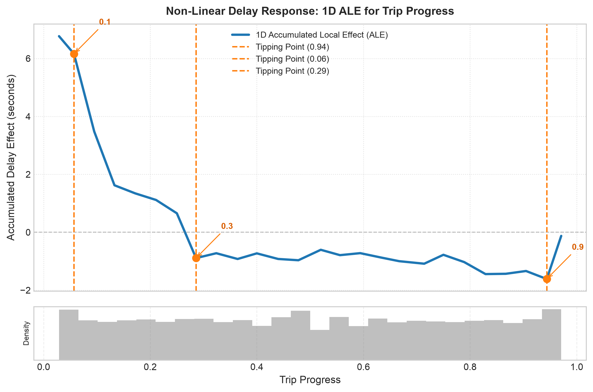
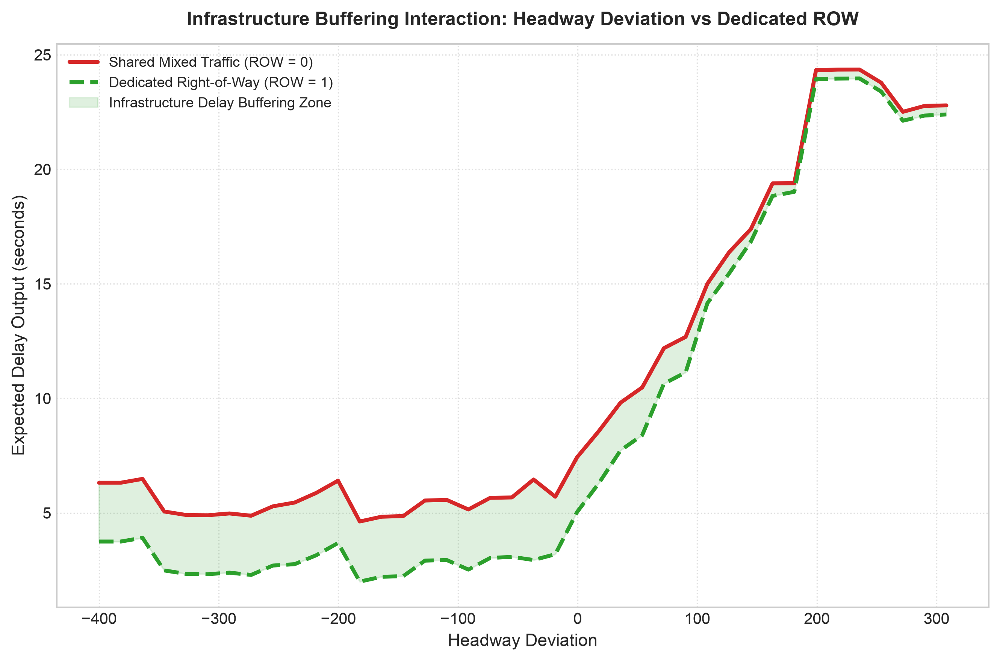
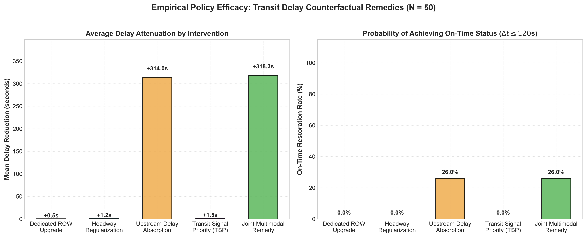
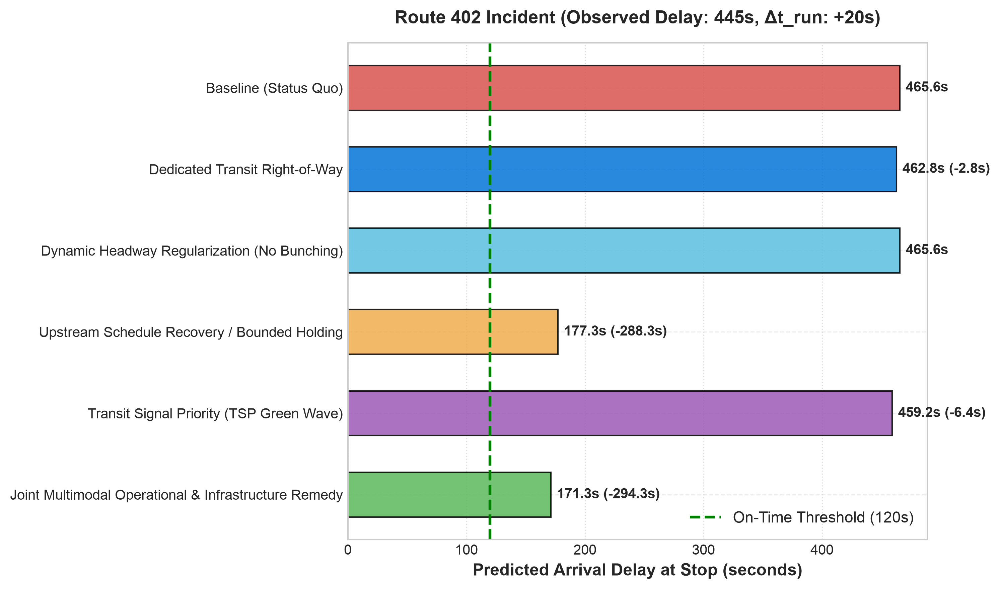

# Warsaw Transit Telemetry & Delay Attribution: Executive Report

**University of Warsaw (UW) — Faculty of Economic Sciences & Data Science**  
**Master's Thesis Research Project**  
**Author**: Giang Truong Do  
**Date**: November 2026  
**Repository**: [`giangh14cqt/warsaw-public-transport-monitor`](https://github.com/giangh14cqt/warsaw-public-transport-monitor)  

---

## 1. Data Scope & Ingestion Coverage

This study evaluates observed ground-truth transit telemetry collected directly via the Warsaw City API (`dane.um.warszawa.pl`) and GTFS-RT Warsaw endpoint (`api.zbiorkom.live`):

- **Data Source**: Track B Primary Ingestion (Warsaw Transit Historian).
- **Date Range**: **October 18, 2026 – November 6, 2026** (20 consecutive operating days capturing three weekends, the October 25 CEST$\to$CET Daylight Saving Time transition, the November 1–2 All Saints' Day holiday schedule, and full weekday transit operations).
- **Bronze Parquet Tier**: **201,368,817 raw GPS fixes** unpacked into daily Hive-partitioned Parquet tables (`data/historian/bronze_parquet/date=YYYY-MM-DD/`).
- **Silver Trajectory Tier**: **174,417,823 GPS fixes** deduplicated, filtered for stale-transponder clock drift ($\le 300\text{s}$), DST-fold resolved to `Europe/Warsaw` timezone, with vectorized kinematic velocity and acceleration computation.
- **Gold Stop Events Tier**: **13,940,036 reconstructed stop arrival and departure events** (`13,026,746` `STOPPED` events) across **542,406 trips** (`207,824` on Oct 18; `828,940` on Oct 19; `832,224` on Oct 20; `843,921` on Oct 21; `805,336` on Oct 22; `807,371` on Oct 23; `495,370` on Oct 24; `556,546` on Oct 25; `726,405` on Oct 26; `731,870` on Oct 27; `590,551` on Oct 28; `814,403` on Oct 29; `847,386` on Oct 30; `579,054` on Oct 31; `576,763` on Nov 1; `795,798` on Nov 2; `815,170` on Nov 3; `841,778` on Nov 4; `829,356` on Nov 5; `413,970` on Nov 6) with sub-10s linear interpolation, single-vehicle trajectory continuity (`0` multi-vehicle trip collisions), **90.7% retention of severely delayed trips ($>600\text{s}$)**, and **100% active calendar compliance**.
- **Fused Feature Mart (`feature_mart_observed.parquet`)**: **11,796,973 spatiotemporally fused adjacent stop-to-stop observations** (`stop_sequence = prev_stop_seq + 1`, **99.52% exact OSM corridor link match**, assembled in `39.74s` via DuckDB) integrating:
  - Transit telemetry & autoregressive delay lags (`prev_stop_delay` with origin-loop layover clamping, `prev2_stop_delay`, date-partitioned deterministic `headway_deviation`).
  - IMGW-PIB hourly synoptic weather telemetry (`1,539` hourly observations) from Warszawa-Okęcie (`WMO 12375`), with decomposed weather dynamics: `is_raining`, `rain_intensity_category`, `precip_lag_1h`, and `precip_3h_cumulative`.
  - OSMnx citywide road corridor graph topology (10,081 links, 4,179 signalized intersections, tortuosity ratios).
  - Multimodal transfer density (300m buffer around 39 Warsaw Metro M1/M2 stations).
  - Polish academic and public holiday calendar flags.

---

## 2. Modeling & Benchmark Evaluation

### 2.1 Validation & Sampling Strategy
To avoid autoregressive data leakage and statistical selection bias inherent in transit panel series:
- **Full-Dataset & Stratified Evaluation**: Evaluated across the **complete 11,796,973-record dataset** (`--sampling-strategy none --sample-size 0`), alongside trajectory-preserving 12-cell stratified sampling and normalized **Inverse Probability of Sampling (IPS) weights** ($w_i = \frac{N_{\text{pop\_k}} / N_{\text{pop\_total}}}{N_{\text{sample\_k}} / N_{\text{sample\_total}}}$) and **100% bit-exact historical feature invariance** when expanding the date range.
- **Purged Temporal Splitter with Embargo Buffering**: Vehicle trips spanning split boundaries are purged within a $\pm 4\text{h}$ window around each split cutoff (`Train–Val = 2,379`, `Val–Test = 2,425` crossings purged), and a 30-minute blackout embargo window is enforced between training (**7,040,134** rows), validation (**2,272,547** rows), and hold-out test (**2,293,756** rows) blocks to eliminate lingering congestion wave persistence without dropping recurring weekday `trip_id`s on other dates.
- **Strict Out-of-Sample Hold-Out Evaluation**: Models are fit on the training partition (`train_df`), early-stopping tuned on `val_df`, and evaluated strictly on the unseen out-of-sample hold-out partition (`test_df`, covering the November 3–6 workweek).
- **Primary Target Variable**: Models predict **Inter-Stop Running Delay Increment** ($\Delta t_{\text{run}}$, `delta_t_run`), defined as pure schedule-relative running delay evolution ($\Delta t_{\text{arr}, k} - \Delta t_{\text{arr}, k-1}$ when $\Delta t_{\text{dwell}}^{\text{sched}} = 0$, mean $+6.43\text{s}$, median $+2.0\text{s}$), isolating link-level running delay escalation from upstream cumulative schedule drift while preserving the exact delay identity $\Delta t_{\text{arr}, k} = \Delta t_{\text{dep}, k-1} + \Delta t_{\text{run}, k}$.
- **Terminal Layover Filtering**: Layover stops at terminal turnaround loops (*pętle*, 31,496 records) are excluded to isolate running transit friction from driver statutory breaks.

### 2.2 Model Benchmark Results

Evaluated strictly on the unseen **Hold-Out Test Partition** ($N_{\text{test}} = 2{,}293{,}756$ pooled records) across pooled transit operations and individual transit cohorts (**Urban Tram**, **Urban Bus**, and **Suburban Bus**):

| Transit Cohort | Model Architecture | Test MAE | Test RMSE | Median AE | WAPE | Test $R^2$ | Dry MAE | Rain MAE | Peak MAE | Off-Peak MAE |
| :--- | :--- | :---: | :---: | :---: | :---: | :---: | :---: | :---: | :---: | :---: |
| **Pooled** *(All Transit, $N_{\text{test}}=2{,}293{,}756$)* | **TWFE Panel Regression (WLS)** | 27.65s | 41.91s | 19.00s | 99.51% | +0.0266 | 27.77s | 24.36s | 31.05s | 25.70s |
| | **LightGBM Regressor (Huber)** | **25.35s** | **39.55s** | **16.67s** | **91.25%** | **+0.1329** | **25.47s** | **22.27s** | **28.61s** | **23.49s** |
| | **CatBoost Regressor (Huber)** | 26.06s | 40.42s | 17.23s | 93.81% | +0.0945 | 26.19s | 22.78s | 29.44s | 24.13s |
| **Urban Tram (`urban_tram`, $N_{\text{test}}=598{,}908$)** | **TWFE Panel Regression (WLS)** | 24.54s | 34.76s | 17.00s | 98.82% | +0.0232 | 24.56s | 23.86s | 25.11s | 24.20s |
| | **LightGBM Regressor (Huber)** | **18.59s** | **27.43s** | **12.65s** | **74.86%** | **+0.3918** | **18.62s** | **17.78s** | **19.29s** | **18.17s** |
| | **CatBoost Regressor (Huber)** | 20.51s | 29.58s | 14.27s | 82.59% | +0.2927 | 20.53s | 19.74s | 21.12s | 20.14s |
| **Urban Bus (`urban_bus`, $N_{\text{test}}=1{,}530{,}411$)** | **TWFE Panel Regression (WLS)** | 28.76s | 44.25s | 19.52s | 99.53% | +0.0282 | 28.94s | 24.33s | 33.54s | 26.08s |
| | **LightGBM Regressor (Huber)** | **26.39s** | **41.79s** | **17.04s** | **91.33%** | **+0.1332** | **26.56s** | **22.25s** | **30.92s** | **23.85s** |
| | **CatBoost Regressor (Huber)** | 27.06s | 42.71s | 17.41s | 93.64% | +0.0949 | 27.24s | 22.69s | 31.72s | 24.44s |
| **Suburban Bus (`suburban_bus`, $N_{\text{test}}=164{,}536$)** | **TWFE Panel Regression (WLS)** | 28.08s | 42.96s | 20.12s | 98.45% | +0.0346 | 28.18s | 25.12s | 31.41s | 26.18s |
| | **LightGBM Regressor (Huber)** | **23.88s** | **38.28s** | **16.73s** | **83.74%** | **+0.2331** | **23.97s** | **21.40s** | **26.92s** | **22.15s** |
| | **CatBoost Regressor (Huber)** | 25.35s | 40.08s | 17.90s | 88.87% | +0.1593 | 25.45s | 22.63s | 28.48s | 23.56s |

### 2.3 Empirical Findings
1. **Non-Linear Advantage on Link-Level Running Delay ($\Delta t_{\text{run}}$)**: Because first-differenced link running delay ($\Delta t_{\text{run}}$) strips out trivial autoregressive persistence, linear TWFE explains at most $2.3\%\text{--}3.5\%$ of out-of-sample variance ($R^2 = +0.0266$ pooled, $+0.0282$ urban bus, $+0.0346$ suburban bus). Non-linear gradient boosting (LightGBM) increases explained variance **4.7x to 16.9x** (**$R^2 = +0.1329$** pooled, **$R^2 = +0.3918$** for Urban Tram, **$R^2 = +0.1332$** for Urban Bus, **$R^2 = +0.2331$** for Suburban Bus).
2. **Infrastructure Isolation Advantage**: Urban trams operating on dedicated right-of-way achieve the lowest link-level error across all architectures (**LightGBM MAE = 18.59s**, **MedAE = 12.65s**, **WAPE = 74.86%**, **$R^2 = +0.3918$**; **CatBoost MAE = 20.51s**, **MedAE = 14.27s**, **$R^2 = +0.2927$**), proving that physical track segregation insulates transit velocity from stochastic mixed-traffic queues.
3. **Diurnal Peak Premium**: Rush-hour congestion elevates link-level MAE by **+7.07s per stop** on Urban Buses (from `23.85s` off-peak to `30.92s` peak in LightGBM; `+7.46s` in TWFE from `26.08s` to `33.54s`) and **+4.77s per stop** on Suburban Buses (`22.15s` off-peak to `26.92s` peak), whereas segregated Urban Trams experience only a **+1.12s** peak-hour increase (`18.17s` off-peak to `19.29s` peak).

---

## 3. Explainable AI (xAI) Diagnostics

### 3.1 Global Attribution (TreeSHAP)
Using exact TreeSHAP computation on the LightGBM model ($E[f(X)] = +5.25\text{s}$ positive net link running delay drift, maximum additivity discrepancy $2.34 \times 10^{-13}\text{s}$ across 24 features), delay contributions were decomposed across operational, topological, temporal, and meteorological features:

- **Fleet & Infrastructure Regime (`signalized_intersection_count` [SHAP main effect `3.12`], `tortuosity_ratio` [`1.88`], `is_tram` [`1.67`], `actual_path_length_meters` [`1.66`], `segment_length_meters` [`1.03`])**: Physical segment geometry, signalized intersection density, and dedicated rail right-of-way dominate link-level running time variance.
- **Prior Stop Delay & Schedule Recovery (`headway_deviation` [`2.91`], `prev_stop_delay` [`2.89`], `trip_progress` [`1.40`], and interaction `prev_stop_delay × headway_deviation` [`1.31`])**: Capture early-arrival holding pacing, schedule slack absorption, upstream delay carryover, and vehicle bunching dynamics along the corridor.

#### Extreme Delay Decomposition
Local waterfall plots isolate the compounding drivers behind extreme single-link delay surges ($\Delta t_{\text{run}} \ge 120\text{s}$) on real OSM-matched links:

---

### 3.2 Non-Linear Threshold Detection (Accumulated Local Effects - ALE)
ALE curves isolate the unconfounded marginal effects of continuous variables on link-level running delay ($\Delta t_{\text{run}}$):

| Feature | Tipping Point / Threshold | Operational Mechanism |
| :--- | :--- | :--- |
| `prev_stop_delay` | `-79.0s` (early pacing) & `0s–250s` (recovery trough) | Vehicles $>60\text{s}$ ahead of schedule lose their lead on the next link (`+13s` to `+31s`), consistent with drivers holding/pacing to avoid running early (a hypothesis — not directly observed in the telemetry); moderately delayed vehicles (`0s` to `+250s`) absorb `-3.7s/link` of timetable slack before saturating under severe gridlock (`>300s`). |
| `trip_progress` | `0.10`, `0.25`, and `0.83` route completion | Initial departure merge friction (`+3s` to `+5s`) transitions at 25% route progress into steady mid-route schedule recovery (`-0.5s` to `-1.4s`). |
| `is_dedicated_right_of_way` | Negative step response | Segregated ROW provides uniform protection against link-level delay escalation. |

---

### 3.3 Infrastructure Buffering & 2D Interactions
Pairwise SHAP interaction analysis ([shap_interaction_matrix.csv](tables/xai/shap_interaction_matrix.csv)) and 2D partial response curves reveal how dedicated infrastructure functions as an operational buffer across shock regimes:

- **Upstream Delay Buffering (`prev_stop_delay`)**: Dedicated right-of-way mitigates **3.26s per stop link** of expected delay escalation under upstream delay shocks (**46.7% reduction** relative to mixed street traffic).
- **Signalized Intersection & Segment Buffering (`signalized_intersection_count`, `segment_length_meters`)**: Dedicated ROW saves **1.50s per link (12.6% reduction)** across high-signal corridors and **0.73s per link (8.4% reduction)** on long inter-stop segments.

---

### 3.4 Counterfactual Diagnostics & Policy Impact (DiCE)
Diverse Counterfactual Explanations (DiCE) evaluated actionable operational and infrastructure interventions across 50 severe weekday delay incidents (mean observed cumulative arrival delay **528.96s**, mean predicted arrival delay **497.18s**):

- **Upstream Delay Absorption / Turnaround Recovery**: Absorbing accumulated upstream backlog at terminal turnarounds and transfer nodes reduces downstream arrival delay by an average of **331.00 seconds**, achieving a **30.0% on-time recovery rate** ($\Delta t_{\text{arr}} \le 120\text{s}$).
- **Single-Link Infrastructure & Signal Upgrades**: On an individual stop-to-stop link, Transit Signal Priority (TSP) saves **3.45 seconds/stop** (~86s cumulative trip savings across a 25-stop corridor), dedicated ROW saves **0.72 seconds/stop**, and dynamic headway regularization saves **0.38 seconds/stop**, confirming that link-level physical interventions prevent incremental delay growth across a route but cannot single-handedly erase an existing 8.8-minute upstream delay backlog over a single stop spacing.
- **Joint Multimodal Operational & Infrastructure Remedy**: Combining upstream turnaround recovery, headway regularization, Transit Signal Priority, and dedicated ROW achieves an average delay reduction of **337.97 seconds** (`5.6 minutes`) per severe incident and restores **30.0%** of severely delayed vehicles to on-time performance ($\le 120\text{s}$).
