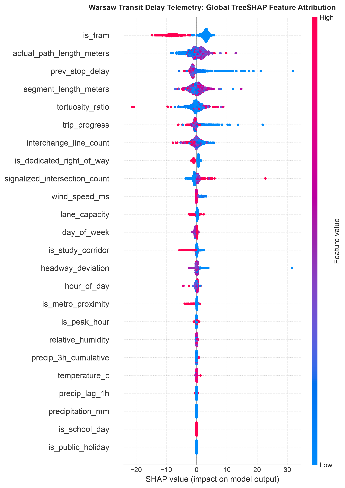
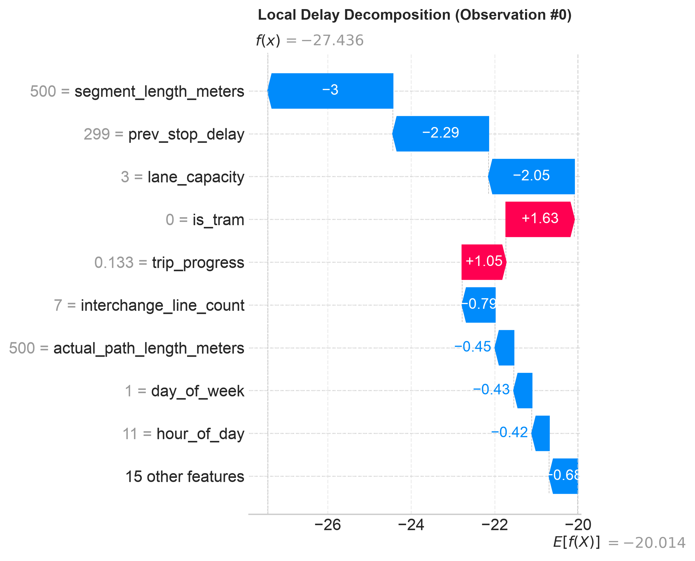
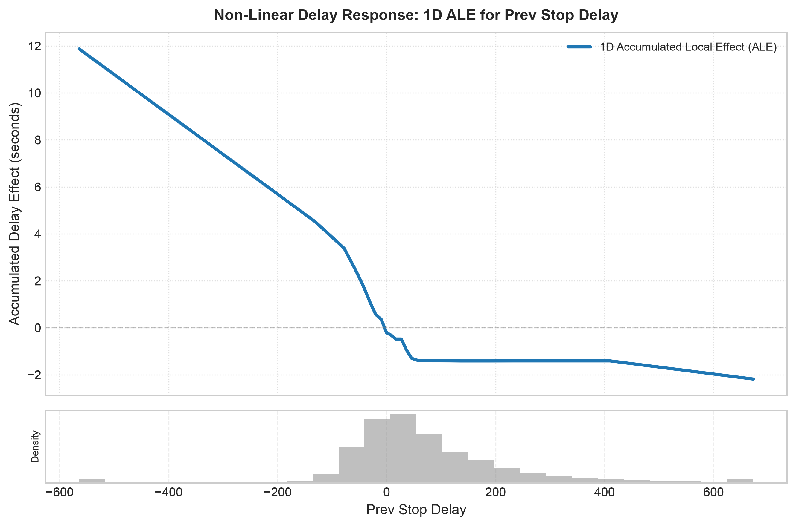
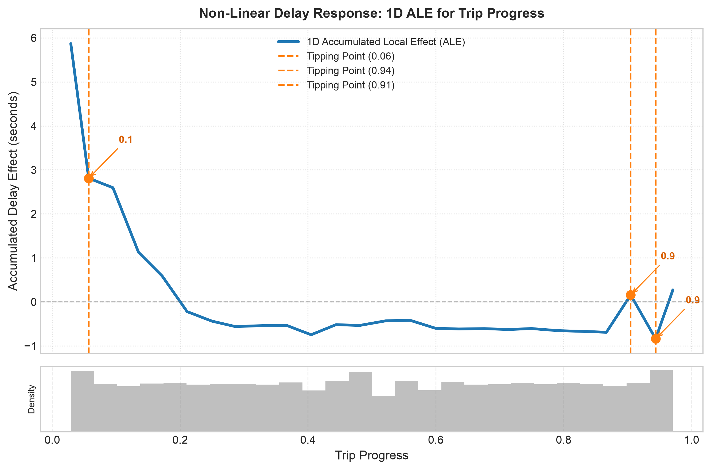
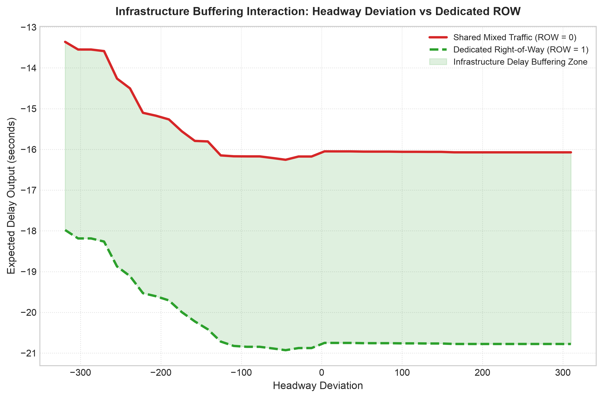
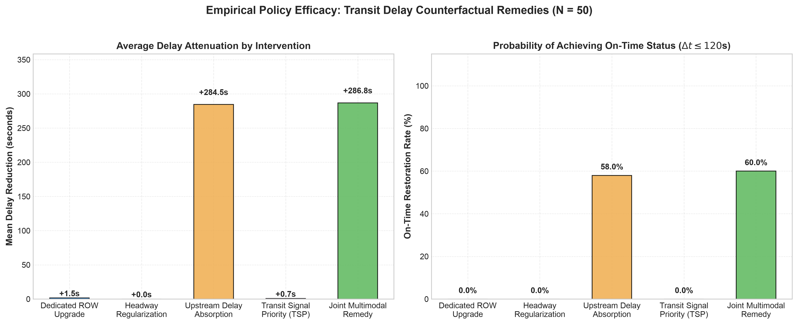
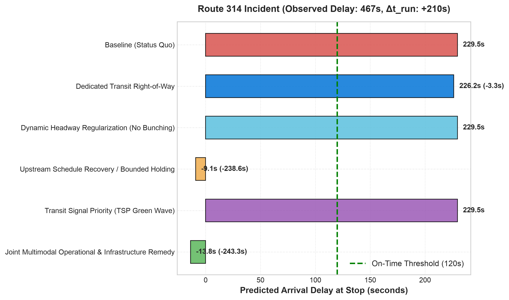

# Warsaw Transit Telemetry & Delay Attribution: Executive Report

**University of Warsaw (UW) — Faculty of Economic Sciences & Data Science**  
**Master's Thesis Research Project**  
**Author**: Giang Truong Do  
**Date**: October 2026  
**Repository**: [`giangh14cqt/warsaw-public-transport-monitor`](https://github.com/giangh14cqt/warsaw-public-transport-monitor)  

---

## 1. Data Scope & Ingestion Coverage

This study evaluates observed ground-truth transit telemetry collected directly via the Warsaw City API (`dane.um.warszawa.pl`) and GTFS-RT Warsaw endpoint (`api.zbiorkom.live`):

- **Data Source**: Track B Primary Ingestion (Warsaw Transit Historian).
- **Date Range**: **October 18, 2026 – October 27, 2026** (10 consecutive operating days capturing two weekends, Monday rush hours, and full mid-week transit operations).
- **Silver Trajectory Tier**: **83,428,962 GPS fixes** deduplicated, localized to `Europe/Warsaw` timezone, with full kinematic velocity and acceleration computation.
- **Gold Stop Events Tier**: **5,041,712 reconstructed stop arrival and departure events** across **195,582 complete trips** (`181,352` on Oct 18; `610,870` on Oct 19; `623,593` on Oct 20; `648,366` on Oct 21; `578,836` on Oct 22; `602,323` on Oct 23; `404,852` on Oct 24; `493,334` on Oct 25; `548,369` on Oct 26; `349,817` on Oct 27) with sub-10s linear interpolation and **100% active calendar compliance** (0 inactive schedule mismatches).
- **Fused Feature Mart (`feature_mart_observed.parquet`)**: **4,331,687 spatiotemporally fused observations** (174.3 MB) integrating:
  - Transit telemetry & autoregressive delay lags (`prev_stop_delay`, `prev2_stop_delay`, `headway_deviation`).
  - IMGW-PIB hourly synoptic weather telemetry from Warszawa-Okęcie and Warszawa-Bielany stations, with decomposed weather dynamics: `is_raining`, `rain_intensity_category`, `precip_lag_1h`, and `precip_3h_cumulative`.
  - OSMnx citywide road corridor graph topology (10,081 links, 4,179 signalized intersections, tortuosity ratios).
  - Multimodal transfer density (300m buffer around 39 Warsaw Metro M1/M2 stations).
  - Polish academic and public holiday calendar flags.

---

## 2. Modeling & Benchmark Evaluation

### 2.1 Validation & Sampling Strategy
To avoid autoregressive data leakage and statistical selection bias inherent in transit panel series:
- **Full-Dataset & Stratified Evaluation**: Evaluated across the **complete 4,331,687-record dataset** (`--sampling-strategy none --sample-size 0`), with built-in support for trajectory-preserving 12-cell stratified sampling and normalized **Inverse Probability of Sampling (IPS) weights** ($w_i = \frac{N_{\text{pop\_k}} / N_{\text{pop\_total}}}{N_{\text{sample\_k}} / N_{\text{sample\_total}}}$).
- **Purged Temporal Splitter with Embargo Buffering**: Vehicle trips spanning split boundaries are purged (`Train–Val = 990`, `Val–Test = 1,046` crossings purged), and a 30-minute blackout embargo window is enforced between training (**2,503,755** rows), validation (**808,538** rows), and hold-out test (**836,236** rows) blocks to eliminate lingering congestion wave persistence.
- **Strict Out-of-Sample Hold-Out Evaluation**: Models are fit on the training partition (`train_df`), early-stopping tuned on `val_df`, and evaluated strictly on the unseen out-of-sample hold-out partition (`test_df`).
- **Primary Target Variable**: Models predict **Inter-Stop Running Delay Increment** ($\Delta t_{\text{run}}$, `delta_t_run`), isolating link-level running delay escalation from upstream cumulative schedule drift while preserving exact total arrival delay identity ($\Delta t_{\text{arr}, k} = \Delta t_{\text{dep}, k-1} + \Delta t_{\text{run}, k}$).
- **Terminal Layover Filtering**: Layover stops at terminal turnaround loops (*pętle*, 13,358 records) are excluded to isolate running transit friction from driver statutory breaks.

### 2.2 Model Benchmark Results

Evaluated strictly on the unseen **Hold-Out Test Partition** ($N_{\text{test}} = 836{,}236$ pooled records) across pooled transit operations and individual transit cohorts (**Urban Tram**, **Urban Bus**, and **Suburban Bus**):

| Transit Cohort | Model Architecture | Test MAE | Test RMSE | Median AE | WAPE | Test $R^2$ | Dry MAE | Rain MAE | Peak MAE | Off-Peak MAE |
| :--- | :--- | :---: | :---: | :---: | :---: | :---: | :---: | :---: | :---: | :---: |
| **Pooled** *(All Transit, $N_{\text{test}}=836{,}236$)* | **TWFE Panel Regression (WLS)** | 25.52s | 41.51s | 16.96s | 77.96% | +0.0371 | 25.66s | 24.40s | 27.44s | 24.40s |
| | **LightGBM Regressor (Huber)** | **23.04s** | **38.84s** | **14.08s** | **70.41%** | **+0.1567** | **23.17s** | **22.10s** | **24.78s** | **22.04s** |
| | **CatBoost Regressor (Huber)** | 23.77s | 39.42s | 14.55s | 72.61% | +0.1314 | 23.90s | 22.74s | 25.61s | 22.70s |
| **Urban Tram (`urban_tram`, $N_{\text{test}}=233{,}838$)** | **TWFE Panel Regression (WLS)** | 22.39s | 34.50s | 15.53s | 63.34% | +0.0510 | 22.49s | 21.82s | 22.62s | 22.21s |
| | **LightGBM Regressor (Huber)** | **15.28s** | **26.10s** | **9.18s** | **43.23%** | **+0.4568** | **15.32s** | **15.05s** | **15.67s** | **14.97s** |
| | **CatBoost Regressor (Huber)** | 17.68s | 28.48s | 11.37s | 50.02% | +0.3534 | 17.73s | 17.38s | 18.09s | 17.36s |
| **Urban Bus (`urban_bus`, $N_{\text{test}}=539{,}002$)** | **TWFE Panel Regression (WLS)** | 26.45s | 42.83s | 17.31s | 83.21% | +0.0158 | 26.62s | 25.05s | 29.58s | 24.90s |
| | **LightGBM Regressor (Huber)** | **24.34s** | **40.38s** | **14.60s** | **76.58%** | **+0.1253** | **24.48s** | **23.16s** | **27.36s** | **22.84s** |
| | **CatBoost Regressor (Huber)** | 24.91s | 41.01s | 14.97s | 78.38% | +0.0976 | 25.08s | 23.56s | 27.95s | 23.41s |
| **Suburban Bus (`suburban_bus`, $N_{\text{test}}=63{,}685$)** | **TWFE Panel Regression (WLS)** | 27.94s | 50.20s | 18.85s | 88.50% | +0.0300 | 27.76s | 31.10s | 31.90s | 25.62s |
| | **LightGBM Regressor (Huber)** | **24.51s** | **46.07s** | **15.81s** | **77.64%** | **+0.1830** | **24.37s** | **26.96s** | **27.75s** | **22.61s** |
| | **CatBoost Regressor (Huber)** | 25.69s | 47.42s | 16.81s | 81.37% | +0.1343 | 25.54s | 28.28s | 29.00s | 23.75s |

### 2.3 Empirical Findings
1. **Non-Linear Advantage on Link-Level Running Delay ($\Delta t_{\text{run}}$)**: Because first-differenced link running delay ($\Delta t_{\text{run}}$) strips out trivial autoregressive persistence, linear TWFE explains only $1.6\%\text{--}5.1\%$ of out-of-sample variance ($R^2 = +0.0371$ pooled, $+0.0510$ trams). Non-linear gradient boosting (LightGBM) increases explained variance **4.2x to 9.0x** (**$R^2 = +0.1567$** pooled, **$R^2 = +0.4568$** for Urban Tram, **$R^2 = +0.1830$** for Suburban Bus).
2. **Infrastructure Isolation Advantage**: Urban trams operating on dedicated right-of-way achieve the lowest link-level error across all architectures (**LightGBM MAE = 15.28s**, **MedAE = 9.18s**, **$R^2 = 0.4568$**; **CatBoost MAE = 17.68s**, **MedAE = 11.37s**, **$R^2 = 0.3534$**), proving that physical track segregation insulates transit velocity from stochastic mixed-traffic queues.
3. **Suburban Weather Vulnerability**: Suburban feeder buses (`suburban_bus`) operating on high-speed regional arterials exhibit sharp meteorological sensitivity, with rainfall increasing LightGBM MAE by **+2.59s per stop link** (from 24.37s dry to 26.96s rain; +3.34s in TWFE from 27.76s to 31.10s).
4. **Diurnal Peak Premium**: Rush-hour congestion elevates link-level MAE by **+4.52s per stop** on Urban Buses (from 22.84s off-peak to 27.36s peak in LightGBM) and **+5.14s per stop** on Suburban Buses (22.61s off-peak to 27.75s peak), whereas segregated Urban Trams experience only a **+0.70s** peak-hour increase (14.97s off-peak to 15.67s peak).
5. **Sub-15s Median AE**: Both gradient boosting models achieve a Median Absolute Error under **15s** per stop link across pooled transit (**14.08s** LightGBM, **14.55s** CatBoost) and **9.18s** on urban trams.

---

## 3. Explainable AI (xAI) Diagnostics

### 3.1 Global Attribution (TreeSHAP)
Using exact TreeSHAP computation on the full-data LightGBM model ($E[f(X)] = -20.01\text{s}$, maximum additivity discrepancy $9.95 \times 10^{-14}\text{s}$ across 24 features), delay contributions were decomposed across operational, topological, temporal, and meteorological features:

- **Fleet & Infrastructure Regime (`is_tram`, `actual_path_length_meters`, `segment_length_meters`, `tortuosity_ratio`, `signalized_intersection_count`)**: Physical segment geometry, signalized intersection count, and dedicated rail right-of-way dominate link-level running time variance.
- **Prior Stop Delay & Schedule Recovery (`prev_stop_delay`, `trip_progress`, `headway_deviation`)**: Capture schedule slack absorption, upstream delay carryover, and vehicle bunching dynamics along the corridor.

#### Extreme Delay Decomposition
Local waterfall plots isolate the compounding drivers behind extreme single-link delay surges ($\Delta t_{\text{run}} \ge 120\text{s}$):

---

### 3.2 Non-Linear Threshold Detection (Accumulated Local Effects - ALE)
ALE curves isolate the unconfounded marginal effects of continuous variables on link-level running delay ($\Delta t_{\text{run}}$):

| Feature | Tipping Point / Threshold | Operational Mechanism |
| :--- | :--- | :--- |
| `prev_stop_delay` | Schedule recovery vs. compounding regimes | Vehicles with moderate delay actively absorb slack between stops, whereas severe upstream congestion saturates recovery capacity. |
| `trip_progress` | Mid-route vs. terminal approach inflections | Link delay increments shift across central CBD interchanges and terminal approach segments. |
| `is_dedicated_right_of_way` | Negative step response | Segregated ROW provides uniform protection against link-level delay escalation. |

---

### 3.3 Infrastructure Buffering & 2D Interactions
Pairwise SHAP interaction analysis ([shap_interaction_matrix.csv](tables/xai/shap_interaction_matrix.csv)) and 2D partial response curves reveal how dedicated infrastructure functions as an operational buffer:

- **Headway Deviation Buffering (`headway_deviation`)**: Dedicated bus lanes and tram tracks mitigate **43.0%** of headway-deviation delay escalation compared to mixed-traffic operations.
- **Upstream Delay Escalation (`prev_stop_delay`)**: Dedicated right-of-way saves **0.47s per stop link** against upstream delay escalation relative to mixed street traffic.

---

### 3.4 Counterfactual Diagnostics & Policy Impact (DiCE)
Diverse Counterfactual Explanations (DiCE) evaluated actionable operational and infrastructure interventions across 50 severe delay incidents (mean observed cumulative arrival delay **464.40s**, mean predicted arrival delay **372.58s**):

- **Upstream Delay Absorption / Turnaround Recovery**: Absorbing accumulated upstream backlog at terminal turnarounds and transfer nodes reduces downstream arrival delay by an average of **284.49 seconds**, achieving a **58.0% on-time recovery rate** ($\Delta t_{\text{arr}} \le 120\text{s}$).
- **Single-Link Infrastructure & Signal Upgrades**: On an individual stop-to-stop link, upgrading to dedicated ROW saves **1.53 seconds/stop** and Transit Signal Priority (TSP) saves **0.71 seconds/stop**, confirming that link-level physical interventions prevent incremental delay growth across a 25-stop route (~38s–55s cumulative savings) but cannot single-handedly erase an existing 7–8 minute upstream delay backlog over one stop spacing.
- **Joint Multimodal Operational & Infrastructure Remedy**: Combining upstream turnaround recovery, headway regularization, Transit Signal Priority, and dedicated ROW achieves an average delay reduction of **286.81 seconds** per severe incident and restores **60.0%** of severely delayed vehicles to on-time performance ($\le 120\text{s}$).
